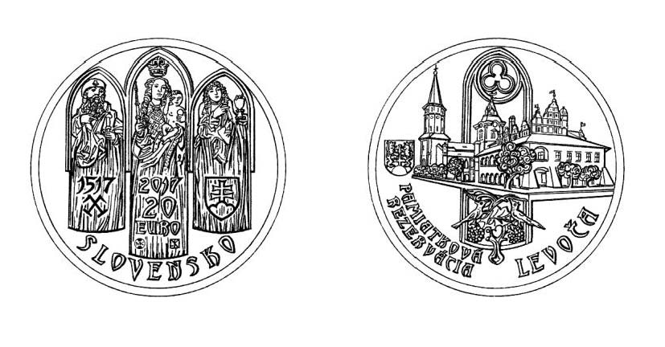

## 64

OZNÁMENIE

Národnej banky Slovenska

z 21. februára 2017

## o vydaní strieborných zberateľských euromincí v nominálnej hodnote 20 eur s tematikou pamiatkovej rezervácie Levoča a 500. výročia dokončenia hlavného oltára v Kostole sv. Jakuba

1. Úvodné ustanovenia

- a) Národná banka Slovenska podľa § 17h ods. 1 zákona Národnej rady Slovenskej republiky č. 566/1992 Zb. o Národnej banke Slovenska v znení neskorších predpisov a podľa § 12 ods. 1 písm. b) zákona č. 400/2015 Z. z. o tvorbe právnych predpisov a o Zbierke zákonov Slovenskej republiky a o zmene a doplnení niektorých zákonov oznamuje, že vydáva do obehu strieborné zberateľské euromince v nominálnej hodnote 20 eur s tematikou pamiatkovej rezervácie Levoča a 500. výročia dokončenia hlavného oltára v Kostole sv. Jakuba (ďalej len „zberateľská eurominca“).

- b) Zberateľská eurominca má štatút zákonného platidla len v Slovenskej republike.

- c) Zberateľská eurominca sa razí zo zliatiny obsahujúcej 925 dielov striebra a 75 dielov medi; jej hmotnosť je 33,63 g a priemer 40 mm. Pri razbe zberateľskej euromince je povolená horná a dolná odchýlka v priemere 0,1 mm; povolená horná odchýlka v hmotnosti je 0,4 g a v obsahu striebra 10/1000.

2. Vzhľad zberateľskej euromince

- a) Na líci zberateľskej euromince sú vyobrazené tri plastiky oltárnej skrine v Kostole sv. Jakuba vystupujúce z troch blokov dreva, čím je vyjadrený materiál, z ktorého je oltár vyrobený a proces jeho tvorby. Štátny znak Slovenskej republiky je v spodnej časti plastiky umiestnenej vpravo. V spodnej časti prostrednej plastiky je letopočet „2017“, pod ktorým je v dvoch riadkoch označenie nominálnej hodnoty zberateľskej euromince „20 EURO“. Pod ním je značka Mincovne Kremnica, štátny podnik, ktorú tvorí skratka „MK“ medzi dvoma razidlami a štylizované iniciálky mena a priezviska autora výtvarného návrhu zberateľskej euromince Pavla Károlyho „PK“. V spodnej časti plastiky umiestnenej vľavo je rok dokončenia hlavného oltára „1517“, pod ktorým je značka Majstra Pavla. Pri spodnom okraji zberateľskej euromince je v opise názov štátu „SLOVENSKO“.

- b) Na rube zberateľskej euromince je vyobrazená časť Kostola sv. Jakuba s vežou a radnica v Levoči. Kompozícia je v pozadí doplnená gotickým oknom, v ktorého spodnej časti je ornamentálna výzdoba oltára. V ľavej časti mincového poľa je erb mesta Levoča. Pri spodnom okraji zberateľskej euromince vľavo je v opise v dvoch riadkoch nápis „PAMIATKOVÁ REZERVÁCIA“ a vpravo nápis „LEVOČA“.

- c) Na hrane mince je reliéfny nápis „NAJKRAJŠIE HISTORICKÉ MESTÁ“. Začiatok a koniec textu je oddelený vyobrazením štylizovaného kľúča.

Štát vydania: Slovenská republika

Začiatok vydávania: máj 2017

Jozef Makúch v. r.
