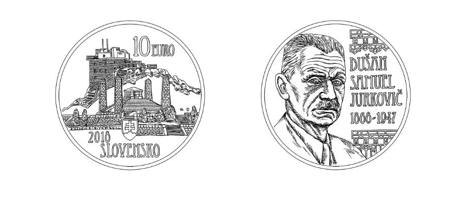

## 149

OZNÁMENIE

Národnej banky Slovenska

z 24. apríla 2018

## o vydaní strieborných zberateľských euromincí v nominálnej hodnote 10 eur pri príležitosti 150. výročia narodenia Dušana Samuela Jurkoviča

1. Úvodné ustanovenia

- a) Národná banka Slovenska podľa § 17h ods. 1 zákona Národnej rady Slovenskej republiky č. 566/1992 Zb. o Národnej banke Slovenska v znení neskorších predpisov a podľa § 12 ods. 1 písm. b) zákona č. 400/2015 Z. z. o tvorbe právnych predpisov a o Zbierke zákonov Slovenskej republiky a o zmene a doplnení niektorých zákonov oznamuje, že vydáva do obehu strieborné zberateľské euromince v nominálnej hodnote 10 eur pri príležitosti 150. výročia narodenia Dušana Samuela Jurkoviča (ďalej len „zberateľská eurominca“).

- b) Zberateľská eurominca má štatút zákonného platidla len v Slovenskej republike.

- c) Zberateľská eurominca sa razí zo zliatiny obsahujúcej 900 dielov striebra a 100 dielov medi; jej hmotnosť je 18 g a priemer 34 mm. Pri razbe zberateľskej euromince je povolená horná a dolná odchýlka v priemere 0,1 mm; povolená horná odchýlka v hmotnosti je 0,4 g a v obsahu striebra 10/1000.

2. Vzhľad zberateľskej euromince

- a) Na líci zberateľskej euromince sú vyobrazené dve vrcholné architektonické diela Dušana Samuela Jurkoviča – mohyla Milana Rastislava Štefánika na Bradle a vrcholová stanica lanovky na Lomnickom štíte. Štátny znak Slovenskej republiky je v spodnej časti mincového poľa. Pod ním sú v dvoch riadkoch letopočet „2018“ a názov štátu „SLOVENSKO“. Označenie nominálnej hodnoty zberateľskej euromince „10 EURO“ je v hornej časti mincového poľa. Štylizované iniciálky autora zberateľskej euromince Karola Lička „KL“ a značka Mincovne Kremnica, štátny podnik, ktorú tvorí skratka „MK“ umiestnená medzi dvoma razidlami, sú vpravo od mohyly.

- b) Na rube zberateľskej euromince je vyobrazený portrét Dušana Samuela Jurkoviča, ktorý je v pravej hornej a spodnej časti mincového poľa doplnený motívmi vitráží z jeho architektonických diel. Vpravo od portrétu sú v troch riadkoch mená a priezvisko „DUŠAN SAMUEL JURKOVIČ“. Pod nimi sú letopočty jeho narodenia a úmrtia „1868 – 1947“.

- c) Na hrane zberateľskej euromince je nápis do hĺbky „• OSOBNOSŤ SLOVENSKEJ ARCHITEKTÚRY“.

- 

- Štát vydania: Slovenská republika

- Začiatok vydávania: júl 2018

Jozef Makúch v. r.
