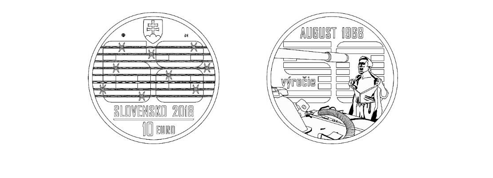

## 181

OZNÁMENIE

Národnej banky Slovenska

z 15. mája 2018

## o vydaní strieborných zberateľských euromincí v nominálnej hodnote 10 eur s tematikou nenásilného spontánneho odporu občanov proti vstupu vojsk Varšavskej zmluvy v auguste 1968

1. Úvodné ustanovenia

- a) Národná banka Slovenska podľa § 17h ods. 1 zákona Národnej rady Slovenskej republiky č. 566/1992 Zb. o Národnej banke Slovenska v znení neskorších predpisov a podľa § 12 ods. 1 písm. b) zákona č. 400/2015 Z. z. o tvorbe právnych predpisov a o Zbierke zákonov Slovenskej republiky a o zmene a doplnení niektorých zákonov oznamuje, že vydáva do obehu strieborné zberateľské euromince v nominálnej hodnote 10 eur s tematikou nenásilného spontánneho odporu občanov proti vstupu vojsk Varšavskej zmluvy v auguste 1968 (ďalej len „zberateľská eurominca“).

- b) Zberateľská eurominca má štatút zákonného platidla len v Slovenskej republike.

- c) Zberateľská eurominca sa razí zo zliatiny obsahujúcej 900 dielov striebra a 100 dielov medi; jej hmotnosť je 18 g a priemer 34 mm. Pri razbe zberateľskej euromince je povolená horná a dolná odchýlka v priemere 0,1 mm; povolená horná odchýlka v hmotnosti je 0,4 g a v obsahu striebra 10/1000.

2. Vzhľad zberateľskej euromince

- a) Na líci zberateľskej euromince sú vyobrazené zábrany z ostnatého drôtu s číslicou 68 na pozadí, ktoré symbolizujú obdobie normalizácie po invázii vojsk Varšavskej zmluvy do Československa v auguste 1968. Štátny znak Slovenskej republiky je v hornej časti mincového poľa. Názov štátu „SLOVENSKO“ a letopočet „2018“ sú v spodnej časti mincového poľa. Pod nimi je vodorovná linka a označenie nominálnej hodnoty zberateľskej euromince „10 EURO“. Značka Mincovne Kremnica, štátny podnik, ktorú tvorí skratka „MK“ umiestnená medzi dvoma razidlami, je vľavo od štátneho znaku Slovenskej republiky a vpravo od neho sú štylizované iniciálky autora zberateľskej euromince prof. Mgr. art. Patrika Kovačovského „PK“.

- b) Na rube zberateľskej euromince je vyobrazený fragment fotografie Ladislava Bielika „Muž s odhalenou hruďou pred okupačným tankom“, na pozadí doplnený číslicou 50 a nápisom „výročie“, ktoré vyjadrujú 50. výročie invázie vojsk Varšavskej zmluvy do Československa v auguste 1968. V hornej časti mincového poľa je nápis „AUGUST 1968“.

- c) Na hrane zberateľskej euromince je nápis do hĺbky „• 21. AUGUST 1968 • 21. AUGUST 1968“.

- 

- Štát vydania: Slovenská republika

- Začiatok vydávania: august 2018

Jozef Makúch v. r.
