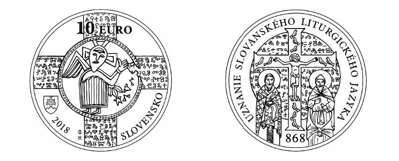

## 2

OZNÁMENIE

Národnej banky Slovenska

z 28. novembra 2017

## o vydaní strieborných zberateľských euromincí v nominálnej hodnote 10 eur pri príležitosti 1150. výročia uznania slovanského liturgického jazyka

1. Úvodné ustanovenia

- a) Národná banka Slovenska podľa § 17h ods. 1 zákona Národnej rady Slovenskej republiky č. 566/1992 Zb. o Národnej banke Slovenska v znení neskorších predpisov a podľa § 12 ods. 1 písm. b) zákona č. 400/2015 Z. z. o tvorbe právnych predpisov a o Zbierke zákonov Slovenskej republiky a o zmene a doplnení niektorých zákonov oznamuje, že vydáva do obehu strieborné zberateľské euromince v nominálnej hodnote 10 eur pri príležitosti 1150. výročia uznania slovanského liturgického jazyka (ďalej len „zberateľská eurominca“).

- b) Zberateľská eurominca má štatút zákonného platidla len v Slovenskej republike.

- c) Zberateľská eurominca sa razí zo zliatiny obsahujúcej 900 dielov striebra a 100 dielov medi; jej hmotnosť je 18 g a priemer 34 mm. Pri razbe zberateľskej euromince je povolená horná a dolná odchýlka v priemere 0,1 mm; povolená horná odchýlka v hmotnosti je 0,4 g a v obsahu striebra 10/1000.

2. Vzhľad zberateľskej euromince

- a) Na líci zberateľskej euromince je na pozadí byzantského kríža vyobrazený motív plakety z Bojnej, ktorý symbolizuje ranné kresťanstvo na území Slovenskej republiky. Na kríži je text v hlaholike. Štátny znak Slovenskej republiky je v ľavej časti mincového poľa. Pod ním je v opise letopočet „2018“. Názov štátu „SLOVENSKO“ je v opise pri pravom spodnom okraji mincového poľa a označenie nominálnej hodnoty zberateľskej euromince „10 EURO“ je v jeho hornej časti. Značka Mincovne Kremnica, štátny podnik, ktorú tvorí skratka „MK“ umiestnená medzi dvoma razidlami, a štylizované iniciálky autora zberateľskej euromince Mgr. art. Romana Lugára „RL“ sú pri spodnom okraji zberateľskej euromince.

- b) Na rube zberateľskej euromince sú pod krížom s ukrižovaným Ježišom Kristom vyobrazení vierozvestcovia Konštantín a Metod. Na pozadí je v kruhu text v hlaholike. V opise je nápis „UZNANIE SLOVANSKÉHO LITURGICKÉHO JAZYKA“. Letopočet „868“ je pri spodnom okraji zberateľskej euromince.

- c) Na hrane zberateľskej euromince je nápis do hĺbky „• Konštantín a Metod • pápež Hadrián II. • Rím“.

- Štát vydania: Slovenská republika

- Začiatok vydávania: február 2018

Jozef Makúch v. r.
