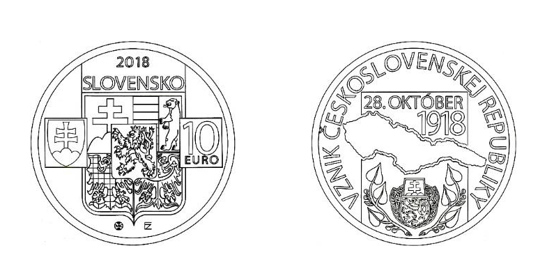

## 219

OZNÁMENIE

Národnej banky Slovenska

z 3. júla 2018

## o vydaní strieborných zberateľských euromincí v nominálnej hodnote 10 eur pri príležitosti 100. výročia vzniku Československej republiky

1. Úvodné ustanovenia

- a) Národná banka Slovenska podľa § 17h ods. 1 zákona Národnej rady Slovenskej republiky č. 566/1992 Zb. o Národnej banke Slovenska v znení neskorších predpisov a podľa § 12 ods. 1 písm. b) zákona č. 400/2015 Z. z. o tvorbe právnych predpisov a o Zbierke zákonov Slovenskej republiky a o zmene a doplnení niektorých zákonov oznamuje, že vydáva do obehu strieborné zberateľské euromince v nominálnej hodnote 10 eur pri príležitosti 100. výročia vzniku Československej republiky (ďalej len „zberateľská eurominca“).

- b) Zberateľská eurominca má štatút zákonného platidla len v Slovenskej republike.

- c) Zberateľská eurominca sa razí zo zliatiny obsahujúcej 900 dielov striebra a 100 dielov medi; jej hmotnosť je 18 g a priemer 34 mm. Pri razbe zberateľskej euromince je povolená horná a dolná odchýlka v priemere 0,1 mm; povolená horná odchýlka v hmotnosti je 0,4 g a v obsahu striebra 10/1 000.

2. Vzhľad zberateľskej euromince

- a) Na líci zberateľskej euromince je vyobrazený stredný štátny znak Československej republiky. V popredí vľavo od neho je štátny znak Slovenskej republiky a vpravo označenie nominálnej hodnoty zberateľskej euromince „10 EURO“. Názov štátu „SLOVENSKO“ je v hornej časti mincového poľa. Nad ním je letopočet „2018“. Značka Mincovne Kremnica, štátny podnik, ktorú tvorí skratka „MK“ umiestnená medzi dvoma razidlami, a štylizované iniciálky autora zberateľskej euromince akad. soch. Zbyňka Fojtů „ZF“ sú v spodnej časti mincového poľa.

- b) Na rube zberateľskej euromince je vyobrazená mapa Československej republiky. Pod ňou je legionársky znak používaný československými légiami počas prvej svetovej vojny, ktorý je po oboch stranách doplnený lipovými vetvičkami. Nad mapou je v dvoch riadkoch nápis „28. OKTÓBER 1918“. V opise je nápis „VZNIK ČESKOSLOVENSKEJ REPUBLIKY“.

- c) Na hrane zberateľskej euromince sú lipové listy.

- 

- Štát vydania: Slovenská republika

- Začiatok vydávania: október 2018

Jozef Makúch v. r.
