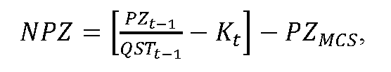
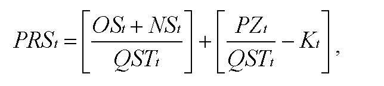

## 225

OZNÁMENIE

## o oprave chyby

vo vyhláške Úradu pre reguláciu sieťových odvetví č. 204/2018 Z. z., ktorou sa mení a dopĺňa vyhláška Úradu pre reguláciu sieťových odvetví č. 21/2017 Z. z., ktorou sa ustanovuje cenová regulácia výroby, distribúcie a dodávky pitnej vody verejným vodovodom a odvádzania a čistenia odpadovej vody verejnou kanalizáciou

V čl. I šiestom bode § 8 majú slová „RAB2015 je faktor investičného rozvoja určeného na podporu investícií do vodárenského majetku využívaného na odvádzanie a čistenie odpadovej vody v eurách na objemovú jednotku vypočítaný podľa odseku 2,“ správne znieť: „RAB2015 je účtovná hodnota (zostatková cena) hmotného majetku a nehmotného majetku v eurách v roku 2015 používaného na regulovanú činnosť podľa prílohy č. 12.“.

V čl. I šiestom bode § 9 odseky 3 až 6 správne znejú:

„(3)

Hodnota zmeny primeraného zisku NPZ sa vypočíta podľa vzorca

kde

PZt-1 je výška primeraného zisku v eurách vypočítaná podľa odseku 5, pričom najvyššia miera primeraného zisku je 0,10 eura na 1 m3 množstva odvedenej odpadovej vody v roku t-1 vrátane vlastnej produkcie, alebo podľa odseku 6; pri výpočte ceny za čistenie odpadovej vody sa uplatní najviac polovica hodnoty PZt-1,

PZMCS je hodnota primeraného zisku v eurách na objemovú jednotku v maximálnej cene za odvádzanie a čistenie odpadovej vody, maximálnej cene za odvádzanie odpadovej vody, maximálnej cene za čistenie odpadovej vody alebo maximálnej cene za odvádzanie a čistenie odpadovej vody pre skupinu producentov3) schválenej alebo určenej v cenovom rozhodnutí na rok t-1.

(4)

Ak regulovaný subjekt prvýkrát predkladá návrh na určenie maximálnej ceny za odvádzanie a čistenie odpadovej vody, maximálnej ceny za odvádzanie odpadovej vody, maximálnej ceny za čistenie odpadovej vody alebo maximálnej ceny za odvádzanie a čistenie odpadovej vody pre skupinu producentov3) v eurách na objemovú jednotku, priemerná cena sa vypočíta podľa vzorca

kde

PRSt je priemerná cena za odvádzanie a čistenie odpadovej vody v eurách na objemovú jednotku,

OSt sú odpisy hmotného a nehmotného majetku a nájomné za prenájom hmotného a nehmotného majetku používaného na odvádzanie a čistenie odpadovej vody v eurách na rok t podľa § 4 ods. 1 písm. e) až h),

NSt sú ekonomicky oprávnené prevádzkové náklady v eurách na odvádzanie a čistenie odpadovej vody v roku t okrem OSt,

QSTt je množstvo odvedenej a čistenej odpadovej vody v objemových jednotkách pre všetkých producentov3) v roku t,

PZt je výška primeraného zisku v eurách vypočítaná podľa odseku 5, pričom najvyššia miera primeraného zisku je 0,10 eura na 1 m3 množstva odvedenej odpadovej vody v roku t vrátane vlastnej produkcie, alebo podľa odseku 6; pri výpočte ceny za čistenie odpadovej vody sa uplatní najviac polovica hodnoty PZt,

Kt je faktor využitia kapacity vodárenského majetku používaného na odvádzanie a čistenie odpadovej vody vypočítaný podľa odseku 7.

(5)

Výška primeraného zisku PZt sa vypočíta podľa vzorca

PZt = RAB2015 × WACCt,

kde

RAB2015 je účtovná hodnota (zostatková cena) hmotného a nehmotného majetku v eurách v roku 2015 používaného na odvádzanie a čistenie odpadovej vody podľa prílohy č. 12.

(6)

Výška primeraného zisku PZt pre regulovaný subjekt, ktorého odvedené a čistené množstvo odpadovej vody verejnou kanalizáciou nepresiahne 1 000 000 m3, sa ustanovuje maximálne vo výške 0,05 eura za 1m3 množstva odvedenej odpadovej vody v roku t vrátane vlastnej produkcie.“.
