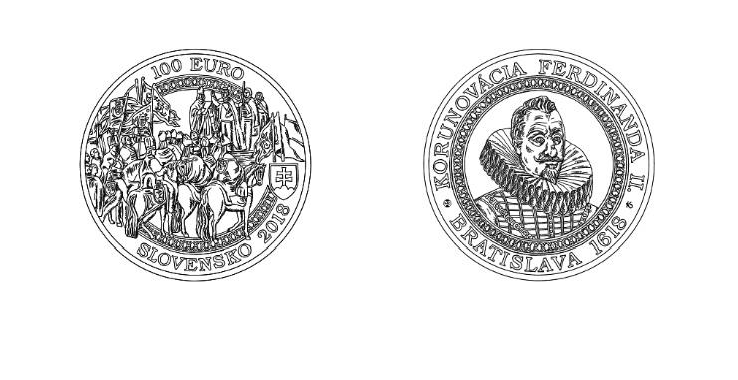

## 267

OZNÁMENIE

Národnej banky Slovenska

z 21. augusta 2018

## o vydaní zlatých zberateľských euromincí v nominálnej hodnote 100 eur pri príležitosti 400. výročia korunovácie Ferdinanda II. v Bratislave

1. Úvodné ustanovenia

- a) Národná banka Slovenska podľa § 17h ods. 1 zákona Národnej rady Slovenskej republiky č. 566/1992 Zb. o Národnej banke Slovenska v znení neskorších predpisov a podľa § 12 ods. 1 písm. b) zákona č. 400/2015 Z. z. o tvorbe právnych predpisov a o Zbierke zákonov Slovenskej republiky a o zmene a doplnení niektorých zákonov oznamuje, že vydáva do obehu zlaté zberateľské euromince v nominálnej hodnote 100 eur pri príležitosti 400. výročia korunovácie Ferdinanda II. v Bratislave (ďalej len „zberateľská eurominca“).

- b) Zberateľská eurominca má štatút zákonného platidla len v Slovenskej republike.

- c) Zberateľská eurominca sa razí zo zliatiny obsahujúcej 900 dielov zlata, 75 dielov striebra a 25 dielov medi; jej hmotnosť je 9,5 g a priemer 26 mm. Pri razbe euromince je povolená horná a dolná odchýlka v priemere 0,1 mm; povolená horná odchýlka v hmotnosti je 0,08 g a v obsahu zlata 10/1000.

2. Vzhľad zberateľskej euromince

- a) Na líci zberateľskej euromince je vyobrazený dobový výjav z korunovačného sprievodu Ferdinanda II. v Bratislave, ktorý je v hornej a v spodnej časti doplnený ozdobným ornamentom. Štátny znak Slovenskej republiky je pri pravom okraji zberateľskej euromince. V hornej časti mincového poľa je označenie nominálnej hodnoty zberateľskej euromince „100 EURO“ . V spodnej časti mincového poľa je v opise názov štátu „SLOVENSKO“ a za ním letopočet „2018“.

- b) Na rube zberateľskej euromince je vyobrazený portrét Ferdinanda II., ktorý je po obvode doplnený ozdobným ornamentom. V opise zľava doprava sú nápisy „KORUNOVÁCIA FERDINANDA II.“ a „BRATISLAVA“ a rok „1618“. Značka Mincovne Kremnica, štátny podnik, ktorú tvorí skratka „MK“ umiestnená medzi dvoma razidlami, je pri ľavom okraji zberateľskej euromince a štylizované iniciálky mena a priezviska autora výtvarného návrhu zberateľskej euromince Karola Lička „KL“ sú pri jej pravom okraji.

- c) Hrana zberateľskej euromince je vrúbkovaná.

- 

- Štát vydania: Slovenská republika

- Začiatok vydávania: november 2018

Jozef Makúch v. r.
