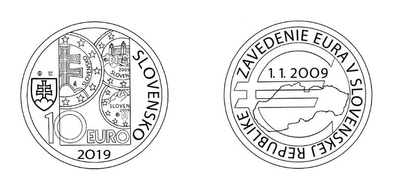

## 297

OZNÁMENIE

Národnej banky Slovenska

z 25. septembra 2018

## o vydaní strieborných zberateľských euromincí v nominálnej hodnote 10 eur pri príležitosti 10. výročia zavedenia eura v Slovenskej republike

1.Úvodné ustanovenia

- a) Národná banka Slovenska podľa § 17h ods. 1 zákona Národnej rady Slovenskej republiky č. 566/1992 Zb. o Národnej banke Slovenska v znení neskorších predpisov a podľa § 12 ods. 1 písm. b) zákona č. 400/2015 Z. z. o tvorbe právnych predpisov a o Zbierke zákonov Slovenskej republiky a o zmene a doplnení niektorých zákonov oznamuje, že vydáva do obehu strieborné zberateľské euromince v nominálnej hodnote 10 eur pri príležitosti 10. výročia zavedenia eura v Slovenskej republike (ďalej len „zberateľská eurominca“).

- b) Zberateľská eurominca má štatút zákonného platidla len v Slovenskej republike.

- c) Zberateľská eurominca sa razí zo zliatiny obsahujúcej 900 dielov striebra a 100 dielov medi; jej hmotnosť je 18 g a priemer 34 mm. Pri razbe zberateľskej euromince je povolená horná a dolná odchýlka v priemere 0,1 mm; povolená horná odchýlka v hmotnosti je 0,4 g a v obsahu striebra 10/1000.

2. Vzhľad zberateľskej euromince

- a) Na líci zberateľskej euromince sú vyobrazené časti národných strán slovenských obehových euromincí so všetkými tromi používanými motívmi – dvojkrížom na trojvrší, Bratislavským hradom a tatranským štítom Kriváňom. Štátny znak Slovenskej republiky je v ľavej časti mincového poľa. Názov štátu „SLOVENSKO“ je v opise pri pravom okraji zberateľskej euromince. Označenie nominálnej hodnoty zberateľskej euromince „10 EURO“ je v spodnej časti mincového poľa. Pod ním je letopočet „2019“. Značka Mincovne Kremnica, štátny podnik, ktorú tvorí skratka „MK“ umiestnená medzi dvoma razidlami, a štylizované iniciálky autora zberateľskej euromince akad. soch. Zbyňka Fojtů „ZF“ sú nad štátnym znakom Slovenskej republiky.

- b) Na rube zberateľskej euromince je vyobrazená mapa Slovenskej republiky v kompozícii so znakom eura. V hornej časti mincového poľa je dátum zavedenia eura v Slovenskej republike „1. 1. 2009“. V opise je nápis „ZAVEDENIE EURA V SLOVENSKEJ REPUBLIKE“.

- c) Na hrane zberateľskej euromince sú hviezdy.

- 

- Štát vydania: Slovenská republika

- Začiatok vydávania: január 2019

Jozef Makúch v. r.
