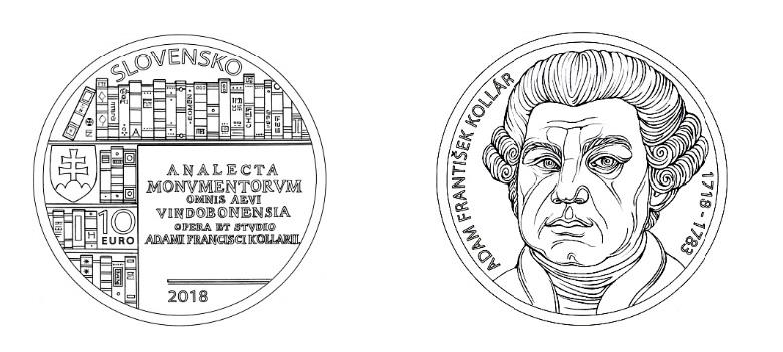

## 3

OZNÁMENIE

Národnej banky Slovenska

z 28. novembra 2017

## o vydaní strieborných zberateľských euromincí v nominálnej hodnote 10 eur pri príležitosti 300. výročia narodenia Adama Františka Kollára

1. Úvodné ustanovenia

- a) Národná banka Slovenska podľa § 17h ods. 1 zákona Národnej rady Slovenskej republiky č. 566/1992 Zb. o Národnej banke Slovenska v znení neskorších predpisov a podľa § 12 ods. 1 písm. b) zákona č. 400/2015 Z. z. o tvorbe právnych predpisov a o Zbierke zákonov Slovenskej republiky a o zmene a doplnení niektorých zákonov oznamuje, že vydáva do obehu strieborné zberateľské euromince v nominálnej hodnote 10 eur pri príležitosti 300. výročia narodenia Adama Františka Kollára (ďalej len „zberateľská eurominca“).

- b) Zberateľská eurominca má štatút zákonného platidla len v Slovenskej republike.

- c) Zberateľská eurominca sa razí zo zliatiny obsahujúcej 900 dielov striebra a 100 dielov medi; jej hmotnosť je 18 g a priemer 34 mm. Pri razbe zberateľskej euromince je povolená horná a dolná odchýlka v priemere 0,1 mm; povolená horná odchýlka v hmotnosti je 0,4 g a v obsahu striebra 10/1000.

2. Vzhľad zberateľskej euromince

- a) Na líci zberateľskej euromince je vyobrazená časť dobovej knižnice doplnená názvom vedeckého diela Adama Františka Kollára Analecta monvmentorvm omnis aevi Vindobonensia. Štátny znak Slovenskej republiky je v ľavej časti mincového poľa. Pri hornom okraji zberateľskej euromince je v opise názov štátu „SLOVENSKO“. Letopočet „2018“ je v spodnej časti mincového poľa. Označenie nominálnej hodnoty zberateľskej euromince „10 EURO“ je v dvoch riadkoch kompozične vsadené do spodnej časti knižnice. Značka Mincovne Kremnica, štátny podnik, ktorú tvorí skratka „MK“ umiestnená medzi dvoma razidlami, a štylizované iniciálky autora zberateľskej euromince akad. soch. Zbyňka Fojtů „ZF“ sú medzi knihami v ľavej hornej časti mincového poľa.

- b) Na rube zberateľskej euromince je vyobrazený portrét Adama Františka Kollára. Vľavo od portrétu sú v opise mená a priezvisko „ADAM FRANTIŠEK KOLLÁR“ a vpravo od neho sú letopočty narodenia a úmrtia Adama Františka Kollára „1718 – 1783“.

- c) Na hrane zberateľskej euromince je nápis do hĺbky „• VZDELANEC • DVORSKÝ RADCA MÁRIE TERÉZIE“.

- Štát vydania: Slovenská republika

- Začiatok vydávania: marec 2018

Jozef Makúch v. r.
