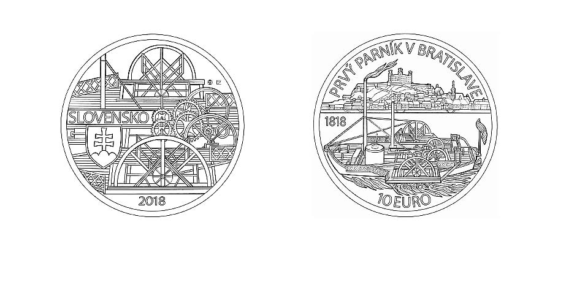

## 32

OZNÁMENIE

Národnej banky Slovenska

zo 16. januára 2018

## o vydaní strieborných zberateľských euromincí v nominálnej hodnote 10 eur pri príležitosti 200. výročia plavby prvého parníka na Dunaji v Bratislave

1. Úvodné ustanovenia

- a) Národná banka Slovenska podľa § 17h ods. 1 zákona Národnej rady Slovenskej republiky č. 566/1992 Zb. o Národnej banke Slovenska v znení neskorších predpisov a podľa § 12 ods. 1 písm. b) zákona č. 400/2015 Z. z. o tvorbe právnych predpisov a o Zbierke zákonov Slovenskej republiky a o zmene a doplnení niektorých zákonov oznamuje, že vydáva do obehu strieborné zberateľské euromince v nominálnej hodnote 10 eur pri príležitosti 200. výročia plavby prvého parníka na Dunaji v Bratislave (ďalej len „zberateľská eurominca“).

- b) Zberateľská eurominca má štatút zákonného platidla len v Slovenskej republike.

- c) Zberateľská eurominca sa razí zo zliatiny obsahujúcej 900 dielov striebra a 100 dielov medi; jej hmotnosť je 18 g a priemer 34 mm. Pri razbe zberateľskej euromince je povolená horná a dolná odchýlka v priemere 0,1 mm; povolená horná odchýlka v hmotnosti je 0,4 g a v obsahu striebra 10/1000.

2. Vzhľad zberateľskej euromince

- a) Na líci zberateľskej euromince je vyobrazený detail parného stroja v parníku Caroline, ktorý sa v roku 1818 ako prvý parník plavil na Dunaji v Bratislave. V ľavej časti mincového poľa je štátny znak Slovenskej republiky. Nad ním je názov štátu „SLOVENSKO“. Letopočet „2018“ je v spodnej časti mincového poľa. Značka Mincovne Kremnica, štátny podnik, ktorú tvorí skratka „MK“ umiestnená medzi dvoma razidlami, a štylizované iniciálky autora zberateľskej euromince akad. soch. Zbyňka Fojtů „ZF“ sú v pravej hornej časti mincového poľa.

- b) Na rube zberateľskej euromince je z nadhľadu vyobrazený parník Caroline, na ktorého pozadí je dobová veduta Bratislavy. Označenie nominálnej hodnoty zberateľskej euromince „10 EURO“ je v opise v spodnej časti mincového poľa. Nápis „PRVÝ PARNÍK V BRATISLAVE“ je v opise v hornej časti mincového poľa. Rok uskutočnenia prvej plavby parníka na Dunaji v Bratislave „1818“ je pri ľavom okraji zberateľskej euromince.

- c) Na hrane mince je nápis do hĺbky „– VIEDEŇ – BRATISLAVA – BUDAPEŠŤ“.

- 

Štát vydania: Slovenská republika

Začiatok vydávania: máj 2018

Jozef Makúch v. r.
