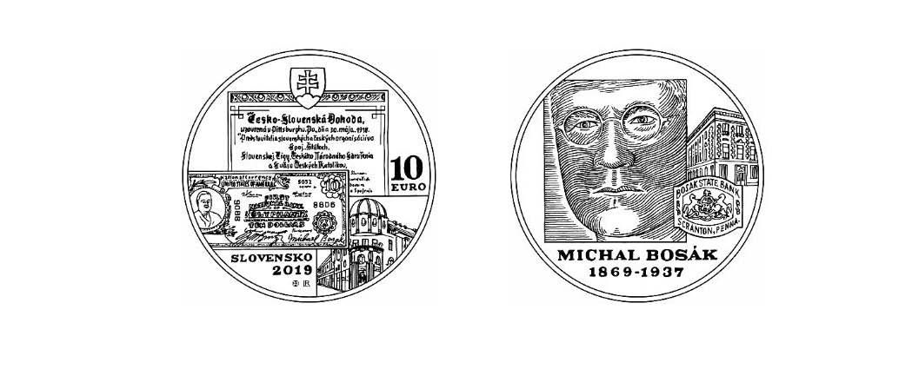

## 260

OZNÁMENIE

Národnej banky Slovenska

z 23. júla 2019

## o vydaní strieborných zberateľských euromincí v nominálnej hodnote 10 eur pri príležitosti 150. výročia narodenia Michala Bosáka

1. Úvodné ustanovenia

- a) Národná banka Slovenska podľa § 17h ods. 1 zákona Národnej rady Slovenskej republiky č. 566/1992 Zb. o Národnej banke Slovenska v znení neskorších predpisov a podľa § 12 ods. 1 písm. b) zákona č. 400/2015 Z. z. o tvorbe právnych predpisov a o Zbierke zákonov Slovenskej republiky a o zmene a doplnení niektorých zákonov oznamuje, že vydáva do obehu strieborné zberateľské euromince v nominálnej hodnote 10 eur pri príležitosti 150. výročia narodenia Michala Bosáka (ďalej len „zberateľská eurominca“).

- b) Zberateľská eurominca má štatút zákonného platidla len v Slovenskej republike.

- c) Zberateľská eurominca sa razí zo zliatiny obsahujúcej 900 dielov striebra a 100 dielov medi; jej hmotnosť je 18 g a priemer 34 mm. Pri razbe zberateľskej euromince je povolená horná a dolná odchýlka v priemere 0,1 mm; povolená horná odchýlka v hmotnosti je 0,4 g a v obsahu striebra 10/1000.

2. Vzhľad zberateľskej euromince

- a) Na líci zberateľskej euromince je vyobrazená bankovka v nominálnej hodnote 10 dolárov s podpisom Michala Bosáka v hornej časti doplnená fragmentom originálu Pittsburskej dohody, ktorej bol Michal Bosák signatárom, a Bosákovým domom v Prešove. Štátny znak Slovenskej republiky je v hornej časti mincového poľa. Názov štátu „SLOVENSKO“ je v spodnej časti mincového poľa. Pod ním je letopočet „2019“. Označenie nominálnej hodnoty zberateľskej euromince „10 EURO“ je v dvoch riadkoch pri pravom okraji zberateľskej euromince. Značka Mincovne Kremnica, štátny podnik, ktorú tvorí skratka „MK“ umiestnená medzi dvoma razidlami, a štylizované iniciálky autora zberateľskej euromince Mgr. art. Romana Lugára „LR“ sú pod letopočtom.

- b) Na rube zberateľskej euromince je vyobrazený portrét Michala Bosáka kompozične doplnený budovou Bosákovej štátnej banky v Scrantone a jej logom. V spodnej časti mincového poľa je meno a priezvisko „MICHAL BOSÁK“ a pod ním letopočty jeho narodenia a úmrtia „1869 – 1937“.

- c) Na hrane zberateľskej euromince je nápis do hĺbky „• AMERICKO-SLOVENSKÝ BANKÁR“.

- 

- Štát vydania: Slovenská republika

- Začiatok vydávania: október 2019

v z. Ľudovít Ódor v. r.
