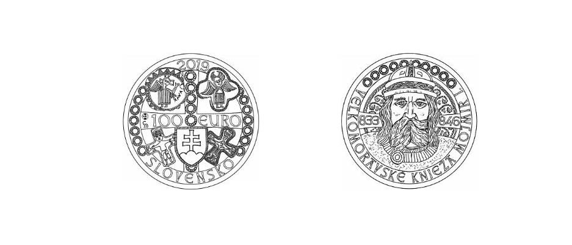

## 284

OZNÁMENIE

Národnej banky Slovenska

z 27. augusta 2019

## o vydaní zlatých zberateľských euromincí v nominálnej hodnote 100 eur na pripomenutie veľkomoravského kniežaťa Mojmíra I.

1. Úvodné ustanovenia

- a) Národná banka Slovenska podľa § 17h ods. 1 zákona Národnej rady Slovenskej republiky č. 566/1992 Zb. o Národnej banke Slovenska v znení neskorších predpisov a podľa § 12 ods. 1 písm. b) zákona č. 400/2015 Z. z. o tvorbe právnych predpisov a o Zbierke zákonov Slovenskej republiky a o zmene a doplnení niektorých zákonov oznamuje, že na pripomenutie veľkomoravského kniežaťa Mojmíra I. vydáva do obehu zlaté zberateľské euromince v nominálnej hodnote 100 eur (ďalej len „zberateľská eurominca“).

- b) Zberateľská eurominca má štatút zákonného platidla len v Slovenskej republike.

- c) Zberateľská eurominca sa razí zo zliatiny obsahujúcej 900 dielov zlata, 75 dielov striebra a 25 dielov medi; jej hmotnosť je 9,5 g a priemer 26 mm. Pri razbe euromince je povolená horná a dolná odchýlka v priemere 0,1 mm; povolená horná odchýlka v hmotnosti je 0,08 g a v obsahu zlata 10/1000.

2. Vzhľad zberateľskej euromince

- a) Na líci zberateľskej euromince je mincové pole rozdelené na štyri plochy krížom, ktorý je zhora nadol vyplnený kruhovými ornamentálnymi motívmi. V hornej časti mincového poľa sú vyobrazené dve plakety z prenosného oltára z Bojnej. V spodnej časti mincového poľa je v popredí štátny znak Slovenskej republiky. Po oboch jeho stranách sú vyobrazené veľkomoravské krížiky. Názov štátu „SLOVENSKO“ je v opise pri spodnom okraji zberateľskej euromince a letopočet „2019“ pri jej hornom okraji. Označenie nominálnej hodnoty nápismi „100“ a „EURO“, ktoré sú oddelené kruhovým ornamentálnym prvkom, je umiestnené do ramien kríža. Značka Mincovne Kremnica, štátny podnik, ktorú tvorí skratka „MK“ umiestnená medzi dvoma razidlami, a značka autora mince MgA. Miroslava Schovanca, DiS. sú pod sebou na konci ľavého ramena kríža.

- b) Na rube zberateľskej euromince je vyobrazený fiktívny portrét veľkomoravského kniežaťa Mojmíra I., ktorý je na pozadí doplnený ornamentálnym gravírovaním. Vľavo od portrétu je letopočet „833“ označujúci začiatok panovania Mojmíra I. a vpravo od portrétu je letopočet „846“ označujúci jeho koniec. V opise zľava doprava je nápis „VEĽKOMORAVSKÉ KNIEŽA MOJMÍR I.“, ktorého začiatok a koniec je oddelený kruhovými ornamentálnymi motívmi.

- c) Hrana zberateľskej euromince je vrúbkovaná.

- 

- Štát vydania: Slovenská republika

- Začiatok vydávania: november 2019

Peter Kažimír v. r.
