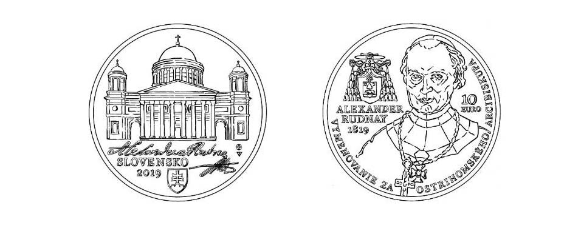

## 285

OZNÁMENIE

Národnej banky Slovenska

z 27. augusta 2019

## o vydaní strieborných zberateľských euromincí v nominálnej hodnote 10 eur pri príležitosti 200. výročia vymenovania Alexandra Rudnaya za ostrihomského arcibiskupa

1. Úvodné ustanovenia

- a) Národná banka Slovenska podľa § 17h ods. 1 zákona Národnej rady Slovenskej republiky č. 566/1992 Zb. o Národnej banke Slovenska v znení neskorších predpisov a podľa § 12 ods. 1 písm. b) zákona č. 400/2015 Z. z. o tvorbe právnych predpisov a o Zbierke zákonov Slovenskej republiky a o zmene a doplnení niektorých zákonov oznamuje, že vydáva do obehu strieborné zberateľské euromince v nominálnej hodnote 10 eur pri príležitosti 200. výročia vymenovania Alexandra Rudnaya za ostrihomského arcibiskupa (ďalej len „zberateľská eurominca“).

- b) Zberateľská eurominca má štatút zákonného platidla len v Slovenskej republike.

- c) Zberateľská eurominca sa razí zo zliatiny obsahujúcej 900 dielov striebra a 100 dielov medi; jej hmotnosť je 18 g a priemer 34 mm. Pri razbe zberateľskej euromince je povolená horná a dolná odchýlka v priemere 0,1 mm; povolená horná odchýlka v hmotnosti je 0,4 g a v obsahu striebra 10/1000.

2. Vzhľad zberateľskej euromince

- a) Na líci zberateľskej euromince je vyobrazená Katedrála Panny Márie a svätého Adalberta v Ostrihome. Pod ňou je v dvoch riadkoch faksimile podpisu arcibiskupa Alexandra Rudnaya. Štátny znak Slovenskej republiky je v spodnej časti mincového poľa. Pod faksimile podpisu je názov štátu „SLOVENSKO“ a pod ním je letopočet „2019“. Značka Mincovne Kremnica, štátny podnik, ktorú tvorí skratka „MK“ umiestnená medzi dvoma razidlami, je pri pravom spodnom okraji zberateľskej euromince. Pod ňou sú štylizované iniciálky autora zberateľskej euromince Mgr. art. Petra Valacha „PV“.

- b) Na rube zberateľskej euromince je vyobrazený potrét arcibiskupa Alexandra Rudnaya v ľavej časti doplnený znakom kardinála, za ktorého bol Alexander Rudnay vymenovaný v roku 1826. Pod znakom kardinála je v dvoch riadkoch meno a priezvisko „ALEXANDER RUDNAY“. Pod priezviskom je letopočet vymenovania Alexandra Rudnaya za arcibiskupa „1819“. Vpravo od portrétu je v dvoch riadkoch označenie nominálnej hodnoty zberateľskej euromince

- „10 EURO“. Pri okraji zberateľskej euromince je v opise zľava doprava nápis „VYMENOVANIE ZA OSTRIHOMSKÉHO ARCIBISKUPA“.

- c) Na hrane zberateľskej euromince je nápis do hĺbky „• ALEXANDER RUDNAY – UHORSKÝ PRÍMAS 1819“.

- 

- Štát vydania: Slovenská republika

- Začiatok vydávania: november 2019

Peter Kažimír v. r.
