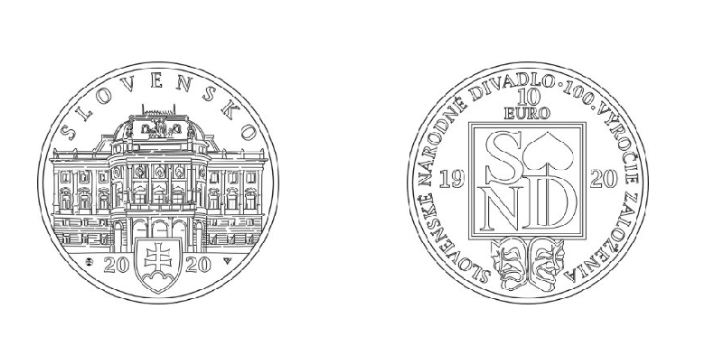

## 416

OZNÁMENIE

Národnej banky Slovenska

z 12. novembra 2019

## o vydaní strieborných zberateľských euromincí v nominálnej hodnote 10 eur pri príležitosti 100. výročia založenia Slovenského národného divadla

1.Úvodné ustanovenia

- a) Národná banka Slovenska podľa § 17h ods. 1 zákona Národnej rady Slovenskej republiky č. 566/1992 Zb. o Národnej banke Slovenska v znení neskorších predpisov a podľa § 12 ods. 1 písm. b) zákona č. 400/2015 Z. z. o tvorbe právnych predpisov a o Zbierke zákonov Slovenskej republiky a o zmene a doplnení niektorých zákonov oznamuje, že vydáva do obehu strieborné zberateľské euromince v nominálnej hodnote 10 eur pri príležitosti 100. výročia založenia Slovenského národného divadla (ďalej len „zberateľská eurominca“).

- b) Zberateľská eurominca má štatút zákonného platidla len v Slovenskej republike.

- c) Zberateľská eurominca sa razí zo zliatiny obsahujúcej 900 dielov striebra a 100 dielov medi; jej hmotnosť je 18 g a priemer 34 mm. Pri razbe zberateľskej euromince je povolená horná a dolná odchýlka v priemere 0,1 mm; povolená horná odchýlka v hmotnosti je 0,4 g a v obsahu striebra 10/1000.

2.Vzhľad zberateľskej euromince

- a) Na líci zberateľskej euromince je vyobrazená historická budova Slovenského národného divadla. V spodnej časti mincového poľa je štátny znak Slovenskej republiky, ktorý je kompozične vsadený doprostred letopočtu „2020“. Názov štátu „SLOVENSKO“ je v opise pri hornom okraji zberateľskej euromince. Vľavo od letopočtu je značka Mincovne Kremnica, štátny podnik, ktorú tvorí skratka „MK“ umiestnená medzi dvoma razidlami, a vpravo od letopočtu sú štylizované iniciálky autora zberateľskej euromince Mgr. art. Petra Valacha „PV“.

- b) Na rube zberateľskej euromince je vyobrazené logo Slovenského národného divadla, ktoré je od ostatnej plochy mincového poľa oddelené rámovaním a v spodnej časti doplnené dvomi divadelnými maskami. Nad logom je v dvoch riadkoch označenie nominálnej hodnoty „10 EURO“. Letopočet „1920“ je uprostred predelený logom. Pri okraji mince sú v opise nápisy „SLOVENSKÉ NÁRODNÉ DIVADLO“ a „100. VÝROČIE ZALOŽENIA“, ktoré sú od seba oddelené grafickou značkou.

- c) Na hrane zberateľskej euromince je nápis do hĺbky „SLOVENSKÉ NÁRODNÉ DIVADLO 1920 – 2020“.

- 

  - Štát vydania: Slovenská republika

  - Začiatok vydávania: február 2020

v z. Ľudovít Ódor v. r.
