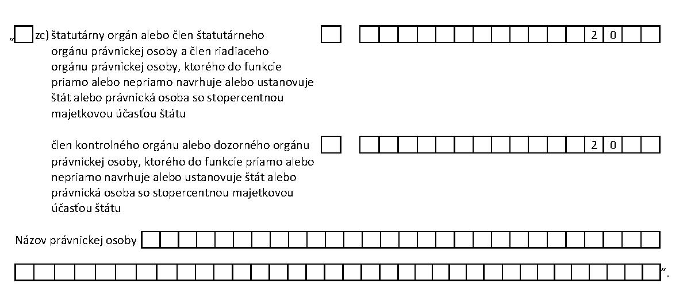
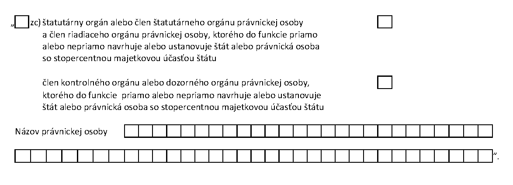

# Čl. I

Ústavný zákon č. 357/2004 Z. z. o ochrane verejného záujmu pri výkone funkcií verejných funkcionárov v znení ústavného zákona č. 545/2005 Z. z., ústavného zákona č. 66/2019 Z. z. a ústavného zákona č. 232/2019 Z. z. sa mení a dopĺňa takto:

- 1. V čl. 2 ods. 1 písmeno zc) znie:

- „zc)

- štatutárneho orgánu alebo členov štatutárneho orgánu, členov riadiaceho orgánu a členov kontrolného orgánu alebo dozorného orgánu právnických osôb, ktorých do funkcie priamo alebo nepriamo navrhuje alebo ustanovuje štát alebo právnická osoba so stopercentnou majetkovou účasťou štátu,“.

- 2. V čl. 2 ods. 2 sa na konci pripája táto veta: „Na členov kontrolného orgánu alebo dozorného orgánu podľa čl. 2 ods. 1 písm. zc) sa nevzťahujú ustanovenia čl. 4 ods. 2 písm. c) až e).“.

- 3. V čl. 2 odsek 4 znie:

- „(4)

- Orgány verejnej moci a právnické osoby, ktoré ustanovujú verejných funkcionárov podľa čl. 2 ods. 1 písm. zc) a zd), sú povinné viesť zoznam verejných funkcionárov v ich pôsobnosti, aktualizovať ho vždy k 31. decembru kalendárneho roka a doručiť ho orgánu podľa čl. 7 ods. 5 písm. e) do 31. januára kalendárneho roka. Orgány verejnej moci alebo právnické osoby, ktoré ustanovujú verejných funkcionárov podľa čl. 2 ods. 1 písm. zc) a zd), oznámia orgánu podľa čl. 7 ods. 5 písm. e) zmenu v zozname verejných funkcionárov v ich pôsobnosti do 20 dní odo dňa, keď sa o zmene dozvedeli.“.

- 4. V čl. 5 odsek 6 znie:

- „(6)

- Ustanovenia odsekov 2 a 3 sa nevzťahujú na verejného funkcionára podľa čl. 2 ods. 1 písm. q) a s) a na členov kontrolného orgánu alebo dozorného orgánu podľa čl. 2 ods. 1 písm. zc). Zákaz podľa odseku 2 sa nevzťahuje na starostov obcí.“.

- 5. V prílohe č. 1 časti B „Vykonávaná verejná funkcia“ písmeno zc) znie:

- 

- 6. V prílohe č. 2 časti B „Vykonávaná verejná funkcia“ písmeno zc) znie:

- 
