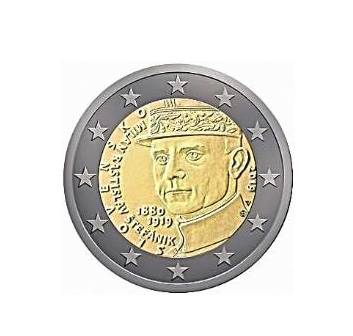

## 68

OZNÁMENIE

Národnej banky Slovenska

z 29. januára 2019

## o vydaní pamätných euromincí v nominálnej hodnote 2 eurá pri príležitosti 100. výročia úmrtia Milana Rastislava Štefánika

1. Úvodné ustanovenia

- a) Národná banka Slovenska podľa § 17h ods. 1 zákona Národnej rady Slovenskej republiky č. 566/1992 Zb. o Národnej banke Slovenska v znení neskorších predpisov a podľa § 12 ods. 1 písm. b) zákona č. 400/2015 Z. z. o tvorbe právnych predpisov a o Zbierke zákonov Slovenskej republiky a o zmene a doplnení niektorých zákonov oznamuje, že pri príležitosti 100. výročia úmrtia Milana Rastislava Štefánika vydáva do obehu pamätné euromince v nominálnej hodnote 2 eurá (ďalej len „pamätná eurominca“).

- b) Pamätná eurominca má rovnaké technické parametre ako obehové euromince1) a na jej národnej strane bude použitý pamätný motív [bod 2 písm. b)].

- c) Pamätná eurominca má štatút zákonného platidla v celej eurozóne.

2. Vzhľad pamätnej euromince

- a) Pamätná eurominca sa vydáva s novou spoločnou európskou stranou.2)

- b) Na národnej strane pamätnej euromince je vyobrazený portrét Milana Rastislava Štefánika. Vľavo od portrétu sú v dvoch riadkoch letopočet jeho narodenia „1880“ a úmrtia „1919“. V ľavej časti mincového poľa sú v opise mená a priezvisko „MILAN RASTISLAV ŠTEFÁNIK“. Pod nimi je v opise vnútorného kruhu názov štátu „SLOVENSKO“. Letopočet „2019“ je v opise vnútorného kruhu vpravo od portrétu. Pod ním sú štylizované iniciálky autora výtvarného návrhu národnej strany pamätnej euromince Mgr. art. Petra Valacha „PV“ a značka Mincovne Kremnica, štátny podnik, ktorú tvorí skratka „MK“ umiestnená medzi dvoma razidlami. Pri okraji pamätnej euromince je dvanásť hviezd vlajky Európskej únie.

- c) Na hrane pamätnej euromince je nápis „SLOVENSKÁ REPUBLIKA“. Začiatok a koniec nápisu je oddelený dvoma hviezdami, medzi ktorými je lipový list.

- Štát vydania: Slovenská republika

- Začiatok vydávania: apríl 2019

Jozef Makúch v. r.
