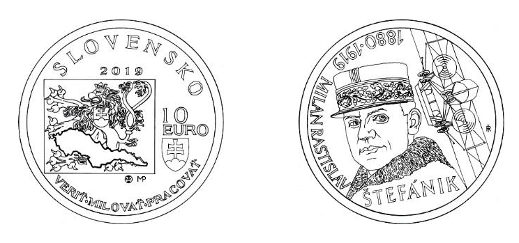

## 69

OZNÁMENIE

Národnej banky Slovenska

z 29. januára 2019

## o vydaní strieborných zberateľských euromincí v nominálnej hodnote 10 eur pri príležitosti 100. výročia úmrtia Milana Rastislava Štefánika

1. Úvodné ustanovenia

- a) Národná banka Slovenska podľa § 17h ods. 1 zákona Národnej rady Slovenskej republiky č. 566/1992 Zb. o Národnej banke Slovenska v znení neskorších predpisov a podľa § 12 ods. 1 písm. b) zákona č. 400/2015 Z. z. o tvorbe právnych predpisov a o Zbierke zákonov Slovenskej republiky a o zmene a doplnení niektorých zákonov oznamuje, že vydáva do obehu strieborné zberateľské euromince v nominálnej hodnote 10 eur pri príležitosti 100. výročia úmrtia Milana Rastislava Štefánika (ďalej len „zberateľská eurominca“).

- b) Zberateľská eurominca má štatút zákonného platidla len v Slovenskej republike.

- c) Zberateľská eurominca sa razí zo zliatiny obsahujúcej 900 dielov striebra a 100 dielov medi; jej hmotnosť je 18 g a priemer 34 mm. Pri razbe zberateľskej euromince je povolená horná a dolná odchýlka v priemere 0,1 mm; povolená horná odchýlka v hmotnosti je 0,4 g a v obsahu striebra 10/1 000.

2. Vzhľad zberateľskej euromince

- a) Na líci zberateľskej euromince je ako symbol vyjadrenia štátotvorných aktivít Milana Rastislava Štefánika vyobrazený český lev s korunou na hlave a slovenským znakom na hrudi z malého štátneho znaku Československej republiky v kompozícii s mapou Československej republiky. V pravej časti mincového poľa je štátny znak Slovenskej republiky, nad ktorým je v dvoch riadkoch označenie nominálnej hodnoty zberateľskej euromince „10 EURO“. Názov štátu „SLOVENSKO“ je v opise pri hornom okraji zberateľskej euromince. Pod ním je letopočet „2019“. Pri spodnom okraji zberateľskej euromince je v opise nápis „VERIŤ • MILOVAŤ • PRACOVAŤ“. Značka Mincovne Kremnica, štátny podnik, ktorú tvorí skratka „MK“ umiestnená medzi dvoma razidlami, a štylizované iniciálky autorky lícnej strany zberateľskej euromince Márie Poldaufovej „MP“ sú pod kompozíciou.

- b) Na rube zberateľskej euromince je vyobrazený portrét Milana Rastislava Štefánika v pravej časti mincového poľa doplnený dvojplošníkom typu Caproni, na ktorého palube Milan Rastislav Štefánik v roku 1919 zahynul. V hornej časti mincového poľa sú v opise letopočty jeho narodenia „1880“ a úmrtia „1919“, ktoré sú od seba oddelené bodkou. V ľavej časti mincového poľa sú v opise mená „MILAN RASTISLAV“ a pod portrétom je priezvisko „ŠTEFÁNIK“. Štylizované iniciálky autora rubovej strany zberateľskej euromince akad. soch. Ivana Řeháka „IŘ“ sú pri pravom okraji zberateľskej euromince.

- c) Na hrane zberateľskej euromince je nápis do hĺbky „VÝZNAMNÁ OSOBNOSŤ SLOVENSKÉHO NÁRODA“. Začiatok a koniec nápisu je oddelený lipovým listom.

- Štát vydania: Slovenská republika

- Začiatok vydávania: apríl 2019

Jozef Makúch v. r.
