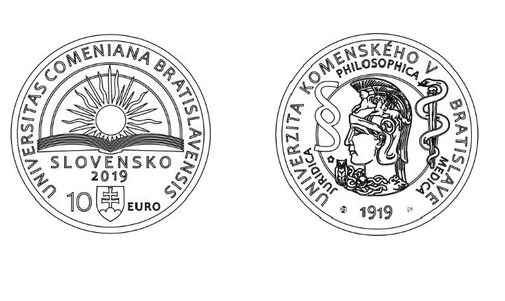

## 97

OZNÁMENIE

Národnej banky Slovenska

z 2. apríla 2019

## o vydaní strieborných zberateľských euromincí v nominálnej hodnote 10 eur pri príležitosti 100. výročia vzniku Univerzity Komenského v Bratislave

1. Úvodné ustanovenia

- a) Národná banka Slovenska podľa § 17h ods. 1 zákona Národnej rady Slovenskej republiky č. 566/1992 Zb. o Národnej banke Slovenska v znení neskorších predpisov a podľa § 12 ods. 1 písm. b) zákona č. 400/2015 Z. z. o tvorbe právnych predpisov a o Zbierke zákonov Slovenskej republiky a o zmene a doplnení niektorých zákonov oznamuje, že vydáva do obehu strieborné zberateľské euromince v nominálnej hodnote 10 eur pri príležitosti 100. výročia vzniku Univerzity Komenského v Bratislave (ďalej len „zberateľská eurominca“).

- b) Zberateľská eurominca má štatút zákonného platidla len v Slovenskej republike.

- c) Zberateľská eurominca sa razí zo zliatiny obsahujúcej 900 dielov striebra a 100 dielov medi; jej hmotnosť je 18 g a priemer 34 mm. Pri razbe zberateľskej euromince je povolená horná a dolná odchýlka v priemere 0,1 mm; povolená horná odchýlka v hmotnosti je 0,4 g a v obsahu striebra 10/1000.

2. Vzhľad pamätnej euromince

- a) Na líci zberateľskej euromince je vyobrazená otvorená kniha v kompozícii s vychádzajúcim slnečným kotúčom s lúčmi, ktoré tvoria súčasť loga Prírodovedeckej fakulty Univerzity Komenského v Bratislave a dvoma paralelne usporiadanými krivkami v opise vychádzajúcimi z knihy. Štátny znak Slovenskej republiky je v spodnej časti mincového poľa. Názov štátu „SLOVENSKO“ a letopočet „2019“ sú v dvoch riadkoch pod otvorenou knihou. Vľavo od štátneho znaku Slovenskej republiky je označenie nominálnej hodnoty zberateľskej euromince „10“ a vpravo od neho označenie meny „EURO“. Pri okraji zberateľskej euromince je v opise nápis „UNIVERSITAS COMENIANA BRATISLAVENSIS“.

- b) Na rube zberateľskej euromince sú v kompozícii vyobrazené časti log Filozofickej fakulty a Lekárskej fakulty Univerzity Komenského v Bratislave v spojení so symbolom paragrafu charakterizujúcim Právnickú fakultu. V opise je kompozícia doplnená nápismi „JURIDICA“, „PHILOSOPHICA“ a „MEDICA“. Pri okraji zberateľskej euromince je v opise zľava doprava nápis „UNIVERZITA KOMENSKÉHO V BRATISLAVE“. Letopočet vzniku Univerzity Komenského „1919“ je pri spodnom okraji zberateľskej euromince. Značka Mincovne Kremnica, štátny podnik, ktorú tvorí skratka „MK“ umiestnená medzi dvoma razidlami, je vľavo od letopočtu a vpravo od neho sú štylizované iniciálky autora zberateľskej euromince prof. Mgr. art. Patrika Kovačovského „PK“.

- c) Na hrane zberateľskej euromince je nápis do hĺbky „• IN UNUM VERTERE • IN UNUM VERTERE“.

- Štát vydania: Slovenská republika

- Začiatok vydávania: jún 2019

Jozef Makúch v. r.
