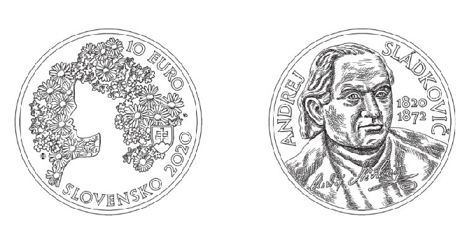

## 10

OZNÁMENIE

Národnej banky Slovenska

z 13. decembra 2019

## o vydaní strieborných zberateľských euromincí v nominálnej hodnote 10 eur pri príležitosti 200. výročia narodenia Andreja Sládkoviča

1. Úvodné ustanovenia

- a) Národná banka Slovenska podľa § 17h ods. 1 zákona Národnej rady Slovenskej republiky č. 566/1992 Zb. o Národnej banke Slovenska v znení neskorších predpisov a podľa § 12 ods. 1 písm. b) zákona č. 400/2015 Z. z. o tvorbe právnych predpisov a o Zbierke zákonov Slovenskej republiky a o zmene a doplnení niektorých zákonov oznamuje, že vydáva do obehu strieborné zberateľské euromince v nominálnej hodnote 10 eur pri príležitosti 200. výročia narodenia Andreja Sládkoviča (ďalej len „zberateľská eurominca“).

- b) Zberateľská eurominca má štatút zákonného platidla len v Slovenskej republike.

- c) Zberateľská eurominca sa razí zo zliatiny obsahujúcej 900 dielov striebra a 100 dielov medi; jej hmotnosť je 18 g a priemer 34 mm. Pri razbe zberateľskej euromince je povolená horná a dolná odchýlka v priemere 0,1 mm; povolená horná odchýlka v hmotnosti je 0,4 g a v obsahu striebra 10/1000.

2. Vzhľad zberateľskej euromince

- a) Na líci zberateľskej euromince je vyobrazená kompozícia kvetov a siluety ženy stvárňujúcej múzu Andreja Sládkoviča – Marínu. Štátny znak Slovenskej republiky je v pravej časti kompozície. V spodnej časti mincového poľa je v opise názov štátu „SLOVENSKO“ a za ním letopočet „2020“. Označenie nominálnej hodnoty „10 EURO“ je v opise v hornej časti mincového poľa. Vľavo od kompozície je značka Mincovne Kremnica, štátny podnik, ktorú tvorí skratka „MK“ umiestnená medzi dvoma razidlami, a vpravo od kompozície sú štylizované iniciálky autora zberateľskej euromince Karola Lička „KL“.

- b) Na rube zberateľskej euromince je vyobrazený potrét Andreja Sládkoviča. V spodnej časti portrétu je faksimile jeho podpisu. V pravej časti mincového poľa sú v dvoch riadkoch letopočty jeho narodenia a úmrtia „1820“ a „1872“. Pri okraji zberateľskej euromince je v opise meno a priezvisko „ANDREJ SLÁDKOVIČ“.

- c) Na hrane zberateľskej euromince je nápis do hĺbky „• KTO LÁSKE A KRÁSE ŽIJE, VEČNE ZOSTANE MLADÝ“.

- 

- Štát vydania: Slovenská republika

- Začiatok vydávania: marec 2020

Peter Kažimír v. r.
