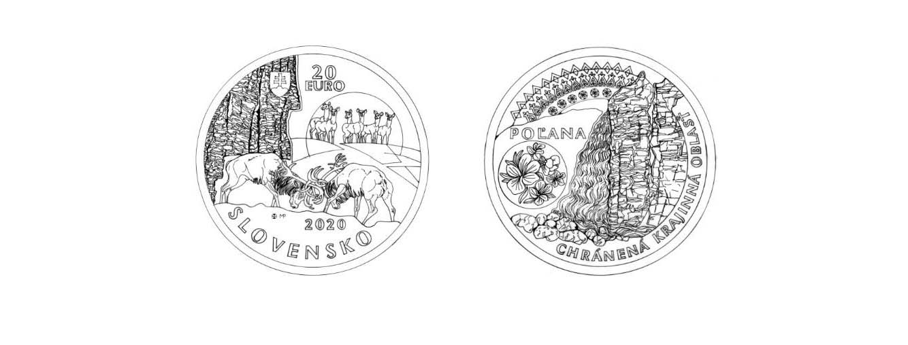

## 185

OZNÁMENIE

Národnej banky Slovenska

z 23. júna 2020

## o vydaní strieborných zberateľských euromincí v nominálnej hodnote 20 eur s tematikou Chránená krajinná oblasť Poľana

1. Úvodné ustanovenia

- a) Národná banka Slovenska podľa § 17h ods. 1 zákona Národnej rady Slovenskej republiky č. 566/1992 Zb. o Národnej banke Slovenska v znení neskorších predpisov a podľa § 12 ods. 1 písm. b) zákona č. 400/2015 Z. z. o tvorbe právnych predpisov a o Zbierke zákonov Slovenskej republiky a o zmene a doplnení niektorých zákonov oznamuje, že vydáva do obehu strieborné zberateľské euromince v nominálnej hodnote 20 eur s tematikou Chránená krajinná oblasť Poľana (ďalej len „zberateľská eurominca“).

- b) Zberateľská eurominca má štatút zákonného platidla len v Slovenskej republike.

- c) Zberateľská eurominca sa razí zo zliatiny obsahujúcej 925 dielov striebra a 75 dielov medi; jej hmotnosť je 33,63 g a priemer 40 mm. Pri razbe zberateľskej euromince je povolená horná a dolná odchýlka v priemere 0,1 mm; povolená horná odchýlka v hmotnosti je 0,4 g a v obsahu striebra 10/1000.

2. Vzhľad zberateľskej euromince

- a) Na líci zberateľskej euromince je vyobrazený súboj dvoch jeleňov, ktorému sa prizerá šesť laní. V ľavej časti mincového poľa je skalný útvar sopečného pôvodu, prírodná pamiatka Kalamárka. Štátny znak Slovenskej republiky je v hornej časti mincového poľa. Vpravo od neho je v dvoch riadkoch označenie nominálnej hodnoty „20 EURO“. V spodnej časti je v opise názov štátu „SLOVENSKO“ a nad ním letopočet „2020“. Značka Mincovne Kremnica, štátny podnik, ktorú tvorí skratka „MK“ umiestnená medzi dvoma razidlami a štylizované iniciálky autorky zberateľskej euromince Márie Poldaufovej „MP“ sú vľavo od letopočtu.

- b) Na rube zberateľskej euromince je národná prírodná pamiatka Vodopád Bystrého potoka. V ľavej hornej časti mincového poľa je v opise fragment ľudového ornamentu. V riadku pod ním je nápis „POĽANA“ a pod ním je vyobrazená fialka žltá sudetská. V pravej časti mincového poľa je v opise nápis „CHRÁNENÁ KRAJINNÁ OBLASŤ“.

- c) Na hrane zberateľskej euromince je nápis do hĺbky „OCHRANA PRÍRODY A KRAJINY“. Začiatok a koniec textu je oddelený vyobrazením štylizovaného kvetu.

- 

- Štát vydania: Slovenská republika

- Začiatok vydávania: september 2020

Peter Kažimír v. r.
