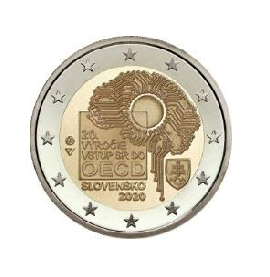

## 221

OZNÁMENIE

Národnej banky Slovenska

zo 14. júla 2020

## o vydaní pamätných euromincí v nominálnej hodnote 2 eurá pri príležitosti 20. výročia vstupu Slovenskej republiky do Organizácie pre hospodársku spoluprácu a rozvoj (OECD)

1. Úvodné ustanovenia

- a) Národná banka Slovenska podľa § 17h ods. 1 zákona Národnej rady Slovenskej republiky č. 566/1992 Zb. o Národnej banke Slovenska v znení neskorších predpisov a podľa § 12 ods. 1 písm. b) zákona č. 400/2015 Z. z. o tvorbe právnych predpisov a o Zbierke zákonov Slovenskej republiky a o zmene a doplnení niektorých zákonov oznamuje, že pri príležitosti 20. výročia vstupu Slovenskej republiky do Organizácie pre hospodársku spoluprácu a rozvoj (OECD) vydáva do obehu pamätné euromince v nominálnej hodnote 2 eurá (ďalej len „pamätná eurominca“).

- b) Pamätná eurominca má rovnaké technické parametre ako obehové euromince1)a na jej národnej strane bude použitý pamätný motív [bod 2 písm. b)].

- c) Pamätná eurominca má štatút zákonného platidla v celej eurozóne.

2. Vzhľad pamätnej euromince

- a) Pamätná eurominca sa vydáva s novou spoločnou európskou stranou.2)

- b) Na národnej strane pamätnej euromince je v kompozícii vyobrazená silueta ľudského mozgu tvoreného plošnými spojmi a centrálne umiestneným kruhom zobrazujúcim mikroprocesor ako vyjadrenie konceptu digitálneho humanizmu. Štátny znak Slovenskej republiky je v pravej časti mincového poľa. Do kompozície zasahuje štvorec, na ktorom je v dvoch riadkoch nápis „20. VÝROČIE“ a pod ním v dvoch riadkoch nápis „VSTUP SR DO OECD“. Pod ním je umiestnený názov štátu „SLOVENSKO“, pod ktorým je letopočet „2020“. V ľavej časti mincového poľa je značka Mincovne Kremnica, štátny podnik, ktorú tvorí skratka „MK“ umiestnená medzi dvoma razidlami a štylizované iniciálky autora výtvarného návrhu národnej strany pamätnej euromince Mgr. art. Petra Valacha „PV“. Pri okraji pamätnej euromince je dvanásť hviezd vlajky Európskej únie.

- c) Na hrane pamätnej euromince je nápis „SLOVENSKÁ REPUBLIKA“. Začiatok a koniec nápisu je oddelený dvoma hviezdami, medzi ktorými je lipový list.

- 

- Štát vydania: Slovenská republika

- Začiatok vydávania: november 2020

Peter Kažimír v. r.
