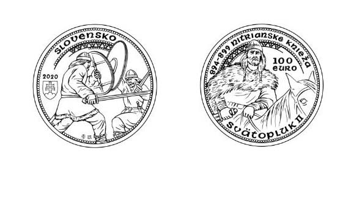

## 270

OZNÁMENIE

Národnej banky Slovenska

z 8. septembra 2020

## o vydaní zlatých zberateľských euromincí v nominálnej hodnote 100 eur na pripomenutie nitrianskeho kniežaťa Svätopluka II.

1. Úvodné ustanovenia

- a) Národná banka Slovenska podľa § 17h ods. 1 zákona Národnej rady Slovenskej republiky č. 566/1992 Zb. o Národnej banke Slovenska v znení neskorších predpisov a podľa § 12 ods. 1 písm. b) zákona č. 400/2015 Z. z. o tvorbe právnych predpisov a o Zbierke zákonov Slovenskej republiky a o zmene a doplnení niektorých zákonov oznamuje, že na pripomenutie nitrianskeho kniežaťa Svätopluka II. vydáva do obehu zlaté zberateľské euromince v nominálnej hodnote 100 eur (ďalej len „zberateľská eurominca“).

- b) Zberateľská eurominca má štatút zákonného platidla len v Slovenskej republike.

- c) Zberateľská eurominca sa razí zo zliatiny obsahujúcej 900 dielov zlata, 75 dielov striebra a 25 dielov medi; jej hmotnosť je 9,5 g a priemer 26 mm. Pri razbe zberateľskej euromince je povolená horná a dolná odchýlka v priemere 0,1 mm; povolená horná odchýlka v hmotnosti je 0,08 g a v obsahu zlata 10/1000.

2. Vzhľad zberateľskej euromince

- a) Na líci zberateľskej euromince je vyobrazená kompozícia dvoch súperiacich dobových bojovníkov. Štátny znak Slovenskej republiky je vľavo od kompozície. Nad ním je letopočet „2020“. Názov „SLOVENSKO“ je v opise pri hornom okraji zberateľskej euromince a od kompozície je oddelený poloblúkom dobovej ornamentiky. Mincové pole je v opise lemované perlovcom. Značka Mincovne Kremnica, štátny podnik, ktorú tvorí skratka „MK“ umiestnená medzi dvoma razidlami a štylizované iniciálky autora zberateľskej euromince Mgr. art. Romana Lugára „LR“ sú v spodnej časti mincového poľa.

- b) Na rube zberateľskej euromince je vyobrazený fiktívny portrét Svätopluka II. sediaceho na koni v pozadí doplnený poloblúkom dobovej ornamentiky. Vpravo od neho je v dvoch riadkoch označenie nominálnej hodnoty „100 EURO“. V hornej časti mincového poľa je v opise nápis „894 – 899 NITRIANSKE KNIEŽA“ a v jeho spodnej časti je v opise nápis „SVÄTOPLUK II“. Mincové pole je v opise lemované perlovcom.

- c) Hrana zberateľskej euromince je vrúbkovaná.

- 

Štát vydania: Slovenská republika

Začiatok vydávania: november 2020

Peter Kažimír v. r.
