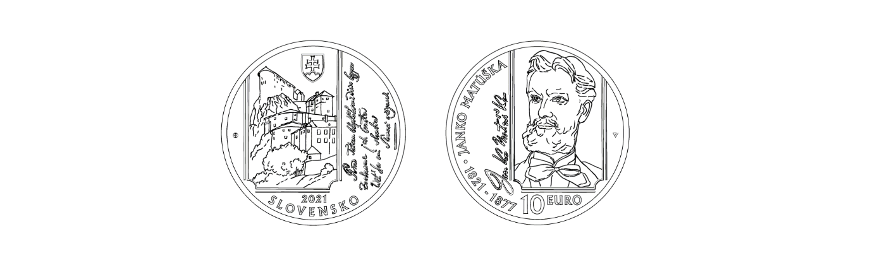

## 305

OZNÁMENIE

Národnej banky Slovenska

z 27. októbra 2020

## o vydaní strieborných zberateľských euromincí v nominálnej hodnote 10 eur pri príležitosti 200. výročia narodenia Janka Matúšku

1. Úvodné ustanovenia

- a) Národná banka Slovenska podľa § 17h ods. 1 zákona Národnej rady Slovenskej republiky č. 566/1992 Zb. o Národnej banke Slovenska v znení neskorších predpisov a podľa § 12 ods. 1 písm. b) zákona č. 400/2015 Z. z. o tvorbe právnych predpisov a o Zbierke zákonov Slovenskej republiky a o zmene a doplnení niektorých zákonov oznamuje, že vydáva do obehu strieborné zberateľské euromince v nominálnej hodnote 10 eur pri príležitosti 200. výročia narodenia Janka Matúšku (ďalej len „zberateľská eurominca“).

- b) Zberateľská eurominca má štatút zákonného platidla len v Slovenskej republike.

- c) Zberateľská eurominca sa razí zo zliatiny obsahujúcej 900 dielov striebra a 100 dielov medi; jej hmotnosť je 18 g a priemer 34 mm. Pri razbe zberateľskej euromince je povolená horná a dolná odchýlka v priemere 0,1 mm; povolená horná odchýlka v hmotnosti je 0,4 g a v obsahu striebra 10/1000.

2. Vzhľad zberateľskej euromince

- a) Na líci zberateľskej euromince je v rámiku vyobrazený Oravský hrad ako symbol životného pôsobenia Janka Matúšku, nad ktorým je štátny znak Slovenskej republiky. Faksimile dobového autentického zápisu textu hymny Slovenskej republiky v štyroch riadkoch je v pravej časti mincového poľa. V spodnej časti je v opise nápis „SLOVENSKO“ a nad ním letopočet „2021“. Vľavo od rámika je značka Mincovne Kremnica, štátny podnik, ktorú tvorí skratka „MK“ umiestnená medzi dvoma razidlami.

- b) Na rube zberateľskej euromince je v rámiku vyobrazený portrét Janka Matúšku. Vľavo od portrétu je faksimile jeho podpisu. Pod portrétom je označenie nominálnej hodnoty „10 EURO“. V ľavej časti mincového poľa sú v opise meno a priezvisko „JANKO MATÚŠKA“, od ktorých sú grafickou značkou oddelené letopočty jeho narodenia a úmrtia „1821 – 1877“. Vpravo od rámika sú štylizované iniciálky autora zberateľskej euromince Mgr. art. Petra Valacha „PV“.

- c) Na hrane zberateľskej euromince je nápis do hĺbky „• AUTOR TEXTU ŠTÁTNEJ HYMNY SLOVENSKEJ REPUBLIKY“.

- 

Štát vydania: Slovenská republika

Začiatok vydávania: január 2021

Peter Kažimír v. r.
