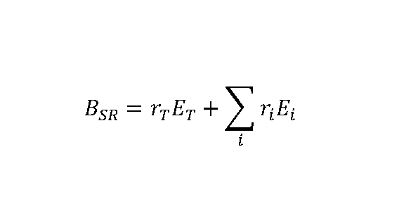
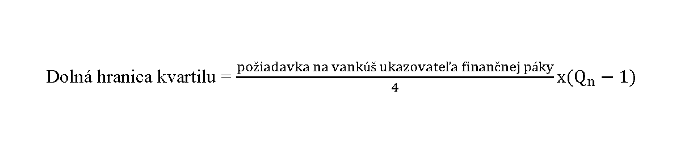
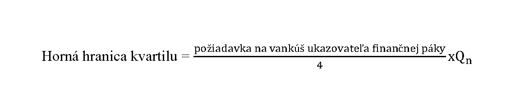

# Čl. I

Zákon č. 483/2001 Z. z. o bankách a o zmene a doplnení niektorých zákonov v znení zákona č. 430/2002 Z. z., zákona č. 510/2002 Z. z., zákona č. 165/2003 Z. z., zákona č. 603/2003 Z. z., zákona č. 215/2004 Z. z., zákona č. 554/2004 Z. z., zákona č. 747/2004 Z. z., zákona č. 69/2005 Z. z., zákona č. 340/2005 Z. z., zákona č. 341/2005 Z. z., zákona č. 214/2006 Z. z., zákona č. 644/2006 Z. z., zákona č. 209/2007 Z. z., zákona č. 659/2007 Z. z., zákona č. 297/2008 Z. z., zákona č. 552/2008 Z. z., zákona č. 66/2009 Z. z., zákona č. 186/2009 Z. z., zákona č. 276/2009 Z. z., zákona č. 492/2009 Z. z., zákona č. 129/2010 Z. z., zákona č. 46/2011 Z. z., zákona č. 130/2011 Z. z., zákona č. 314/2011 Z. z., zákona č. 394/2011 Z. z., zákona č. 520/2011 Z. z., zákona č. 547/2011 Z. z., zákona č. 234/2012 Z. z., zákona č. 352/2012 Z. z., zákona č. 132/2013 Z. z., zákona č. 352/2013 Z. z., zákona č. 213/2014 Z. z., zákona č. 371/2014 Z. z., zákona č. 374/2014 Z. z., zákona č. 35/2015 Z. z., zákona č. 252/2015 Z. z., zákona č. 359/2015 Z. z., zákona č. 392/2015 Z. z., zákona č. 405/2015 Z. z., zákona č. 437/2015 Z. z., zákona č. 90/2016 Z. z., zákona č. 91/2016 Z. z., zákona č. 125/2016 Z. z., zákona č. 292/2016 Z. z., zákona č. 298/2016 Z. z., zákona č. 299/2016 Z. z., zákona č. 315/2016 Z. z., zákona č. 386/2016 Z. z., zákona č. 2/2017 Z. z., zákona č. 264/2017 Z. z., zákona č. 279/2017 Z. z., zákona č. 18/2018 Z. z., zákona č. 69/2018 Z. z., zákona č. 108/2018 Z. z., zákona č. 109/2018 Z. z., zákona č. 177/2018 Z. z., zákona č. 345/2018 Z. z., zákona č. 373/2018 Z. z., zákona č. 6/2019 Z. z., zákona č. 30/2019 Z. z., zákona č. 54/2019 Z. z., zákona č. 211/2019 Z. z., zákona č. 305/2019 Z. z. a zákona č. 390/2019 Z. z. sa mení a dopĺňa takto:

- 1. V § 5 písm. af) sa slová „dcérska spoločnosť“ nahrádzajú slovami „jej dcérske spoločnosti“.

- 2. § 5 sa dopĺňa písmenami ai) až ak), ktoré znejú:

- „ai)

- tlmiacou rezervou (ďalej len „vankúš“) na zachovanie kapitálu vlastné zdroje, ktoré banka udržiava podľa § 33b,

- aj)

- skupinou na účely zákona okrem § 33o až 33z, § 49a až 49o a § 62a skupina podľa osobitného predpisu,13na)

- ak)

- skupinou mimo územia členského štátu skupina, ktorej materská spoločnosť má sídlo mimo územia členského štátu.“.

  - Poznámka pod čiarou k odkazu 13na znie:

  - „13na) Čl. 4 ods. 1 bod 138 nariadenia (EÚ) č. 575/2013 v platnom znení.“.

- 3. V § 6 ods. 2 sa za prvú vetu vkladá nová druhá veta, ktorá znie:

- „Pri preskúmaní a hodnotení v rámci výkonu dohľadu podľa prvej vety Národná banka Slovenska uplatňuje zásadu proporcionality v súlade so všeobecnými hodnotiacimi kritériami a s metodikou zverejňovanými podľa odseku 20 písm. c).“.

- 4. V § 6 ods. 11 sa vypúšťajú slová „alebo banka kontrolovaná materskou finančnou holdingovou spoločnosťou v Európskej únii alebo materskou zmiešanou finančnou holdingovou spoločnosťou v Európskej únii“.

- 5. V § 6 ods. 13 sa za slová „systémov9)“ vkladá čiarka a slová „s osobitným útvarom služby finančnej polície Policajného zboru17a) (ďalej len „finančná spravodajská jednotka“), s príslušnými orgánmi zodpovednými za uplatňovanie pravidiel štrukturálneho oddelenia v rámci bankovej skupiny“ a za slovami „angažovanosti banky“ sa vypúšťa čiarka a slová „ďalšie skutočnosti, ktoré môžu ovplyvniť systémové riziko vyvolané bankou“.

  - Poznámka pod čiarou k odkazu 17a znie:

  - „17a) § 10 ods. 3 a § 26 zákona č. 297/2008 Z. z. v znení neskorších predpisov.“.

- 6. V § 6 ods. 20 písm. c) sa za slovo „metodiku“ vkladajú slová „vrátane kritérií uplatňovania zásady proporcionality“.

- 7. V § 6 ods. 21 sa slovo „dohliadok“ nahrádza slovom „dohľadov“ a za slová „na mieste,“ sa vkladajú slová „zabezpečiť trvalú prítomnosť zástupcu Národnej banky Slovenska v banke,“.

- 8. V § 6 ods. 22 a 23 sa slovo „dohliadok“ nahrádza slovom „dohľadov“.

- 9. V § 6 ods. 23 sa vypúšťa písmeno c).

  - Doterajšie písmeno d) sa označuje ako písmeno c).

- 10. Poznámka pod čiarou k odkazu 20a znie:

- „20a) Čl. 92, 93 až 386 nariadenia (EÚ) č. 575/2013 v platnom znení.“.

- 11. V § 6 ods. 30 sa vypúšťa písmeno i).

- 12. V § 6 ods. 31 písmeno e) znie:

- „e)

- expozície banky voči riziku nadmerného využívania finančnej páky,20g) ktoré je identifikované na základe ukazovateľa finančnej páky určeného podľa osobitného predpisu20h) a nesúladov medzi aktívami a záväzkami,“.

  - Poznámky pod čiarou k odkazom 20g a 20h znejú:

  - „20g) Čl. 4 ods. 1 bod 94 nariadenia (EÚ) č. 575/2013 v platnom znení.

  - 20h) Čl. 429 nariadenia (EÚ) č. 575/2013 v platnom znení.“.

- 13. § 6 sa dopĺňa odsekmi 32 až 37, ktoré znejú:

- „(32)

- Národná banka Slovenska pri výkone dohľadu nad pobočkou zahraničnej banky so sídlom mimo územia členského štátu spolupracuje s príslušnými orgánmi dohľadu nad inštitúciami, ktoré sú súčasťou tej istej skupiny mimo územia členského štátu, s cieľom zabezpečiť, aby všetky činnosti tejto skupiny podliehali dohľadu na účely zabránenia obchádzaniu požiadaviek vyžadovaných od skupín mimo územia členského štátu podľa tohto zákona a osobitného predpisu,30x) ako aj na účely zabránenia akémukoľvek nepriaznivému vplyvu na finančnú stabilitu Európskej únie.

- (33)

- Národná banka Slovenska môže prispôsobiť metodiku preskúmania a hodnotenia podľa odseku 2 pri bankách alebo pobočkách zahraničných bánk s podobným rizikovým profilom, najmä ak ide o podobný podnikateľský model alebo podobné geografické umiestnenie expozícií. Táto prispôsobená metodika môže zahŕňať rizikovo orientované kritériá a kvantitatívne ukazovatele, umožňuje riadne zohľadniť špecifické riziká, ktorým môže byť vystavená každá banka alebo pobočka zahraničnej banky, a nemá vplyv na povahu opatrení na nápravu uložených podľa § 50, ktoré sú špecifické pre každú banku alebo pobočku zahraničnej banky. Ak Národná banka Slovenska postupuje podľa prvej vety, informuje o tom Európsky orgán dohľadu (Európsky orgán pre bankovníctvo).13o)

- (34)

- Ak na základe vykonaného preskúmania a hodnotenia podľa odseku 2 existuje dôvodné podozrenie, že v súvislosti s bankou alebo pobočkou zahraničnej banky dochádza k porušeniu, došlo k porušeniu alebo k pokusu o porušenie ustanovení osobitného predpisu21a) alebo existuje zvýšené riziko porušenia ustanovení osobitného predpisu,21a) Národná banka Slovenska bezodkladne informuje o výsledkoch tohto preskúmania Európsky orgán dohľadu (Európsky orgán pre bankovníctvo) a finančnú spravodajskú jednotku. Ak hrozí potenciálne zvýšené riziko porušenia ustanovení osobitného predpisu,21a) Národná banka Slovenska v spolupráci s finančnou spravodajskou jednotkou posúdia situáciu a bez zbytočného odkladu informujú Európsky orgán dohľadu (Európsky orgán pre bankovníctvo) o výsledku tohto spoločného posúdenia rizika. Ak je to potrebné, Národná banka Slovenska prijme opatrenia na nápravu podľa § 50. Tým nie je dotknuté ustanovenie § 48 ods. 15.

- (35)

- Národná banka Slovenska môže v súlade s podmienkami podľa odsekov 36 a 37 zdieľať alebo zaslať informácie

- a)

- Medzinárodnému menovému fondu a Svetovej banke na účely hodnotení pre program posúdenia finančného sektora,

- b)

- Banke pre medzinárodné zúčtovanie na účely štúdií kvantitatívneho vplyvu,

- c)

- Rade pre finančnú stabilitu na účely jej funkcie dohľadu.

- (36)

- Národná banka Slovenska môže zdieľať dôverné informácie len na základe žiadosti príslušného subjektu podľa odseku 35, ak sú splnené aspoň tieto podmienky:

- a)

- žiadosť je riadne odôvodnená vzhľadom na osobitné úlohy, ktoré vykonáva príslušný subjekt podľa odseku 35 v súlade so svojou určenou pôsobnosťou,

- b)

- žiadosť musí obsahovať presné označenie povahy, rozsahu a formátu požadovaných informácií a prostriedkov na ich sprístupnenie alebo zasielanie,

- c)

- požadované informácie sú nevyhnutne potrebné na vykonávanie osobitných úloh príslušného subjektu podľa odseku 35 a nepresahujú rámec úloh zverených tomuto subjektu,

- d)

- informácie sa zasielajú alebo sprístupňujú výlučne osobám priamo zapojeným do vykonávania osobitných úloh podľa písmena c),

- e)

- na osoby, ktoré majú prístup k takýmto informáciám, sa vzťahuje povinnosť zachovávania mlčanlivosti, ktorá musí byť na rovnakej úrovni ako povinnosť zachovávania mlčanlivosti podľa tohto zákona a osobitných predpisov.18)

- (37)

- Národná banka Slovenska môže zaslať informácie na základe žiadosti príslušného subjektu podľa odseku 35 len v súhrnnej podobe, z ktorých nie je zrejmý názov banky alebo pobočky zahraničnej banky, meno a priezvisko klienta; iné informácie sa môžu zdieľať iba v priestoroch Národnej banky Slovenska.“.

  - Poznámka pod čiarou k odkazu 13o znie:

  - „13o) Nariadenie Európskeho parlamentu a Rady (EÚ) č. 1093/2010 z 24. novembra 2010, ktorým sa zriaďuje Európsky orgán dohľadu (Európsky orgán pre bankovníctvo) a ktorým sa mení a dopĺňa rozhodnutie č. 716/2009/ES a zrušuje rozhodnutie Komisie 2009/78/ES (Ú. v. EÚ L 331, 15. 12. 2010) v platnom znení.“.

- 14. § 7 sa dopĺňa odsekmi 23 a 24, ktoré znejú:

- „(23)

- Ak je žiadateľ súčasťou skupiny, predloží aj informácie o materskej spoločnosti, finančnej holdingovej spoločnosti a zmiešanej finančnej holdingovej spoločnosti v rámci skupiny.

- (24)

- Ustanovenia odseku 2 písm. e), odseku 14, § 25 ods. 1 až 6, 9, 11 a § 50 ods. 20 sa na finančné holdingové spoločnosti a zmiešané finančné holdingové spoločnosti vzťahujú rovnako.“.

- 15. Za § 20 sa vkladajú § 20a až 20c, ktoré vrátane nadpisov znejú:

- 㤠20a

- Súhlas na vykonávanie činnosti finančnej holdingovej spoločnosti a zmiešanej finančnej holdingovej spoločnosti

- (1)

- Na vykonávanie činnosti finančnej holdingovej spoločnosti alebo zmiešanej finančnej holdingovej spoločnosti sa vyžaduje súhlas Národnej banky Slovenska. Žiadosť o udelenie súhlasu podľa prvej vety sa predkladá Národnej banke Slovenska.

- (2)

- Žiadosť podľa odseku 1 Národnej banke Slovenska podáva

- a)

- materská finančná holdingová spoločnosť so sídlom v Slovenskej republike alebo materská zmiešaná finančná holdingová spoločnosť so sídlom v Slovenskej republike,

- b)

- materská finančná holdingová spoločnosť v Európskej únii alebo materská zmiešaná finančná holdingová spoločnosť v Európskej únii,

- c)

- finančná holdingová spoločnosť povinná dodržiavať tento zákon alebo osobitný predpis30x) na subkonsolidovanom základe alebo zmiešaná finančná holdingová spoločnosť povinná dodržiavať tento zákon alebo osobitný predpis30x) na subkonsolidovanom základe alebo

- d)

- finančná holdingová spoločnosť, ktorá nie je materskou spoločnosťou, alebo zmiešaná finančná holdingová spoločnosť, ktorá nie je materskou spoločnosťou, ak je povinná dodržiavať tento zákon alebo osobitný predpis30x) na subkonsolidovanom základe.

- (3)

- Žiadosť podľa odseku 1 obsahuje informácie o

- a)

- organizačnej štruktúre skupiny, ktorej súčasťou je finančná holdingová spoločnosť alebo zmiešaná finančná holdingová spoločnosť, pričom uvedie svoje dcérske spoločnosti a materské spoločnosti, ich sídlo a druh činnosti každého subjektu v rámci skupiny,

- b)

- odbornej spôsobilosti a dôveryhodnosti aspoň dvoch fyzických osôb v riadiacej funkcii vo finančnej holdingovej spoločnosti alebo zmiešanej finančnej holdingovej spoločnosti; na odbornú spôsobilosť a dôveryhodnosť týchto osôb sa vzťahuje § 7 ods. 15 a 16 a § 7a ods. 4,

- c)

- dodržiavaní ustanovení § 7 ods. 2 písm. c) a § 28 akcionármi banky, ktorá je dcérskou spoločnosťou finančnej holdingovej spoločnosti alebo zmiešanej finančnej holdingovej spoločnosti,

- d)

- organizačnej štruktúre a rozdelení úloh v rámci skupiny.

- (4)

- Na udelenie súhlasu podľa odseku 1 musia byť splnené tieto podmienky:

- a)

- vnútorné mechanizmy a rozdelenie úloh sú primerané na účely dodržiavania požiadaviek ustanovených týmto zákonom alebo osobitným predpisom30x) na konsolidovanom základe alebo subkonsolidovanom základe, a najmä účinne

- 1.

- koordinujú činnosť všetkých dcérskych spoločností finančnej holdingovej spoločnosti alebo zmiešanej finančnej holdingovej spoločnosti, a to aj prostredníctvom primeraného rozdelenia úloh medzi bankami, ktoré sú dcérskymi spoločnosťami,

- 2.

- predchádzajú alebo riešia konflikty v rámci skupiny a

- 3.

- presadzujú zásady určené materskou finančnou holdingovou spoločnosťou alebo materskou zmiešanou finančnou holdingovou spoločnosťou v rámci celej skupiny,

- b)

- organizačná štruktúra skupiny, ktorej súčasťou je finančná holdingová spoločnosť alebo zmiešaná finančná holdingová spoločnosť, nebráni účinnému výkonu dohľadu nad bankou, ktorá je dcérskou spoločnosťou, alebo dohľadu nad materskou bankou na individuálnom základe, konsolidovanom základe alebo subkonsolidovanom základe, pričom sa zohľadňuje najmä

- 1.

- postavenie finančnej holdingovej spoločnosti alebo zmiešanej finančnej holdingovej spoločnosti vo viacúrovňovej skupine,

- 2.

- štruktúra akcionárov a

- 3.

- úloha finančnej holdingovej spoločnosti alebo zmiešanej finančnej holdingovej spoločnosti v rámci skupiny a

- c)

- spôsobilosť a vhodnosť osôb, ktoré sú akcionármi s kvalifikovanou účasťou na banke a preukázanie dôveryhodnosti a odbornej spôsobilosti fyzických osôb, ktoré sú členmi štatutárneho orgánu a dozornej rady finančnej holdingovej spoločnosti alebo zmiešanej finančnej holdingovej spoločnosti; na posudzovanie dôveryhodnosti a odbornej spôsobilosti sa vzťahuje § 7 ods. 15 a 16 a § 7a ods. 4.

- (5)

- Národná banka Slovenska žiadosť podľa odseku 1 zamietne, ak žiadateľ nesplní niektorú z podmienok uvedených v odseku 4. Dôvodom na zamietnutie žiadosti podľa odseku 1 nemôžu byť ekonomické potreby finančného trhu.

- (6)

- Podmienky na udelenie súhlasu podľa odseku 4 je finančná holdingová spoločnosť alebo zmiešaná finančná holdingová spoločnosť povinná dodržiavať počas celej doby platnosti súhlasu podľa odseku 1.

- (7)

- Ak sa konanie o žiadosti o udelenie súhlasu podľa odseku 1 uskutoční súčasne s konaním podľa § 28 ods. 1 písm. a), Národná banka Slovenska spolupracuje s orgánom dohľadu v inom členskom štáte, v ktorom má sídlo finančná holdingová spoločnosť alebo zmiešaná finančná holdingová spoločnosť. Plynutie lehoty podľa § 28 ods. 21 tretej vety sa preruší na obdobie dlhšie ako 20 pracovných dní, najviac však do dňa udelenia súhlasu podľa odseku 1.

- (8)

- Udelenie súhlasu podľa odseku 1 sa nevyžaduje, ak sú splnené tieto podmienky:

- a)

- hlavným predmetom činnosti finančnej holdingovej spoločnosti je nadobúdať účasti v dcérskych spoločnostiach a hlavným predmetom činnosti zmiešanej finančnej holdingovej spoločnosti v súvislosti s inštitúciou alebo finančnou inštitúciou je nadobúdať účasti v dcérskych spoločnostiach,

- b)

- finančná holdingová spoločnosť alebo zmiešaná finančná holdingová spoločnosť nie je v rámci skupiny určená v žiadnej zo skupín, ktorých krízová situácia sa rieši, za subjekt, ktorého krízová situácia sa rieši podľa osobitného predpisu,62)

- c)

- banka, ktorá je dcérskou spoločnosťou, je určená za zodpovednú za zabezpečenie toho, aby skupina dodržiavala obozretné požiadavky na konsolidovanom základe, a sú jej poskytnuté všetky prostriedky a právomoci na to, aby tieto povinnosti účinne plnila,

- d)

- finančná holdingová spoločnosť alebo zmiešaná finančná holdingová spoločnosť sa nezúčastňuje na riadiacich, prevádzkových alebo finančných rozhodnutiach, ktoré sa týkajú skupiny alebo jej dcérskych spoločností, ktoré sú bankami alebo finančnými inštitúciami a

- e)

- neexistuje prekážka brániaca účinnému výkonu dohľadu nad skupinou na konsolidovanom základe.

- (9)

- Finančné holdingové spoločnosti alebo zmiešané finančné holdingové spoločnosti, ktoré spĺňajú podmienky podľa odseku 8, nie sú vyňaté z rozsahu konsolidácie podľa tohto zákona a osobitného predpisu.30x)

- (10)

- Na účely vykonávania dohľadu na konsolidovanom základe alebo subkonsolidovanom základe banka, materská banka, materská banka v Európskej únii a materská spoločnosť zahŕňajú aj

- a)

- finančnú holdingovú spoločnosť a zmiešanú finančnú holdingovú spoločnosť, ktorým bol udelený súhlas podľa odseku 1,

- b)

- určenú banku podľa odseku 8 písm. c) kontrolovanú materskou finančnou holdingovou spoločnosťou v Európskej únii, materskou zmiešanou finančnou holdingovou spoločnosťou v Európskej únii, materskou finančnou holdingovou spoločnosťou, materskou zmiešanou finančnou holdingovou spoločnosťou, ak príslušná materská spoločnosť spĺňa podmienky podľa odseku 8,

- c)

- finančnú holdingovú spoločnosť, zmiešanú finančnú holdingovú spoločnosť alebo banku určené podľa § 20b ods. 2 písm. d).

- (11)

- Národná banka Slovenska ako orgán dohľadu na konsolidovanom základe monitoruje dodržiavanie podmienok uvedených v odseku 4 alebo odseku 8. Finančná holdingová spoločnosť a zmiešaná finančná holdingová spoločnosť poskytuje na požiadanie Národnej banke Slovenska ako orgánu dohľadu na konsolidovanom základe všetky informácie potrebné na priebežné monitorovanie organizačnej štruktúry skupiny a dodržiavanie podmienok podľa odseku 4 alebo odseku 8. Národná banka Slovenska ako orgán dohľadu na konsolidovanom základe tieto informácie poskytuje príslušnému orgánu dohľadu v inom členskom štáte, v ktorom má sídlo finančná holdingová spoločnosť alebo zmiešaná finančná holdingová spoločnosť.

- (12)

- Ak Národná banka Slovenska ako orgán dohľadu na konsolidovanom základe zistí, že finančná holdingová spoločnosť alebo zmiešaná finančná holdingová spoločnosť nespĺňa podmienky podľa odseku 8, finančná holdingová spoločnosť alebo zmiešaná finančná holdingová spoločnosť je povinná požiadať bezodkladne o udelenie súhlasu podľa odseku 1.

- (13)

- Ak je Národná banka Slovenska orgánom dohľadu na konsolidovanom základe a finančná holdingová spoločnosť alebo zmiešaná finančná holdingová spoločnosť má sídlo v inom členskom štáte, Národná banka Slovenska na účely prijímania rozhodnutia o udelení súhlasu podľa odseku 1, nevyžadovania súhlasu podľa odseku 8 a opatrení na nápravu podľa § 20b spolupracuje a vedie konzultácie s príslušným orgánom dohľadu v tomto inom členskom štáte. V rámci spolupráce s príslušným orgánom dohľadu podľa prvej vety Národná banka Slovenska ako orgán dohľadu na konsolidovanom základe podľa potreby vypracuje posúdenie skutočností uvedených v odsekoch 4, 8, 12 a v § 20b, predloží toto posúdenie príslušnému orgánu dohľadu podľa prvej vety a ďalej postupuje tak, aby po dohode s týmto príslušným orgánom dohľadu rozhodla do dvoch mesiacov od doručenia tohto posúdenia. Toto spoločné rozhodnutie musí byť riadne zdokumentované a obsahovať odôvodnenie. Národná banka Slovenska ako orgán dohľadu na konsolidovanom základe oznámi spoločné rozhodnutie finančnej holdingovej spoločnosti alebo zmiešanej finančnej holdingovej spoločnosti.

- (14)

- Ak sa nedosiahne dohoda medzi Národnou bankou Slovenska a príslušným orgánom dohľadu v inom členskom štáte, v ktorom má finančná holdingová spoločnosť alebo zmiešaná finančná holdingová spoločnosť sídlo, Národná banka Slovenska nevydá rozhodnutie a obráti sa so žiadosťou o vydanie rozhodnutia na Európsky orgán dohľadu (Európsky orgán pre bankovníctvo) v súlade s osobitným predpisom19) v lehote dvoch mesiacov od doručenia posúdenia podľa odseku 13 alebo do vydania spoločného rozhodnutia.

- (15)

- Ak Národná banka Slovenska nie je orgánom dohľadu na konsolidovanom základe a finančná holdingová spoločnosť alebo zmiešaná finančná holdingová spoločnosť má sídlo v Slovenskej republike, Národná banka Slovenska vyvinie maximálne úsilie, aby bola dosiahnutá dohoda medzi ňou a príslušným orgánom dohľadu, ktorý je orgánom dohľadu na konsolidovanom základe, na účely vydania spoločného rozhodnutia.

- (16)

- Ak ide o zmiešanú finančnú holdingovú spoločnosť a Národná banka Slovenska nie je orgánom vykonávajúcim doplňujúci dohľad podľa § 49a až 49o alebo osobitných predpisov,24f) na rozhodnutie podľa odseku 1, 8 alebo odseku 13 alebo rozhodnutí o uložení opatrení na nápravu podľa § 20b sa vyžaduje súhlas príslušného orgánu vykonávajúceho doplňujúci dohľad.

- (17)

- Ak zahraničný orgán vykonávajúci dohľad podľa § 49a až 49o alebo osobitných predpisov24f) nevydá súhlas podľa odseku 16, Národná banka Slovenska žiadosť o pomoc pri dosiahnutí dohody vo veciach podľa odseku 16 postúpi príslušnému Európskemu orgánu dohľadu (Európskemu orgánu pre bankovníctvo alebo Európskemu orgánu pre poisťovníctvo a dôchodkové poistenie zamestnancov). Rozhodnutím prijatým v súlade s týmto odsekom nie sú dotknuté povinnosti podľa tohto zákona alebo osobitných predpisov.24g)

- (18)

- Ak Národná banka Slovenska zamietne žiadosť podľa odseku 1, oznámi žiadateľovi podľa odseku 2 svoje rozhodnutie spolu s odôvodnením v lehote štyroch mesiacov odo dňa doručenia úplnej žiadosti. Rozhodnutie o žiadosti podľa odseku 1 sa prijme najneskôr do šiestich mesiacov od doručenia takejto žiadosti.

- (19)

- Opatrením,23) ktoré vydá Národná banka Slovenska a ktoré sa vyhlasuje v zbierke zákonov, sa ustanovia

- a)

- náležitosti žiadosti o udelenie súhlasu podľa odsekov 1 a 2 a doklady prikladané k žiadosti,

- b)

- podrobnosti o podmienkach podľa odseku 4 a spôsob preukazovania splnenia týchto podmienok,

- c)

- ďalšie informácie a dokumenty, ktoré sú potrebné na posúdenie splnenia podmienok podľa odsekov 4 a 8.

- § 20b

- Opatrenia na nápravu a pokuty pre finančnú holdingovú spoločnosť alebo zmiešanú finančnú holdingovú spoločnosť

- (1)

- Ak Národná banka Slovenska ako orgán dohľadu na konsolidovanom základe zistí nedostatky spočívajúce v nedodržiavaní podmienok podľa § 20a ods. 4, uloží finančnej holdingovej spoločnosti alebo zmiešanej finančnej holdingovej spoločnosti opatrenia na nápravu a pokuty podľa odseku 2 s cieľom zabezpečiť alebo obnoviť kontinuitu a integritu konsolidovaného dohľadu a zabezpečiť dodržiavanie požiadaviek podľa tohto zákona alebo osobitného predpisu30x) na konsolidovanom základe. Ak ide o zmiešanú finančnú holdingovú spoločnosť, pri prijímaní opatrení na nápravu sa zohľadní najmä vplyv na finančný konglomerát.

- (2)

- Ak Národná banka Slovenska ako orgán dohľadu na konsolidovanom základe zistí nedostatky podľa odseku 1 alebo nedostatky spočívajúce v nedodržiavaní podmienok určených v rozhodnutí o súhlase podľa § 20a ods. 1, podmienok alebo povinností vyplývajúcich z iných rozhodnutí Národnej banky Slovenska uložených finančnej holdingovej spoločnosti alebo zmiešanej finančnej holdingovej spoločnosti, v nedodržiavaní podmienok podľa § 20a alebo v nedodržiavaní alebo obchádzaní iných ustanovení tohto zákona, právne záväzných aktov Európskej únie, ktoré sa vzťahujú na výkon bankových činností, osobitných predpisov46) alebo iných všeobecne záväzných právnych predpisov, ktoré sa vzťahujú na výkon bankových činností, môže Národná banka Slovenska podľa závažnosti, rozsahu, dĺžky trvania, následkov a povahy zistených nedostatkov

- a)

- pozastaviť výkon hlasovacích práv spojených s akciami banky, ktorá je dcérskou spoločnosťou, držanými finančnou holdingovou spoločnosťou alebo zmiešanou finančnou holdingovou spoločnosťou,

- b)

- uložiť pokutu finančnej holdingovej spoločnosti, zmiešanej finančnej holdingovej spoločnosti alebo členom štatutárneho orgánu alebo dozornej rady a vedúcim zamestnancom od 3 300 eur do 664 000 eur; tým nie je dotknuté ustanovenie § 50,

- c)

- uložiť finančnej holdingovej spoločnosti alebo zmiešanej finančnej holdingovej spoločnosti povinnosť alebo odporúčanie previesť majetkové účasti na svojich dcérskych spoločnostiach, ktoré sú bankami, na svojich akcionárov,

- d)

- dočasne určiť inú finančnú holdingovú spoločnosť, zmiešanú finančnú holdingovú spoločnosť alebo banku v rámci skupiny za zodpovednú za dodržiavanie požiadaviek ustanovených týmto zákonom a osobitným predpisom30x) na konsolidovanom základe,

- e)

- obmedziť alebo zakázať rozdeľovanie výnosov podľa osobitného predpisu24h) akcionárom,

- f)

- uložiť finančnej holdingovej spoločnosti alebo zmiešanej finančnej holdingovej spoločnosti povinnosť znížiť majetkovú účasť na banke alebo na iných subjektoch finančného sektora alebo povinnosť previesť majetkovú účasť na banke alebo na iných subjektoch finančného sektora na inú osobu,

- g)

- uložiť finančnej holdingovej spoločnosti alebo zmiešanej finančnej holdingovej spoločnosti povinnosť predložiť plán na bezodkladné dodržiavanie požiadaviek podľa tohto zákona,

- h)

- uložiť iné opatrenia na nápravu smerujúce k odstráneniu zistených nedostatkov, ako sú uvedené v písmenách a) až g).

- (3)

- Právomoci v oblasti dohľadu podľa § 50 a § 63 ods. 1 a 2 Národná banka Slovenska primerane použije aj pri dohľade nad finančnou holdingovou spoločnosťou a zmiešanou finančnou holdingovou spoločnosťou.

- (4)

- Rozhodnutím o zamietnutí žiadosti o udelenie súhlasu podľa § 20a ods. 1 nie je dotknuté uloženie opatrení na nápravu podľa odseku 2.

- § 20c

- Sprostredkujúca materská spoločnosť v Európskej únii

- (1)

- Dve alebo viac inštitúcií v Európskej únii, ktoré sú súčasťou tej istej skupiny mimo územia členského štátu, musia mať jednu sprostredkujúcu materskú spoločnosť v Európskej únii, ktorá má sídlo v Európskej únii, ak odsek 2 neustanovuje inak.

- (2)

- Národná banka Slovenska môže povoliť inštitúciám uvedeným v odseku 1, ktoré vykonávajú činnosť na území Slovenskej republiky, aby mali dve sprostredkujúce materské spoločnosti v Európskej únii, ak by zriadenie jednej sprostredkujúcej materskej spoločnosti v Európskej únii

- a)

- bolo v rozpore s povinnou požiadavkou na oddelenie činností, ktoré ustanovujú pravidlá iného ako členského štátu alebo ktorú uložil orgán dohľadu iného ako členského štátu, v ktorom má materská spoločnosť skupiny mimo územia členského štátu sídlo alebo

- b)

- viedlo podľa posúdenia Rady pre riešenie krízových situácií30zx) (ďalej len „rezolučná rada“) k zníženiu efektívnosti riešiteľnosti krízovej situácie v porovnaní s dvoma sprostredkujúcimi materskými spoločnosťami v Európskej únii.

- (3)

- Sprostredkujúca materská spoločnosť v Európskej únii môže byť len banka, finančná holdingová spoločnosť, ktorej bol udelený súhlas podľa § 20a alebo porovnateľného ustanovenia právnych predpisov iného členského štátu, alebo zmiešaná finančná holdingová spoločnosť, ktorej bol udelený súhlas podľa § 20a alebo porovnateľného ustanovenia právnych predpisov iného členského štátu, ak odsek 4 neustanovuje inak. Ak žiadna z inštitúcií uvedených v odseku 1 nie je bankou alebo ak sa v súvislosti s poskytovaním investičných činností musí zriadiť druhá sprostredkujúca materská spoločnosť v Európskej únii, aby bola dodržaná požiadavka podľa odseku 2, sprostredkujúca materská spoločnosť v Európskej únii alebo druhá sprostredkujúca materská spoločnosť v Európskej únii môže byť obchodník s cennými papiermi, na ktorého sa vzťahuje osobitný predpis.62)

- (4)

- Odseky 1 až 3 sa nepoužijú, ak celková hodnota aktív skupiny mimo územia členského štátu, ktoré má vo všetkých členských štátoch, je menej ako 40 000 000 000 eur.

- (5)

- Na účely odsekov 4, 6, 7 a § 122yc celkovou hodnotou aktív skupiny mimo územia členského štátu, ktoré má vo všetkých členských štátoch, je súčet celkovej hodnoty aktív

- a)

- každej inštitúcie, ktoré má vo všetkých členských štátoch skupina mimo územia členského štátu, ako vyplýva z jej konsolidovanej súvahy alebo z individuálnej súvahy, ak súvaha inštitúcie nie je konsolidovaná, a

- b)

- každej pobočky inštitúcie patriacej do skupiny mimo územia členského štátu, ktorej bolo udelené povolenie podľa tohto zákona, osobitných predpisov24i) alebo ktorej bolo udelené povolenie v súlade s právnymi predpismi iného členského štátu.

- (6)

- Národná banka Slovenska oznámi Európskemu orgánu dohľadu (Európskemu orgánu pre bankovníctvo) o každej skupine mimo územia členského štátu, ktorá vykonáva činnosť na území Slovenskej republiky, tieto informácie:

- a)

- názov inštitúcie a celkovú hodnotu aktív tejto inštitúcie podliehajúcej dohľadu Národnej banky Slovenska a patriacej do skupiny mimo územia členského štátu,

- b)

- názov každej pobočky inštitúcie patriacej do skupiny mimo územia členského štátu, ktorej bolo udelené povolenie podľa tohto zákona alebo osobitných predpisov,24i) a celkovú hodnotu aktív zodpovedajúcich tejto pobočke, ako aj druhy činností, na vykonávanie ktorých bolo týmto pobočkám udelené povolenie,

- c)

- názov a druh každej sprostredkujúcej materskej spoločnosti v Európskej únii so sídlom v Slovenskej republike podľa odseku 3 a názov skupiny mimo územia členského štátu, ktorej je súčasťou.

- (7)

- Banka, ktorá vykonáva činnosť na území Slovenskej republiky a ktorá je súčasťou skupiny mimo územia členského štátu, musí spĺňať jednu z týchto podmienok:

- a)

- má sprostredkujúcu materskú spoločnosť v Európskej únii,

- b)

- je sprostredkujúcou materskou spoločnosťou v Európskej únii,

- c)

- je jedinou inštitúciou skupiny mimo územia členského štátu v Európskej únii alebo

- d)

- je súčasťou skupiny mimo územia členského štátu, ktorej celková hodnota aktív, ktoré má vo všetkých členských štátoch, je menej ako 40 000 000 000 eur.“.

  - Poznámky pod čiarou k odkazom 24f až 24i znejú:

  - „24f) § 143a až 143o zákona č. 566/2001 Z. z. v znení neskorších predpisov.

  - § 124 až 138 zákona č. 39/2015 Z. z. o poisťovníctve a o zmene a doplnení niektorých zákonov v znení zákona č. 437/2015 Z. z.

  - 24g) Zákon č. 566/2001 Z. z. v znení neskorších predpisov.

  - Zákon č. 39/2015 Z. z. v znení neskorších predpisov.

  - 24h) Čl. 4 ods. 1 bod 110 nariadenie (EÚ) č. 575/2013 v platnom znení.

  - 24i) Zákon č. 566/2001 Z. z. v znení neskorších predpisov.

  - Nariadenie Európskeho parlamentu a Rady (EÚ) č. 600/2014 z 15. mája 2014 o trhoch s finančnými nástrojmi, ktorým sa mení nariadenie (EÚ) č. 648/2012 (Ú. v. EÚ L 173, 12. 6. 2014) v platnom znení.“.

- 16. V § 23 ods.1 druhej vete sa slová „banky a podporujú ho,“ nahrádzajú slovami „banky, podporujú ho a ktoré sú v súlade so zásadou rovnakého zaobchádzania ustanovenou osobitným predpisom,27fbc)“.

- 17. V § 23 ods. 1 písm. d) sa slovo „banka“ nahrádza slovami „alebo by mohla byť banka“.

- 18. V § 23 ods. 6 písm. a) siedmom bode sa vypúšťajú slová „podľa osobitného predpisu25ab)“.

  - Poznámka pod čiarou k odkazu 25ab sa vypúšťa.

- 19. § 23 ods. 6 písm. a) sa dopĺňa ôsmym bodom, ktorý znie:

- „8.

- úrokové riziko vyplývajúce z činností, ktoré nie sú zaznamenané v obchodnej knihe, je súčasné alebo budúce riziko pre výnosy aj pre ekonomickú hodnotu banky vyplývajúce z nepriaznivých pohybov úrokových sadzieb, ktoré ovplyvňujú nástroje citlivé na úrokové sadzby vrátane rizika vyplývajúceho z časovej štruktúry nástrojov citlivých na úrokové sadzby, ktoré vyplýva z rozdielov v načasovaní zmien sadzieb týchto nástrojov, bázického rizika a opčného rizika.“.

- 20. V § 23 ods. 9 písmeno f) znie:

- „f)

- podrobnosti týkajúce sa uplatňovania zásad odmeňovania podľa § 23a a 23b,“.

- 21. V § 23 ods. 9 sa vypúšťa písmeno g).

- 22. § 23 sa dopĺňa odsekom 10, ktorý znie:

- „(10)

- Na účely zabezpečenia riadneho a bezpečného výkonu povolených bankových činností a zabraňovania vzniku konfliktu záujmov v rámci banky je banka povinná evidovať a na požiadanie Národnej banky Slovenska bezodkladne poskytnúť údaje o úveroch poskytnutých členom štatutárneho orgánu, členom dozornej rady a ich spriazneným osobám; spriaznenou osobou sa rozumie manžel, manželka, dieťa alebo rodič člena štatutárneho orgánu alebo člena dozornej rady alebo právnická osoba, v ktorej má člen štatutárneho orgánu alebo člen dozornej rady alebo jeho manžel, manželka, dieťa alebo rodič kvalifikovanú účasť alebo v nej zastáva výkonnú riadiacu funkciu alebo je členom jej štatutárneho orgánu alebo dozornej rady.“.

- 23. § 23a a 23b znejú:

- 㤠23a

- (1)

- Banka je povinná uplatňovať zásady odmeňovania podľa tohto zákona pri osobách, ktorých profesionálne činnosti majú významný vplyv na rizikový profil banky, a to spôsobom, ktorý zohľadňuje jej veľkosť, vnútornú organizáciu a povahu, rozsah a zložitosť jej činností, u

- a)

- všetkých členov štatutárneho orgánu,

- b)

- všetkých členov dozornej rady,

- c)

- vedúcich zamestnancov,

- d)

- zamestnancov s riadiacou zodpovednosťou za kontrolné funkcie alebo významné obchodné útvary spĺňajúce kritériá v súlade s osobitným predpisom o vydaní regulačného technického predpisu vydaným na základe osobitného predpisu,13o)

- e)

- zamestnancov, ktorí majú nárok na významnú odmenu za predchádzajúce účtovné obdobie, ak

- 1.

- odmena tohto zamestnanca je rovná alebo vyššia ako 500 000 eur a je rovná alebo vyššia ako priemerná odmena priznaná osobám podľa písmen a) až c),

- 2.

- vykonávajú profesionálnu činnosť vo významnom obchodnom útvare ustanovenom v súlade s osobitným predpisom o vydaní regulačného technického predpisu vydaným na základe osobitného predpisu13o) a táto činnosť má významný vplyv na rizikový profil príslušného obchodného útvaru v súlade s osobitným predpisom o vydaní regulačného technického predpisu vydaným na základe osobitného predpisu,13o)

- f)

- ďalších zamestnancov, ktorí nie sú uvedení v písmenách a) až e) a ktorých odborné činnosti majú vplyv na rizikový profil banky a sú určení v súlade s osobitným predpisom o vydaní regulačného technického predpisu vydaným na základe osobitného predpisu.13o)

- (2)

- V rámci zásad odmeňovania osôb podľa odseku 1 banka uplatňuje

- a)

- zaručenú pevnú zložku celkovej odmeny ako

- 1.

- základnú zložku mzdy, ak ide o zamestnanca,

- 2.

- pevnú zložku odmeny, ak ide o člena štatutárneho orgánu banky a člena dozornej rady banky,

- b)

- pohyblivú zložku celkovej odmeny.

- (3)

- Banka je povinná pri uplatňovaní zásad odmeňovania osôb podľa odseku 1 dodržiavať všeobecné princípy ustanovené v odsekoch 4 až 7.

- (4)

- Zásady odmeňovania osôb podľa odseku 1 musia

- a)

- byť v súlade s riadnym a účinným systémom riadenia rizík, ktorý nepodnecuje k vystaveniu sa riziku nad úroveň miery rizika akceptovaného bankou,

- b)

- byť v súlade s obchodnou stratégiou, hodnotami a dlhodobými cieľmi banky,

- c)

- zahŕňať opatrenia na zabránenie konfliktu záujmov,

- d)

- byť v súlade so zásadou rovnakého zaobchádzania ustanovenou osobitným predpisom.27fbc)

- (5)

- Útvar vnútornej kontroly a vnútorného auditu aspoň raz ročne kontroluje uplatňovanie zásad odmeňovania osôb podľa odseku 1 prijatých dozornou radou banky podľa § 24 ods. 4.

- (6)

- Zamestnanec útvaru vnútornej kontroly a vnútorného auditu banky, na ktorého sa uplatňujú zásady odmeňovania osôb podľa odseku 1, musí byť odmeňovaný podľa dosiahnutých cieľov súvisiacich s jeho funkciou, ale nezávisle od výkonnosti ním kontrolovaných oblastí podnikania banky.

- (7)

- Zásady odmeňovania osôb podľa odseku 1 musia rozlišovať medzi kritériami pre určenie

- a)

- zaručenej pevnej zložky celkovej odmeny, ktorá má zohľadňovať odbornú spôsobilosť a zodpovednosť osoby podľa odseku 1 podľa jej pracovnej náplne v rámci organizácie a riadenia banky, a

- b)

- pohyblivej zložky celkovej odmeny, ktorá má zohľadňovať udržateľný výkon osoby podľa odseku 1, riziká a výkon nad rámec požiadaviek na plnenie úloh určených podľa jej pracovnej náplne v rámci organizácie a riadenia banky.

- (8)

- Na účely uplatňovania zásad odmeňovania sa za banku, ktorá je významná z hľadiska svojej veľkosti, vnútornej organizácie a povahy, rozsahu a zložitosti svojej činnosti, považuje banka, ktorá spĺňa tieto kritériá:

- a)

- banka je globálne systémovo významnou bankou podľa § 33a ods. 1 písm. b) alebo

- b)

- banka je lokálne systémovo významnou bankou podľa § 33a ods. 1 písm. c).

- (9)

- Ak sa banke poskytlo stabilizačné opatrenie štátu sledujúce zmiernenie vplyvov globálnej finančnej krízy, je povinná uplatniť aj zásady odmeňovania na

- a)

- pohyblivé zložky celkovej odmeny osoby podľa odseku 1, ktoré nepresiahnu 1 % z čistých príjmov, ak nie sú v súlade s obchodnou stratégiou banky, jej záujmami a s ukončením poskytnutej stabilizačnej pomoci,

- b)

- základe požiadania Národnej banky Slovenska tak, aby upravila ich štruktúru, a ak je to potrebné, aj určila limity na odmeňovanie členov štatutárneho orgánu a členov dozornej rady takým spôsobom, aby boli v súlade s vhodným riadením rizík,

- c)

- pohyblivé zložky celkovej odmeny členov štatutárneho orgánu a členov dozornej rady, ktoré sa nevyplatia za hodnotené obdobie, ak sú neodôvodnené.

- § 23b

- (1)

- Na pohyblivú zložku celkovej odmeny sa okrem všeobecných princípov podľa § 23a ods. 4 až 7 uplatňujú aj princípy podľa odsekov 2 až 18.

- (2)

- Ak je odmeňovanie závislé od výkonnosti, pohyblivá zložka celkovej odmeny je závislá od hodnotenia výkonnosti osoby podľa § 23a ods. 1, výkonnosti príslušného útvaru banky a hodnotenia celkových výsledkov banky, pričom pri hodnotení výkonnosti osoby podľa § 23a ods. 1 sa zohľadňujú finančné kritériá a nefinančné kritériá.

- (3)

- Hodnotenie výkonnosti je určené viacročným rámcom s cieľom zabezpečiť postup hodnotenia založený na hodnotení dlhodobej obchodnej stratégie banky. Vyplácanie pohyblivej zložky celkovej odmeny založenej na hodnotení výkonnosti sa rozloží na obdobie, ktoré zohľadňuje príslušný obchodný cyklus banky a riziká priamo súvisiace s obchodnou činnosťou banky.

- (4)

- Celková výška pohyblivej zložky celkovej odmeny musí zohľadňovať schopnosť banky plniť povinnosti podľa § 29.

- (5)

- Ak banka plní povinnosti podľa § 29, osobe podľa § 23a ods. 1, ktorá sa pripravuje na samostatnú prácu, možno výnimočne v období od uzavretia pracovného pomeru s bankou najdlhšie do uplynutia jedného roka poskytovať pohyblivú zložku celkovej odmeny v zaručenej výške bez ohľadu na hodnotenie plnenia úloh touto osobou. Pohyblivá zložka celkovej odmeny v zaručenej výške nesmie závisieť od riadenia rizík, výkonnosti a nesmie byť súčasťou budúcich plánov odmeňovania banky.

- (6)

- Zaručená pevná zložka celkovej odmeny osoby podľa § 23a ods. 1 musí byť primerane vyvážená s pohyblivou zložkou celkovej odmeny. Pohyblivá zložka celkovej odmeny nesmie presiahnuť zaručenú pevnú zložku celkovej odmeny. Zaručená pevná zložka celkovej odmeny má predstavovať dostatočne vysoký podiel odmeny, aby bolo možné uplatňovať pružnú politiku v oblasti pohyblivých zložiek celkovej odmeny vrátane možnosti nevyplatiť žiadne pohyblivé zložky celkovej odmeny. Zaručená pevná zložka celkovej odmeny má zohľadňovať odbornú spôsobilosť a zodpovednosť osoby podľa § 23a ods. 1 v rámci organizácie a riadenia banky.

- (7)

- Zmluvné odstupné poskytované osobe podľa § 23a ods. 1 v súvislosti s predčasným skončením pracovnoprávneho vzťahu alebo iného obdobného vzťahu musí zohľadňovať výkonnosť tejto osoby dosiahnutú za určité obdobie a nemôže byť kompenzáciou za zlyhanie alebo porušenie povinnosti.

- (8)

- Vyplatenie kompenzácie v spojitosti s predchádzajúcim zamestnaním osôb podľa § 23a ods. 1 musí byť v súlade s dlhodobou obchodnou stratégiou banky vrátane podmienok zadržiavania vyplatenia kompenzácie, odkladu vyplatenia kompenzácie, výkonu vyplatenia kompenzácie a spätného vymáhania vyplatenej kompenzácie.

- (9)

- Postup merania výkonnosti na účely výpočtu pohyblivej zložky celkovej odmeny alebo pohyblivých zložiek celkových odmien za banku musí obsahovať pravidlá, ktoré zohľadňujú všetky druhy súčasných a budúcich rizík a schopnosť banky plniť povinnosti podľa § 27 ods. 9 písm. b) a § 29.

- (10)

- Pri určení pohyblivej zložky celkovej odmeny v banke sa musia zohľadniť všetky druhy súčasných a budúcich rizík.

- (11)

- Významná časť, najmenej však 50 % odloženej pohyblivej zložky celkovej odmeny a 50 % neodloženej pohyblivej zložky celkovej odmeny, je tvorená vhodnou kombináciou

- a)

- cenných papierov a

- b)

- vždy, ak je to možné, iných finančných nástrojov podľa osobitného predpisu25af) alebo iných nástrojov, ktoré možno plne konvertovať na nástroje kapitálu Tier 1 alebo odpísať, pričom musí byť zabezpečené, že tieto nástroje primerane odrážajú kreditnú kvalitu banky pri pokračovaní jej činnosti.

- (12)

- Cenné papiere a iné finančné nástroje podľa odseku 11 musia byť počas primeraného obdobia podľa zásad odmeňovania banky zadržiavané tak, aby motivácia osôb podľa § 23a ods. 1 bola zosúladená s dlhodobými cieľmi banky.

- (13)

- Najmenej 40 % pohyblivej zložky celkovej odmeny sa odkladá na obdobie najmenej štyri až päť rokov od určenia predpokladanej výšky pohyblivej zložky celkovej odmeny, pričom obdobie odkladu musí byť riadne zosúladené s povahou činnosti a rizikami banky a činnosťou osoby podľa § 23a ods. 1. Banka podľa § 23a ods. 8 osobe podľa § 23a ods. 1 písm. a) až c) odloží najmenej 40 % pohyblivej zložky celkovej odmeny na obdobie najmenej päť rokov od určenia predpokladanej výšky pohyblivej zložky celkovej odmeny, pričom obdobie odkladu musí byť riadne zosúladené s povahou činnosti a rizikami banky a činnosťou osoby podľa § 23a ods. 1 písm. a) až c). Nárok na vyplatenie odloženej odmeny neuplynie rýchlejšie ako pri pomernom vyplácaní. Ak je úhrn predpokladanej pohyblivej zložky celkovej odmeny mimoriadne vysoký, podiel plnení viazaných na obdobie podľa prvej a druhej vety nesmie byť nižší ako 60 % pohyblivej zložky celkovej odmeny. Dĺžka obdobia odkladu sa určuje v súlade s obchodným cyklom, povahou a rizikami podnikania a činnosťami dotknutej osoby podľa § 23a ods. 1.

- (14)

- Ak je to udržateľné vzhľadom na finančnú situáciu banky a odôvodnené výkonnosťou banky, výkonnosťou príslušného obchodného útvaru a výkonnosťou dotknutej osoby podľa § 23a ods. 1, prizná sa osobe podľa § 23a ods. 1 nárok na pohyblivú zložku celkovej odmeny vrátane odloženej časti podľa odseku 13 alebo sa vyplatí osobe podľa § 23a ods. 1 pohyblivá zložka celkovej odmeny vrátane odloženej časti podľa odseku 13.

- (15)

- Banka je povinná zaviesť opatrenia, ktoré jej umožnia odňať priznanie nároku na pohyblivú zložku celkovej odmeny alebo jeho časti a požadovať späť už vyplatenú pohyblivú zložku celkovej odmeny alebo jej časť, ak sa finančná situácia banky výrazne zhorší; týmto nie sú dotknuté ustanovenia Zákonníka práce o mzde, dojednaní mzdy a o vykonaní zrážok zo mzdy. Kritériá na použitie opatrení podľa prvej vety zahŕňajú situáciu, keď sa osoba podľa § 23a ods. 1 podieľala na konaní, ktoré viedlo k významným finančným stratám banky alebo bola za také konanie zodpovedná.

- (16)

- Banka môže v rámci dôchodkovej politiky v súlade s jej obchodnou stratégiou, cieľmi, hodnotami a záujmami určiť kritériá pre určenie pohyblivej zložky celkovej odmeny formou dobrovoľných platieb do systému doplnkového dôchodkového zabezpečenia (ďalej len „dobrovoľné platby dôchodkového zabezpečenia“). Ak banka poskytuje dobrovoľné platby dôchodkového zabezpečenia podľa prvej vety a osoba podľa § 23a ods. 1 ukončí pracovnoprávny vzťah alebo iný obdobný vzťah s bankou pred vznikom nároku na starobný dôchodok, banka bude počas piatich rokov držať dobrovoľné platby dôchodkového zabezpečenia v podobe nástrojov uvedených v odseku 11. Ak banka poskytuje dobrovoľné platby dôchodkového zabezpečenia podľa prvej vety a osoba podľa § 23a ods. 1 dosiahne nárok na starobný dôchodok, dobrovoľné platby dôchodkového zabezpečenia sa tejto osobe vyplatia v podobe nástrojov uvedených v odseku 11, a to pri uplatnení päťročného odkladu.

- (17)

- Osoby podľa § 23a ods. 1 nemôžu uzavrieť poistnú zmluvu pre prípad nevyplatenia pohyblivej zložky celkovej odmeny.

- (18)

- Pohyblivá zložka celkovej odmeny nesmie byť vyplatená v nástrojoch alebo vo forme, ktorá by umožnila obchádzanie ustanovení tohto zákona alebo osobitného predpisu.30x)

- (19)

- Ustanovenia odsekov 11 až 13 a odseku 16 druhej a tretej vety sa neuplatňujú na

- a)

- banku, ktorá nie je veľkou inštitúciou podľa osobitného predpisu25ag) a ktorej priemerná hodnota aktív na individuálnom základe podľa tohto zákona a osobitného predpisu30x) počas štyroch rokov, ktoré predchádzajú aktuálnemu účtovnému obdobiu, je rovná alebo nižšia ako 5 000 000 000 eur,

- b)

- zamestnanca, ktorého ročná pohyblivá zložka celkovej odmeny je nižšia ako 50 000 eur a nie je vyššia ako tretina celkovej ročnej odmeny tohto zamestnanca.“.

  - Poznámka pod čiarou k odkazu 25ag znie:

  - „25ag) Čl. 4 ods. 1 bod 146 nariadenia (EÚ) č. 575/2013 v platnom znení.“.

  - Poznámka pod čiarou k odkazu 25aea sa vypúšťa.

- 24. § 23c sa vypúšťa.

- 25. V § 23d ods. 1 prvá veta znie: „Banka podľa § 23a ods. 8 je povinná zriadiť výbor pre odmeňovanie v banke; iná banka ako banka podľa § 23a ods. 8 nie je povinná zriadiť výbor pre odmeňovanie v banke, ak určí osobu zodpovednú za systém odmeňovania v banke.“.

- 26. V § 23d ods. 1 písm. d) sa slová „osôb podľa § 23a ods. 1 písm. a) a b)“ nahrádzajú slovami „všetkých členov štatutárneho orgánu a vedúcich zamestnancov zodpovedných za riadenie rizík“.

- 27. V § 23e ods. 1 sa za slovo „Slovenska“ vkladajú slová „o rozdieloch v odmeňovaní mužov a žien a“.

- 28. V § 23e ods. 2 sa na konci pripájajú tieto slová: „a podľa osobitného predpisu.25ah)“.

  - Poznámka pod čiarou k odkazu 25ah znie:

  - „25ah) Čl. 450 ods. 1 písm. g), h), i) a k) nariadenia (EÚ) č. 575/2013 v platnom znení.“.

- 29. V § 23e ods. 3 sa slová „odseku 1 a informácie zverejňované podľa § 37 ods. 9 písm. h)“ nahrádzajú slovami „odsekov 1 a 2“.

- 30. V § 24 ods. 1 sa na konci pripája táto veta: „Zloženie štatutárneho orgánu a dozornej rady musí byť také, aby vedomosti, zručnosti a skúsenosti štatutárneho orgánu ako celku a dozornej rady ako celku zodpovedali činnosti banky vrátane hlavných rizík.“.

- 31. V § 24 ods. 4 druhá veta znie: „Členovia dozornej rady banky prijímajú a pravidelne skúmajú všeobecné zásady odmeňovania, dohliadajú nad ich uplatňovaním a sú povinní kontrolovať bezpečnosť a účinnosť systému riadenia rizík.“.

- 32. V § 25 ods. 9 sa na konci bodka nahrádza bodkočiarkou a pripájajú sa tieto slová: „skutočnosť, že člen štatutárneho orgánu alebo člen dozornej rady banky je spoločníkom v pridruženej spoločnosti,26da) nemusí sama osebe byť prekážkou nezávislosti.“.

  - Poznámka pod čiarou k odkazu 26da znie:

  - „26da) Medzinárodný účtovný štandard 28 Prílohy nariadenia Komisie (ES) č. 1126/2008 z 3. novembra 2008, ktorým sa v súlade s nariadením Európskeho parlamentu a Rady (ES) č. 1606/2002 prijímajú určité medzinárodné účtovné štandardy (Ú. v. EÚ L 320, 29. 11. 2008) v platnom znení.“.

- 33. V § 25 ods. 12 sa na konci pripája táto veta: „Národná banka Slovenska používa tieto informácie na porovnávanie politiky rôznorodosti výberu členov štatutárneho orgánu a členov dozornej rady banky.“.

- 34. V § 27 odsek 3 znie:

- „(3)

- Na účely odsekov 2 a 4 banka, ktorá je G-SII podľa § 33a ods. 1 písm. b), alebo banka, ktorá je O-SII podľa § 33a ods. 1 písm. c), je povinná zriadiť výbor pre riadenie rizík zložený z členov štatutárneho orgánu alebo členov dozornej rady, ktorí v príslušnej banke nevykonávajú žiadnu výkonnú funkciu. Členovia výboru pre riadenie rizík musia mať primerané vedomosti, zručnosti a odborné znalosti na to, aby úplne chápali a monitorovali stratégiu riadenia rizika a ochotu banky podstupovať riziká. Iná banka ako banka podľa prvej vety nie je povinná zriadiť výbor pre riadenie rizík, ak riadenie rizík vykonáva výborom pre audit podľa osobitného predpisu,26ga) ktorý vykonáva činnosti podľa odsekov 2 a 4.“.

  - Poznámka pod čiarou k odkazu 26ga znie:

  - „26ga) § 34 zákona č. 423/2015 Z. z. o štatutárnom audite a o zmene a doplnení zákona č. 431/2002 Z. z. o účtovníctve v znení neskorších predpisov.“.

- 35. V § 28 ods. 2 druhej vete sa na konci bodka nahrádza bodkočiarkou a pripájajú sa tieto slová: „na vydanie predchádzajúceho súhlasu podľa odseku 1 písm. a) sa nevyžaduje splnenie podmienok uvedených v § 7 ods. 2 písm. e) a r) pre vedúceho zamestnanca.“.

- 36. V § 28 ods. 22 prvej vete sa na konci bodka nahrádza čiarkou a pripájajú sa tieto slová: „ak odsek 24 neustanovuje inak.“.

- 37. § 28 sa dopĺňa odsekom 24, ktorý znie:

- „(24)

- Národná banka Slovenska bezodkladne posúdi žiadosť rezolučnej rady podľa osobitného predpisu30aa) o nadobudnutí kvalifikovanej účasti podľa odseku 1 písm. a). Po posúdení žiadosti rezolučnej rady Národná banka Slovenska bezodkladne doručí rezolučnej rade a dotknutej banke písomné rozhodnutie o udelení súhlasu alebo nesúhlasu na nadobudnutie alebo zvýšenie kvalifikovanej účasti na banke.“.

  - Poznámka pod čiarou k odkazu 30aa znie:

  - „30aa) § 9 ods. 1 písm. l) zákona č. 371/2014 Z. z.“.

- 38. Za § 29 sa vkladajú § 29a až 29c, ktoré vrátane nadpisov znejú:

- 㤠29a

- Odporúčania týkajúce sa dodatočných vlastných zdrojov

- (1)

- Národná banka Slovenska v rámci preskúmania a hodnotenia podľa § 6 ods. 2, ako aj na základe výsledkov stresových testov podľa § 6 ods. 27 pravidelne preskúmava úroveň vnútorného kapitálu podľa § 27 ods. 7 a 8. Na základe preskúmania a hodnotenia podľa prvej vety Národná banka Slovenska určí pre každú banku celkovú úroveň vlastných zdrojov, ktorú považuje za primeranú.

- (2)

- Národná banka Slovenska na základe preskúmania a hodnotenia podľa odseku 1 oznámi banke svoje odporúčanie o výške dodatočných vlastných zdrojov. Toto odporúčanie určuje vlastné zdroje presahujúce výšku vlastných zdrojov na základe požiadavky podľa osobitných predpisov,30ba) osobitnú požiadavku na vlastné zdroje uloženú podľa § 50 ods. 1 písm. m), požiadavku na kombinovaný vankúš alebo nad rámec požiadavky na vankúš ukazovateľa finančnej páky,30bb) ktoré sú nevyhnutné na dosiahnutie celkovej úrovne vlastných zdrojov, ktorú Národná banka Slovenska považuje za primeranú.

- (3)

- Odporúčanie Národnej banky Slovenska podľa odseku 2 musí byť špecifické pre konkrétnu banku. Odporúčanie týkajúce sa dodatočných vlastných zdrojov môže pokrývať aj riziká, ktoré sa riešia osobitnou požiadavkou na vlastné zdroje uloženou podľa § 50 ods. 1 písm. m), ale len v rozsahu, v ktorom tieto riziká nie sú v osobitnej požiadavke na vlastné zdroje zahrnuté.

- (4)

- Vlastné zdroje použité na splnenie odporúčania podľa odseku 2, ktoré majú pokrývať iné riziká, ako je riziko nadmerného využívania finančnej páky, banka nesmie použiť na splnenie

- a)

- požiadavky na vlastné zdroje určené podľa osobitného predpisu,30bc)

- b)

- osobitnej požiadavky na vlastné zdroje podľa § 29b uloženej Národnou bankou Slovenska na krytie iných rizík ako rizika nadmerného využívania finančnej páky a požiadavky na kombinovaný vankúš.

- (5)

- Vlastné zdroje použité na splnenie odporúčania podľa odseku 2, ktoré majú pokrývať riziko nadmerného využívania finančnej páky, banka nesmie použiť na splnenie

- a)

- požiadavky na vlastné zdroje určené podľa osobitného predpisu,30bd)

- b)

- osobitnej požiadavky na vlastné zdroje podľa § 29b uloženej Národnou bankou Slovenska na krytie rizika nadmerného využívania finančnej páky a požiadavky na vankúš ukazovateľa finančnej páky.

- (6)

- Ak banka spĺňa príslušné požiadavky na vlastné zdroje určené podľa osobitných predpisov,30ba) osobitnú požiadavku na vlastné zdroje uloženú podľa § 50 ods. 1 písm. m) a podľa potreby požiadavku na kombinovaný vankúš alebo požiadavku na vankúš ukazovateľa finančnej páky, nesplnenie odporúčania týkajúceho sa dodatočných vlastných zdrojov podľa odseku 2 nemá za následok uplatnenie obmedzení podľa § 33k alebo § 33ka.

- § 29b

- Osobitná požiadavka na vlastné zdroje

- (1)

- Na základe výsledkov preskúmania a hodnotenia podľa § 6 ods. 2, 24, 25 a § 33, Národná banka Slovenska podľa § 50 ods. 1 písm. m) uloží banke osobitnú požiadavku na vlastné zdroje výlučne na krytie rizík, ktoré sú vyvolané činnosťami tejto banky, vrátane rizík odrážajúcich vplyv určitého hospodárskeho a trhového vývoja na rizikový profil tejto banky, ak

- a)

- banka je vystavená rizikám alebo prvkom rizík, na ktoré sa nevzťahujú alebo sa nedostatočne vzťahujú požiadavky na vlastné zdroje určené podľa osobitných predpisov,30ba)

- b)

- banka nedodržuje povinnosti podľa § 23 ods. 1 až 5 a § 27 ods. 7 alebo osobitného predpisu30be) a nie je pravdepodobné, že iné opatrenia uložené v rámci výkonu dohľadu Národnou bankou Slovenska by boli dostatočné na zabezpečenie týchto požiadaviek v primeranom čase,

- c)

- úpravy ocenení podľa § 39 sú nedostatočné na to, aby banke umožnili za bežných trhových podmienok v krátkom čase predať alebo zaistiť svoje pozície bez významnej straty,

- d)

- neplnenie požiadaviek na používanie interného prístupu podľa § 30 až 32 bude mať podľa Národnej banky Slovenska za následok nedostatočné požiadavky na vlastné zdroje,

- e)

- banka opakovane nezavedie alebo nedodržuje dostatočnú výšku dodatočných vlastných zdrojov na splnenie odporúčania oznámeného podľa § 29a ods. 2 alebo

- f)

- Národná banka Slovenska považuje inú situáciu špecifickú pre banku za situáciu vyvolávajúcu významné obavy z hľadiska dohľadu.

- (2)

- Na účely odseku 1 písm. a) sa riziká alebo prvky rizík považujú za nekryté alebo nedostatočne kryté požiadavkami na vlastné zdroje určenými podľa osobitných predpisov,30ba) ak výška, druh a štruktúra kapitálu, ktorý Národná banka Slovenska považuje za primeraný pri zohľadnení vnútorne určených vlastných zdrojov podľa § 27 ods. 7, sú vyššie ako požiadavky na vlastné zdroje určené podľa osobitných predpisov.30ba) Na účely prvej vety posúdi Národná banka Slovenska s ohľadom na rizikový profil banky riziká alebo prvky rizík, ktorým je banka vystavená, vrátane rizík a prvkov rizík špecifických pre banku,

- a)

- ktoré sú výslovne vylúčené z požiadaviek na vlastné zdroje podľa osobitných predpisov30ba) alebo nie sú týmito požiadavkami priamo pokryté,

- b)

- pri ktorých hrozí podhodnotenie napriek tomu, že spĺňajú uplatniteľné požiadavky podľa osobitných predpisov.30ba)

- (3)

- Na účely odseku 2 kryje kapitál považovaný za primeraný všetky riziká alebo prvky rizík, ktoré boli podľa odseku 2 druhej vety posúdené ako závažné a ktoré nie sú kryté alebo sú len nedostatočne kryté požiadavkami na vlastné zdroje určenými podľa osobitných predpisov.30ba)

- (4)

- Úrokové riziko vyplývajúce z činností, ktoré nie sú zaznamenané v obchodnej knihe, je významné aspoň podľa § 33 ods. 1, ak Národná banka Slovenska pri vykonávaní preskúmania a hodnotenia nedôjde k záveru, že riadenie úrokového rizika vyplývajúceho z činností, ktoré nie sú zaznamenané v obchodnej knihe, je zo strany banky primerané a že banka nie je nadmerne vystavená úrokovému riziku vyplývajúcemu z činností, ktoré nie sú zaznamenané v obchodnej knihe.

- (5)

- Ak sa na krytie rizík, ktoré sú iné ako riziko nadmerného využívania finančnej páky a ktoré sú podľa osobitného predpisu30bd) nedostatočne kryté, vyžadujú osobitné vlastné zdroje, Národná banka Slovenska určí výšku osobitnej požiadavky na vlastné zdroje podľa odseku 1 písm. a) ako rozdiel medzi vlastnými zdrojmi považovanými za primerané podľa odseku 2 a príslušnými požiadavkami na vlastné zdroje určenými podľa osobitných predpisov.30bf)

- (6)

- Ak sa na krytie rizika nadmerného využívania finančnej páky, ktoré je podľa osobitného predpisu30bd) nedostatočne kryté, vyžadujú osobitné vlastné zdroje, Národná banka Slovenska určí výšku osobitnej požiadavky na vlastné zdroje podľa odseku 1 písm. a) ako rozdiel medzi vlastnými zdrojmi považovanými za primerané podľa odseku 2 a príslušnými požiadavkami na vlastné zdroje určenými podľa osobitného predpisu.30bg)

- (7)

- Ak odsek 9 neustanovuje inak, banka spĺňa osobitnú požiadavku na vlastné zdroje, ktorú jej uložila Národná banka Slovenska podľa § 50 ods. 1 písm. m) na riešenie iných rizík, ako je riziko nadmerného využívania finančnej páky, vlastnými zdrojmi spĺňajúcimi tieto podmienky:

- a)

- najmenej tri štvrtiny osobitnej požiadavky na vlastné zdroje tvorí kapitál Tier 1,

- b)

- najmenej tri štvrtiny kapitálu Tier 1 podľa písmena a) tvorí vlastný kapitál Tier 1.

- (8)

- Banka spĺňa osobitnú požiadavku na vlastné zdroje, ktorú jej uložila Národná banka Slovenska podľa § 50 ods. 1 písm. m) na riešenie rizika nadmerného využívania finančnej páky kapitálom Tier 1, ak odsek 9 neustanovuje inak.

- (9)

- Ak je to potrebné a s ohľadom na špecifické okolnosti banky, môže Národná banka Slovenska určiť, aby banka plnila jej osobitnú požiadavku na vlastné zdroje vyšším podielom kapitálu Tier 1 alebo vyšším podielom vlastného kapitálu Tier 1, ako je vyžadovaný podľa odseku 7 alebo odseku 8.

- (10)

- Ak Národná banka Slovenska s cieľom riešiť krytie iných rizík, ako je riziko nadmerného využívania finančnej páky, uloží banke opatrenie na nápravu podľa § 50 ods. 1 písm. m), vlastné zdroje určené na splnenie tejto osobitnej požiadavky na vlastné zdroje banka nesmie použiť na splnenie

- a)

- požiadavky na vlastné zdroje určenej podľa osobitného predpisu,30bc)

- b)

- požiadavky na kombinovaný vankúš podľa § 33a ods. 1 písm. i),

- c)

- odporúčania týkajúceho sa dodatočných vlastných zdrojov podľa § 29a, ak sa toto odporúčanie týka iných rizík, ako je riziko nadmerného využívania finančnej páky.

- (11)

- Ak Národná banka Slovenska s cieľom riešiť krytie rizika nadmerného využívania finančnej páky, ktoré nie je dostatočne kryté podľa osobitného predpisu,30bd) uloží banke opatrenie na nápravu podľa § 50 ods. 1 písm. m), vlastné zdroje určené na splnenie tejto osobitnej požiadavky na vlastné zdroje banka nesmie použiť na splnenie

- a)

- požiadavky na vlastné zdroje určenej podľa osobitného predpisu,30bd)

- b)

- požiadavky na vankúš ukazovateľa finančnej páky,

- c)

- odporúčania týkajúceho sa dodatočných vlastných zdrojov podľa § 29a, ak sa toto odporúčanie týka rizika nadmerného využívania finančnej páky.

- (12)

- Národná banka Slovenska v odôvodnení rozhodnutia o uložení opatrenia na nápravu podľa § 50 ods. 1 písm. m), ktorým uloží banke osobitnú požiadavku na vlastné zdroje, uvedie aspoň popis úplného posúdenia všetkých skutočností podľa odsekov 1 až 11. Ak Národná banka Slovenska uloží opatrenie na nápravu podľa § 50 ods. 1 písm. m), ktorým uloží banke osobitnú požiadavku na vlastné zdroje z dôvodu podľa odseku 1 písm. e), odôvodnenie obsahuje dôvody, pre ktoré uloženie odporúčania týkajúceho sa dodatočných vlastných zdrojov podľa § 29a už nie je dostatočné.

- § 29c

- Národná banka Slovenska informuje rezolučnú radu o odporúčaní týkajúcom sa dodatočných vlastných zdrojov oznámenom banke podľa § 29a ods. 2 a osobitnej požiadavke na vlastné zdroje uloženej banke podľa § 50 ods. 1 písm. m).“.

  - Poznámky pod čiarou k odkazom 30ba až 30bg znejú:

  - „30ba) Tretia, štvrtá a siedma časť nariadenia (EÚ) č. 575/2013 v platnom znení.

  - Kapitola 2 nariadenia Európskeho parlamentu a Rady (EÚ) 2017/2402 z 12. decembra 2017, ktorým sa stanovuje všeobecný rámec pre sekuritizáciu a vytvára sa osobitný rámec pre jednoduchú, transparentnú a štandardizovanú sekuritizáciu, a ktorým sa menia smernice 2009/65/ES, 2009/138/ES a 2011/61/EÚ a nariadenia (ES) č. 1060/2009 a (EÚ) č. 648/2012 (Ú. v. EÚ L 347, 28. 12. 2017).

  - 30bb) Čl. 92 ods. 1a nariadenia (EÚ) č. 575/2013 v platnom znení.

  - 30bc) Čl. 92 ods. 1 písm. a), b) a c) nariadenia (EÚ) č. 575/2013 v platnom znení.

  - 30bd) Čl. 92 ods. 1 písm. d) nariadenia (EÚ) č. 575/2013 v platnom znení.

  - 30be) Čl. 393 nariadenia (EÚ) č. 575/2013 v platnom znení.

  - 30bf) Tretia a štvrtá časť nariadenia (EÚ) č. 575/2013 v platnom znení.

  - Kapitola 2 nariadenia (EÚ) 2017/2402.

  - 30bg) Tretia a siedma časť nariadenia (EÚ) č. 575/2013 v platnom znení.“.

- 39. Za § 31 sa vkladá § 31a, ktorý vrátane nadpisu znie:

- 㤠31a

- Úrokové riziko vyplývajúce z činností, ktoré nie sú zaznamenané v obchodnej knihe

- (1)

- Banka je povinná zaviesť interné systémy, používať štandardizovanú metodiku alebo zjednodušenú štandardizovanú metodiku na identifikáciu, hodnotenie, riadenie a zmierňovanie rizík vyplývajúcich z možných zmien úrokových sadzieb, ktoré ovplyvňujú ekonomickú hodnotu vlastného imania a čisté príjmy z úrokov z jej činností, ktoré nie sú zaznamenané v obchodnej knihe. Štandardizovaná metodika alebo zjednodušená štandardizovaná metodika používaná bankou musí byť v súlade s osobitným predpisom o vydaní regulačného technického predpisu vydaným na základe osobitného predpisu.13o)

- (2)

- Banka je povinná zaviesť interné systémy na posudzovanie a monitorovanie rizík vyplývajúcich z možných zmien kreditných rozpätí, ktoré ovplyvňujú ekonomickú hodnotu vlastného imania a čisté príjmy z úrokov z jej činností, ktoré nie sú zaznamenané v obchodnej knihe.

- (3)

- Národná banka Slovenska môže od banky vyžadovať, aby na účely riadenia úrokového rizika vyplývajúceho z činností, ktoré nie sú zaznamenané v obchodnej knihe, použila štandardizovanú metodiku podľa odseku 1, ak interné systémy riadenia úrokového rizika vyplývajúceho z činností, ktoré nie sú zaznamenané v obchodnej knihe, používané bankou nie sú uspokojivé.

- (4)

- Národná banka Slovenska môže od malej a menej zložitej banky podľa osobitného predpisu30ka) vyžadovať, aby na účely riadenia úrokového rizika vyplývajúceho z činností, ktoré nie sú zaznamenané v obchodnej knihe, používala štandardizovanú metodiku podľa odseku 1, ak podľa Národnej banky Slovenska zjednodušená štandardizovaná metodika podľa odseku 1 nie je vhodná na zachytenie úrokového rizika vyplývajúceho z činností banky, ktoré nie sú zaznamenané v obchodnej knihe.“.

  - Poznámka pod čiarou k odkazu 30ka znie:

  - „30ka) Čl. 4 ods. 1 bod 145 nariadenia (EÚ) č. 575/2013 v platnom znení.“.

- 40. V § 33 odsek 1 znie:

- „(1)

- Národná banka Slovenska uloží banke opatrenie na nápravu podľa § 50 ods. 1 alebo určí iné modelovacie predpoklady a parametrické predpoklady, ako sú ustanovené v súlade s osobitným predpisom o vydaní regulačného technického predpisu vydaným na základe osobitného predpisu13o), aspoň vtedy, ak

- a)

- ekonomická hodnota vlastného imania klesne o viac ako 15 % jej kapitálu Tier 1 následkom náhlej a neočakávanej zmeny úrokových sadzieb podľa ktoréhokoľvek zo šiestich šokových scenárov pre úrokové sadzby ustanovených v súlade s osobitným predpisom o vydaní regulačného technického predpisu vydaným na základe osobitného predpisu,13o)

- b)

- v banke dôjde k veľkému poklesu čistého úrokového výnosu v dôsledku náhlej a neočakávanej zmeny úrokových sadzieb podľa jedného z dvoch šokových scenárov pre úrokové sadzby ustanovených v súlade s osobitným predpisom o vydaní regulačného technického predpisu vydaným na základe osobitného predpisu.13o)“.

- 41. § 33 sa dopĺňa odsekom 4, ktorý znie:

- „(4)

- Ak na základe preskúmania a hodnotenia podľa § 6 ods. 2 Národná banka Slovenska dospeje k záveru, že riadenie úrokového rizika vyplývajúceho z činností, ktoré nie sú zaznamenané v obchodnej knihe, zo strany banky je primerané a že banka nie je nadmerne vystavená úrokovému riziku vyplývajúcemu z činností, ktoré nie sú zaznamenané v obchodnej knihe, Národná banka Slovenska nemusí uložiť opatrenia na nápravu ani určiť iné modelovacie predpoklady a parametrické predpoklady podľa odseku 1.“.

- 42. V § 33a písmená b) až d) znejú:

- „b)

- G-SII globálne systémovo významná banka, ktorou je systémovo významná banka určená Národnou bankou Slovenska podľa § 33d ods. 1 a 2, pričom ako G-SII môže byť určená skupina vedená materskou bankou v Európskej únii, materskou finančnou holdingovou spoločnosťou v Európskej únii alebo materskou zmiešanou finančnou holdingovou spoločnosťou v Európskej únii alebo banka, ktorá nie je dcérskou spoločnosťou materskej banky v Európskej únii, materskej finančnej holdingovej spoločnosti v Európskej únii alebo materskej zmiešanej finančnej holdingovej spoločnosti v Európskej únii,

- c)

- O-SII lokálne systémovo významná banka, ktorou je systémovo významná banka určená Národnou bankou Slovenska podľa § 33d ods. 1 a 4, pričom ako O-SII môže byť určená banka alebo skupina, ktorú vedie materská banka v Európskej únii, materská finančná holdingová spoločnosť v Európskej únii, materská zmiešaná finančná holdingová spoločnosť v Európskej únii, materská banka, materská finančná holdingová spoločnosť alebo materská zmiešaná finančná holdingová spoločnosť,

- d)

- G-SII mimo územia členského štátu globálne systémovo významná banka mimo územia členského štátu podľa osobitného predpisu,30la)“.

  - Poznámka pod čiarou k odkazu 30la znie:

  - „30la) Čl. 4 ods. 1 bod 134 nariadenia (EÚ) č. 575/2013 v platnom znení.“.

- 43. V § 33a písm. f) sa slová „ods. 4“ nahrádzajú slovami „ods. 5“.

- 44. V § 33a písm. g) sa slová „ods. 5“ nahrádzajú slovami „ods. 6“.

- 45. V § 33a písm. i) sa slová „§ 33d ods. 15 až 17 a § 33e ods. 4 a 5“ nahrádzajú slovami „odsekmi 2 a 3 a § 33d ods. 15 a 16“.

- 46. Doterajší text § 33a sa označuje ako odsek 1 a dopĺňa sa odsekmi 2 a 3, ktoré znejú:

- „(2)

- Vlastný kapitál Tier 1 podľa osobitného predpisu,30m) ktorý banka drží na splnenie požiadavky na kombinovaný vankúš podľa odseku 1 písm. i), banka nesmie použiť na splnenie

- a)

- požiadaviek na vlastné zdroje podľa osobitného predpisu,30bc)

- b)

- osobitnej požiadavky na vlastné zdroje uloženej podľa § 29b na riešenie iných rizík, ako je riziko nadmerného využívania finančnej páky,

- c)

- odporúčania týkajúceho sa dodatočných vlastných zdrojov podľa § 29a na riešenie iných rizík, ako je riziko nadmerného využívania finančnej páky,

- d)

- rizikovo orientovaných zložiek požiadaviek podľa osobitných predpisov.30td)

- (3)

- Vlastný kapitál Tier 1 podľa osobitného predpisu,30m) ktorý banka drží na splnenie jedného z prvkov požiadaviek na kombinovaný vankúš podľa odseku 1 písm. i), banka nesmie použiť na splnenie iných uplatniteľných prvkov požiadaviek na kombinovaný vankúš podľa odseku 1 písm. i).“.

  - Poznámka pod čiarou k odkazu 30td znie:

  - „30td) Čl. 92a a 92b nariadenia (EÚ) č. 575/2013 v platnom znení.

  - Zákon č. 371/2014 Z. z. v znení neskorších predpisov.“.

- 47. V § 33b ods. 1 a 2 sa nad slovom „predpisu“ odkaz „30u)“ nahrádza odkazom „30bc)“.

- 48. § 33d a 33e znejú:

- 㤠33d

- (1)

- Národná banka Slovenska rozhodne o určení G-SII podľa odseku 2 na konsolidovanom základe a rozhodne o určení O-SII podľa odseku 4 na individuálnom základe, konsolidovanom základe alebo subkonsolidovanom základe.

- (2)

- Národná banka Slovenska určuje G-SII a zaraďuje G-SII do príslušnej podkategórie podľa odseku 12 na základe kritérií a celkového výsledku vypočítaného podľa týchto kritérií. Kritériá majú rovnakú dôležitosť a tvoria ich tieto kvantifikovateľné ukazovatele:

- a)

- veľkosť skupiny,

- b)

- prepojenie skupiny s finančným systémom,

- c)

- nahraditeľnosť bankových činností, ktoré poskytuje skupina,

- d)

- zložitosť skupiny,

- e)

- cezhraničná činnosť skupiny vrátane cezhraničnej činnosti medzi členskými štátmi a medzi členským štátom a štátom, ktorý nie je členským štátom.

- (3)

- Národná banka Slovenska pri zaraďovaní G-SII do príslušnej kategórie podľa odseku 13 písm. c) môže prihliadnuť na kritériá podľa odseku 2 a dodatočný celkový výsledok vypočítaný podľa dodatočných kritérií, ktoré majú rovnakú váhu a tvoria ich kvantifikovateľné ukazovatele. Dodatočné kritériá pre určenie dodatočného celkového výsledku sú

- a)

- kritériá podľa odseku 2 písm. a) až d),

- b)

- cezhraničná činnosť skupiny okrem činností skupiny v rámci zúčastnených členských štátov podľa osobitných predpisov.30wa)

- (4)

- Kritériom pre určenie O-SII Národnou bankou Slovenska je aspoň jedno z týchto kritérií:

- a)

- veľkosť,

- b)

- dôležitosť pre hospodárstvo Európskej únie ako celku alebo hospodárstvo Slovenskej republiky,

- c)

- význam cezhraničných činností,

- d)

- prepojenie banky alebo skupiny s finančným systémom.

- (5)

- Banka udržiava okrem požiadaviek podľa § 33b ods. 1 a § 33c ods. 1 aj vankúš pre G-SII na konsolidovanom základe vo forme vlastného kapitálu Tier 1, ktorý zodpovedá podkategórii podľa odseku 12, do ktorej je G-SII zaradená.

- (6)

- Banka udržiava okrem požiadaviek podľa § 33b ods. 1 a § 33c ods. 1 aj vankúš pre O-SII na individuálnom základe, konsolidovanom základe alebo subkonsolidovanom základe vo forme vlastného kapitálu Tier 1, o ktorom Národná banka Slovenska môže rozhodnúť do výšky 3 % celkovej rizikovej expozície vypočítanej podľa osobitného predpisu30v) so zohľadnením kritérií podľa odseku 4, ak odsek 7 neustanovuje inak.

- (7)

- Národná banka Slovenska môže rozhodnúť o určení vankúša pre O-SII na individuálnom základe, konsolidovanom základe alebo subkonsolidovanom základe vo forme vlastného kapitálu Tier 1 vo výške najmenej 3 % celkovej rizikovej expozície vypočítanej podľa osobitného predpisu30v) len na základe povolenia udeleného Komisiou.

- (8)

- Národná banka Slovenska určí vankúš pre O-SII tak, aby vankúš pre O-SII nevytváral neprimerané negatívne účinky na celý finančný systém alebo časti finančného systému iných členských štátov alebo Európskej únie ako celku a nebol prekážkou fungovania vnútorného trhu. Národná banka Slovenska prehodnocuje vankúš pre O-SII aspoň raz za kalendárny rok.

- (9)

- Národná banka Slovenska pred rozhodnutím o určení alebo zmene vankúša pre O-SII oznámi tento zámer Európskemu výboru pre systémové riziká, a to v lehote jedného mesiaca pred uverejnením rozhodnutia podľa odseku 6 a v lehote troch mesiacov pred uverejnením rozhodnutia podľa odseku 7. Oznámenie obsahuje

- a)

- dôvody, pre ktoré sa vankúš pre O-SII považuje za účinný a primeraný prostriedok, ktorým možno znížiť riziko,

- b)

- posúdenie pravdepodobného pozitívneho vplyvu alebo negatívneho vplyvu vankúša pre O-SII na vnútorný trh Slovenskej republiky,

- c)

- mieru vankúša pre O-SII, ktorého uplatňovanie Národná banka Slovenska bude požadovať.

- (10)

- Ak O-SII je dcérskou spoločnosťou G-SII alebo dcérskou spoločnosťou O-SII, ktorá je buď bankou, alebo skupinou vedenou materskou bankou v Európskej únii a podlieha vankúšu pre O-SII na konsolidovanom základe, tak vankúš pre O-SII, ktorý sa vzťahuje na O-SII na individuálnom základe alebo subkonsolidovanom základe, nesmie presiahnuť nižšiu z týchto hodnôt:

- a)

- súčet vyššej z hodnôt miery vankúša pre G-SII alebo O-SII, ktorá sa vzťahuje na skupinu na konsolidovanom základe, a 1 % celkovej rizikovej expozície vypočítanej podľa osobitného predpisu,30v)

- b)

- 3 % celkovej rizikovej expozície vypočítanej podľa osobitného predpisu30v) alebo hodnota miery vankúša pre O-SII, ktorej uplatnenie na skupinu na konsolidovanom základe v súlade s odsekom 7 povolila Komisia.

- (11)

- Odsekom 10 nie sú dotknuté ustanovenia odseku 6 a § 33k.

- (12)

- G-SII sa zaraďuje do jednej zo šiestich podkategórií. Najnižšiu hraničnú úroveň a hraničné úrovne medzi jednotlivými podkategóriami určuje Národná banka Slovenska na základe výsledku vypočítaného podľa kritérií uvedených v odseku 2. Hraničný výsledok medzi susednými podkategóriami sa vymedzí jednoznačne a v súlade so zásadou, že medzi jednotlivými podkategóriami dochádza ku konštantnému lineárnemu zvýšeniu systémového významu, čo vedie k lineárnemu zvýšeniu v rámci požiadavky na dodatočný vlastný kapitál Tier 1 okrem piatej podkategórie a šiestej podkategórie. Systémový význam je na účely tohto odseku predpokladaný vplyv na celosvetový finančný trh vyvolaný ťažkosťami G-SII. Vankúš pre G-SII sa priraďuje na úrovni percenta celkovej rizikovej expozície vypočítanej podľa osobitného predpisu30v) takto:

- a)

- podkategória 1 vo výške 1 %,

- b)

- podkategória 2 vo výške 1,5 %,

- c)

- podkategória 3 vo výške 2 %,

- d)

- podkategória 4 vo výške 2,5 %,

- e)

- podkategória 5 vo výške 3 %,

- f)

- podkategória 6 vo výške 3,5 %.

- (13)

- Národná banka Slovenska môže bez toho, aby boli dotknuté odseky 1 a 12,

- a)

- preradiť G-SII z nižšej podkategórie do vyššej podkategórie,

- b)

- zaradiť osobu podľa § 33a ods. 1 písm. c), ktorej celkový výsledok podľa odseku 2 je nižší ako hraničný výsledok podkategórie 1 podľa odseku 12, do tejto podkategórie alebo do vyššej podkategórie, a tým ju určiť ako G-SII,

- c)

- preradiť G-SII z vyššej podkategórie do nižšej podkategórie pri zohľadnení jednotného mechanizmu riešenia krízových situácií podľa osobitného predpisu30wb) a na základe dodatočného celkového výsledku podľa odseku 3.

- (14)

- Národná banka Slovenska oznámi Európskemu výboru pre systémové riziká zoznam a názvy G-SII, O-SII a podkategórie, do ktorých G-SII zaradila, a tieto informácie zverejní aj na svojom webovom sídle. Oznámenie podľa prvej vety obsahuje odôvodnenie uplatnenia alebo neuplatnenia postupu podľa odseku 12. Národná banka Slovenska preskúma určenie G-SII, O-SII a zaradenie G-SII do príslušných podkategórií aspoň raz za kalendárny rok. Výsledok preskúmania oznámi príslušnej G-SII alebo O-SII a Európskemu výboru pre systémové riziká, pričom aktualizovaný zoznam G-SII a O-SII a podkategórie, do ktorých G-SII zaradila, zverejní na svojom webovom sídle.

- (15)

- Ak skupina na konsolidovanom základe podlieha vankúšu pre G-SII aj vankúšu pre O-SII, uplatní sa vyšší z nich.

- (16)

- Ak banka podlieha vankúšu na krytie systémového rizika podľa § 33e, tento vankúš na krytie systémového rizika doplní vankúš pre O-SII alebo vankúš pre G-SII. Ak súčet kombinovanej miery vankúša na krytie systémového rizika vypočítanej podľa § 33e ods. 7, 8 alebo ods. 9 a miery vankúša pre O-SII alebo miery vankúša pre G-SII, ktorý sa vzťahuje na tú istú banku, je vyšší ako 5 %, uplatní sa postup podľa odseku 7.

- § 33e

- (1)

- Národná banka Slovenska rozhodne o určení vankúša vlastného kapitálu Tier 1 na krytie systémového rizika pre banky. Národná banka Slovenska môže vyžadovať od banky na individuálnom základe, konsolidovanom základe alebo subkonsolidovanom základe v súlade s osobitným predpisom,30y) aby udržiavala vankúš podľa prvej vety pri všetkých expozíciách alebo ich podsúbore podľa odseku 2 so zámerom predísť systémovým rizikám alebo makroprudenciálnym rizikám, na ktoré sa nevzťahuje osobitný predpis30x) a § 33c a 33d, a zmierniť ich s cieľom, aby nedošlo k riziku narušenia finančného systému s potenciálnymi vážnymi negatívnymi dôsledkami na finančný sektor a hospodárstvo Slovenskej republiky. Na výpočet vankúša na krytie systémového rizika sa použije tento vzorec:

- 

- kde

- BSR je vankúš na krytie systémového rizika,

- rT je miera vankúša, ktorá sa vzťahuje na celkovú výšku rizikovej expozície banky,

- ET je celková výška rizikovej expozície banky vypočítaná podľa osobitného predpisu,30v)

- i je index označujúci podsúbor expozícií podľa odseku 2,

- ri je miera vankúša uplatniteľná na výšku rizikovej expozície podsúboru expozícií i,

- Ei je výška rizikovej expozície pre podsúbor expozícií i vypočítaná podľa osobitného predpisu.30v)

- (2)

- Vankúš na krytie systémového rizika sa môže uplatňovať na

- a)

- expozície umiestnené v Slovenskej republike,

- b)

- sektorové expozície umiestnené v Slovenskej republike v členení

- 1.

- expozície voči fyzickým osobám, ktoré sú zabezpečené nehnuteľnosťami určenými na bývanie,

- 2.

- expozície voči právnickým osobám, ktoré sú zabezpečené nehnuteľnosťami určenými na podnikanie,

- 3.

- expozície voči fyzickým osobám okrem expozícií podľa prvého bodu,

- 4.

- expozície voči právnickým osobám okrem expozícií podľa prvého bodu,

- c)

- expozície umiestnené v iných členských štátoch, ak odseky 9 a 13 neustanovujú inak,

- d)

- sektorové expozície v členení podľa písmena b) umiestnené v inom členskom štáte, pre ktorý Národná banka Slovenska uznala mieru vankúša podľa § 33f,

- e)

- expozície umiestnené v inom ako členskom štáte,

- f)

- podsúbory expozícií podľa písmena b).

- (3)

- Národná banka Slovenska určí vankúš na krytie systémového rizika na všetky expozície alebo podsúbory expozícií podľa odseku 2 pre všetky banky alebo na jednu alebo viaceré podsúbory expozícií bánk postupne na základe úprav o 0,5 percentuálneho bodu. Národná banka Slovenska môže určiť rôzne vankúše na krytie systémového rizika pre jednotlivé banky a podsúbory expozícií. Vankúš na krytie systémového rizika sa nevzťahuje na riziká, ktoré sú kryté vankúšmi podľa § 33c a 33d.

- (4)

- Národná banka Slovenska pri určení vankúša na krytie systémového rizika zabezpečí, aby vankúš na krytie systémového rizika nespôsoboval neprimerané negatívne účinky na celý finančný systém alebo jeho časti v iných členských štátoch alebo v Európskej únii ako celku a nepredstavoval alebo nevytváral tak prekážku fungovaniu vnútorného trhu Európskej únie. Národná banka Slovenska prehodnocuje vankúš na krytie systémového rizika najmenej raz za dva roky. Vankúš na krytie systémového rizika sa nepoužije na riešenie rizík, ktoré sú kryté vankúšmi podľa § 33c a 33d.

- (5)

- Národná banka Slovenska pred uverejnením oznámenia podľa odseku 10 informuje Európsky výbor pre systémové riziká o určení alebo úprave vankúša na krytie systémového rizika. Ak je banka, na ktorú sa uplatňuje jedna alebo viacero mier vankúša na krytie systémového rizika, dcérskou spoločnosťou, ktorej materská spoločnosť má sídlo v inom členskom štáte, Národná banka Slovenska postúpi oznámenie aj dotknutým príslušným orgánom dohľadu a určeným orgánom príslušného členského štátu. Ak sa miera vankúša na krytie systémového rizika uplatňuje na expozície nachádzajúce sa mimo Európskej únie, Národná banka Slovenska informuje Európsky výbor pre systémové riziká. Oznámenie obsahuje

- a)

- opis systémového rizika alebo makroprudenciálneho rizika v Slovenskej republike,

- b)

- dôvody, pre ktoré rozsah systémového rizika alebo makroprudenciálneho rizika ohrozuje stabilitu finančného systému v Slovenskej republike a ktoré odôvodňujú mieru vankúša na krytie systémového rizika,

- c)

- dôvody, pre ktoré sa vankúš na krytie systémového rizika považuje za účinný a primeraný prostriedok, ktorým možno znížiť riziko,

- d)

- posúdenie pravdepodobného pozitívneho vplyvu alebo pravdepodobného negatívneho vplyvu vankúša na krytie systémového rizika na vnútorný trh Európskej únie na základe informácií dostupných Národnej banke Slovenska,

- e)

- mieru alebo miery vankúša na krytie systémového rizika, ktorú Národná banka Slovenska požaduje, a expozície, na ktoré sa takéto miery vzťahujú, spolu s určením bánk, ktorých sa tieto miery týkajú,

- f)

- dôvody, pre ktoré sa vankúš na krytie systémového rizika nepovažuje za duplicitný k vankúšu pre O-SII, ktorý sa uplatňuje podľa § 33d, ak sa miera vankúša na krytie systémového rizika vzťahuje na všetky expozície.

- (6)

- Ak prijatie rozhodnutia o určení miery vankúša na krytie systémového rizika vedie k zníženiu miery tohto vankúša, ktorá bola určená skôr, alebo sa táto miera nemení, Národná banka Slovenska postupuje podľa odseku 5.

- (7)

- Národná banka Slovenska pred určením alebo zmenou miery vankúša na krytie systémového rizika pre akýkoľvek súbor alebo podsúbor expozícií podľa odseku 2, na ktoré sa vzťahuje jeden alebo viacero vankúšov na krytie systémového rizika, ktoré vedie k zavedeniu miery kombinovaného vankúša na krytie systémového rizika nižšej ako 3 % pri ktorejkoľvek z týchto expozícií, informuje v súlade s odsekom 5 Európsky výbor pre systémové riziká jeden mesiac pred uverejnením oznámenia podľa odseku 10. Do limitu kombinovaného vankúša na krytie systémového rizika podľa prvej vety sa nezapočítava uznanie miery vankúša na krytie systémového rizika podľa § 33f.

- (8)

- Národná banka Slovenska pred určením alebo zmenou miery vankúša na krytie systémového rizika pre akýkoľvek súbor alebo podsúbor expozícií podľa odseku 2, na ktoré sa vzťahuje jeden alebo viacero vankúšov na krytie systémového rizika, ktoré vedie k zavedeniu miery kombinovaného vankúša na krytie systémového rizika od 3 % do 5 % pri ktorejkoľvek z týchto expozícií, požiada Komisiu v oznámení podľa odseku 5 o stanovisko. Ak je stanovisko Komisie negatívne, Národná banka Slovenska postupuje v súlade s týmto stanoviskom alebo uvedie dôvody, pre ktoré podľa stanoviska Komisie nepostupuje. Ak je banka dcérskou spoločnosťou, ktorej materská spoločnosť má sídlo v inom členskom štáte, Národná banka Slovenska v oznámení predloženom podľa odseku 5 požiada o odporúčanie Komisie a odporúčanie Európskeho výboru pre systémové riziká. Ak je stanovisko príslušných alebo určených orgánov dohľadu materskej spoločnosti negatívne a ak je stanovisko Komisie a Európskeho výboru pre systémové riziká negatívne, Národná banka Slovenska môže požiadať Európsky orgán dohľadu (Európsky orgán pre bankovníctvo) o pomoc podľa osobitného predpisu19) a určí mieru vankúša na krytie systémového rizika v súlade s rozhodnutím Európskeho orgánu dohľadu (Európskeho orgánu pre bankovníctvo).

- (9)

- Národná banka Slovenska pred určením alebo zmenou miery vankúša na krytie systémového rizika pre akýkoľvek súbor alebo podsúbor expozícií podľa odseku 2, na ktoré sa vzťahuje jeden alebo viacero vankúšov na krytie systémového rizika, ktoré vedie k zavedeniu miery kombinovaného vankúša na krytie systémového rizika vyššej ako 5 % pri ktorejkoľvek z týchto expozícií, požiada Komisiu o povolenie a určí mieru vankúša na krytie systémového rizika v súlade s rozhodnutím Komisie.

- (10)

- Národná banka Slovenska zverejní na svojom webovom sídle oznámenie o určení alebo úprave vankúša na krytie systémového rizika. Oznámenie obsahuje

- a)

- mieru alebo miery vankúša na krytie systémového rizika,

- b)

- banky, na ktoré sa vankúš na krytie systémového rizika vzťahuje,

- c)

- expozície, na ktoré sa miera alebo miery vankúša na krytie systémového rizika vzťahujú,

- d)

- odôvodnenie pre určenie alebo zmenu miery alebo mier vankúša na krytie systémového rizika,

- e)

- dátum, od ktorého musia banky uplatňovať určený alebo zmenený vankúš na krytie systémového rizika,

- f)

- názvy štátov, v ktorých sa nachádzajú rizikové expozície, na ktoré sa uplatňuje vankúš na krytie systémového rizika.

- (11)

- Ak by zverejnenie informácie podľa odseku 10 písm. d) mohlo ohroziť stabilitu finančného systému, takáto informácia sa v oznámení neuvedie.

- (12)

- Ak banka neplní v celom rozsahu požiadavku podľa odseku 1, podlieha obmedzeniam týkajúcim sa rozdeľovania podľa § 33k ods. 2 a 3. Ak uplatňovanie týchto obmedzení týkajúcich sa rozdeľovania nevedie vzhľadom na systémové riziko k uspokojivému zlepšeniu vlastného kapitálu Tier 1 banky, Národná banka Slovenska môže v súlade s § 50 a 63 prijať dodatočné opatrenia.

- (13)

- Ak Národná banka Slovenska rozhodne o určení vankúša na krytie systémového rizika pre expozície umiestnené v iných členských štátoch, musí byť sadzba vankúša na krytie systémového rizika rovnaká pre všetky členské štáty okrem sadzby určenej podľa § 33f.“.

  - Poznámky pod čiarou k odkazom 30wa, 30wb a 30y znejú:

  - „30wa) Čl. 4 nariadenia Európskeho parlamentu a Rady (EÚ) č. 806/ 2014 z 15. júla 2014, ktorým sa stanovujú jednotné pravidlá a jednotný postup riešenia krízových situácií úverových inštitúcií a určitých investičných spoločností v rámci jednotného mechanizmu riešenia krízových situácií a jednotného fondu na riešenie krízových situácií a ktorým sa mení nariadenie (EÚ) č. 1093/2010

  - (Ú. v. EÚ L 225, 30. 7. 2014) v platnom znení.

  - 30wb) Nariadenie (EÚ) č. 806/ 2014 v platnom znení.

  - 30y) Hlava II prvej časti nariadenia (EÚ) č. 575/2013 v platnom znení.“.

  - Poznámka pod čiarou k odkazu 30z sa vypúšťa.

- 49. V § 33f ods. 2 sa vypúšťajú slová „Komisii,“ a slová „a Európskemu orgánu dohľadu (Európskemu orgánu pre bankovníctvo), príslušnému orgánu dohľadu alebo určenému orgánu podľa odseku 1“.

- 50. V § 33f ods. 3 sa slová „ods. 11, 12 alebo ods. 13“ nahrádzajú slovami „ods. 5, 6 a 10“.

- 51. § 33f sa dopĺňa odsekom 5, ktorý znie:

- „(5)

- Ak Národná banka Slovenska uzná mieru vankúša na krytie systémového rizika pre banku podľa odseku 1, tento vankúš sa môže doplniť vankúšom na krytie systémového rizika podľa § 33e za predpokladu, že tieto vankúše kryjú rozličné riziká. Ak vankúš na krytie systémového rizika podľa odseku 1 kryje rovnaké riziká ako vankúš na krytie systémového rizika podľa § 33e, uplatní sa vyšší z týchto vankúšov.“.

- 52. V § 33g ods. 1 úvodnej vete sa za slovo „Slovenska“ vkladajú slová „štvrťročne posúdi mieru cyklického systémového rizika a“ a za slovom „vankúša“ sa vypúšťa slovo „štvrťročne“.

- 53. V § 33g odsek 6 znie:

- „(6)

- Národná banka Slovenska štvrťročne uverejní na svojom webovom sídle

- a)

- platnú mieru proticyklického kapitálového vankúša,

- b)

- príslušný pomer úverov k hrubému domácemu produktu a jeho odchýlku od dlhodobého trendu,

- c)

- referenčnú hodnotu pre proticyklický kapitálový vankúš vypočítanú podľa odseku 2,

- d)

- odôvodnenie určenej miery proticyklického kapitálového vankúša,

- e)

- dátum, od ktorého sú banky povinné uplatňovať zvýšenú mieru proticyklického kapitálového vankúša na účely výpočtu proticyklického kapitálového vankúša špecifického pre banku, ak sa miera proticyklického kapitálového vankúša zvyšuje,

- f)

- odôvodnenie skrátenia lehoty, ak je dátum uvedený v písmene e) v lehote kratšej ako

- 12 kalendárnych mesiacov po dátume uverejnenia,

- g)

- obdobie, počas ktorého sa nepredpokladá zvýšenie miery proticyklického kapitálového vankúša a jeho odôvodnenie, ak sa miera proticyklického kapitálového vankúša znižuje.“.

- 54. § 33g sa dopĺňa odsekom 7, ktorý znie:

- „(7)

- Národná banka Slovenska oznámi Európskemu výboru pre systémové riziká každú zmenu miery proticyklického kapitálového vankúša a informácie podľa odseku 6.“.

- 55. V § 33k ods. 4 sa na konci pripája táto veta: „Maximálna rozdeliteľná suma sa musí znížiť o sumu vyplývajúcu z opatrenia podľa odseku 2.“.

- 56. V § 33k odsek 5 znie:

- „(5)

- Suma, ktorá sa má podľa odseku 4 vynásobiť, je súčtom predbežného zisku nezahrnutého do vlastného kapitálu Tier 1 podľa osobitného predpisu,30zh) ktorý je znížený o rozdelený zisk alebo platbu vyplývajúcu z opatrení podľa odseku 2, a koncoročného zisku nezahrnutého do vlastného kapitálu Tier 1 podľa osobitného predpisu,30zh) ktorý je znížený o rozdelený zisk alebo platbu vyplývajúcu z opatrení podľa odseku 2, znížený o sumu, ktorá by bola splatnou daňou, ak by predbežný zisk a koncoročný zisk neboli rozdelené.“.

- 57. V § 33k ods. 6 sa slová „predpisu,30zi)“ nahrádzajú slovami „predpisu30bc) a opatrenia na nápravu podľa § 50 ods. 1 písm. m) týkajúceho sa osobitnej požiadavky na vlastné zdroje podľa § 29b na riešenie iných rizík, ako je riziko nadmerného využívania finančnej páky,“.

  - Poznámka pod čiarou k odkazu 30zi sa vypúšťa.

- 58. § 33k sa dopĺňa odsekom 13, ktorý znie:

- „(13)

- Banka nespĺňa požiadavku na kombinovaný vankúš, ak nemá vlastné zdroje vo výške a kvalite potrebnej na súčasné splnenie požiadavky na kombinovaný vankúš a každej z požiadaviek podľa

- a)

- ustanovení osobitného predpisu30zka) a opatrenia na nápravu podľa § 50 ods. 1 písm. m) týkajúceho sa osobitnej požiadavky na vlastné zdroje podľa § 29b na riešenie iných rizík, ako je riziko nadmerného využívania finančnej páky,

- b)

- ustanovení osobitného predpisu30zkb) a opatrenia na nápravu podľa § 50 ods. 1 písm. m) týkajúceho sa osobitnej požiadavky na vlastné zdroje podľa § 29b na riešenie iných rizík, ako je riziko nadmerného využívania finančnej páky,

- c)

- ustanovení osobitného predpisu30zkc) a opatrenia na nápravu podľa § 50 ods. 1 písm. m) týkajúceho sa osobitnej požiadavky na vlastné zdroje podľa § 29b na riešenie iných rizík, ako je riziko nadmerného využívania finančnej páky.“.

  - Poznámky pod čiarou k odkazom 30zka až 30zkc znejú:

  - „30zka) Čl. 92 ods. 1 písm. a) nariadenia (EÚ) č. 575/2013 v platnom znení.

  - 30zkb) Čl. 92 ods. 1 písm. b) nariadenia (EÚ) č. 575/2013 v platnom znení.

  - 30zkc) Čl. 92 ods. 1 písm. c) nariadenia (EÚ) č. 575/2013 v platnom znení.“.

- 59. Za § 33k sa vkladá § 33ka, ktorý znie:

- 㤠33ka

- (1)

- Banka, ktorá spĺňa požiadavku na vankúš ukazovateľa finančnej páky, nesmie vykonávať rozdeľovanie kapitálu Tier 1, ak by týmto rozdeľovaním došlo k zníženiu jej kapitálu Tier 1 na úroveň, na ktorej by už požiadavka na vankúš ukazovateľa finančnej páky nebola splnená.

- (2)

- Banka, ktorá nespĺňa požiadavku na vankúš ukazovateľa finančnej páky, vypočíta maximálnu rozdeliteľnú sumu vzťahujúcu sa na ukazovateľ finančnej páky podľa odseku 4 a oznámi ju Národnej banke Slovenska. Banka do vykonania výpočtu maximálnej rozdeliteľnej sumy vzťahujúcej sa na ukazovateľ finančnej páky a jej oznámenia Národnej banke Slovenska nesmie

- a)

- vykonať rozdeľovanie vlastného kapitálu Tier 1,

- b)

- zaviesť povinnosť uhradiť pohyblivú zložku celkovej odmeny alebo dobrovoľné platby dôchodkového zabezpečenia alebo uhradiť pohyblivú zložku celkovej odmeny, ak povinnosť úhrady vznikla v čase, keď banka nespĺňala požiadavku na vankúš ukazovateľa finančnej páky, alebo

- c)

- uskutočniť platbu v súvislosti s nástrojmi dodatočného kapitálu Tier 1.

- (3)

- Banka počas obdobia, v ktorom nespĺňa alebo neprekračuje požiadavku na vankúš ukazovateľa finančnej páky, môže konať podľa odseku 2 iba do výšky maximálnej rozdeliteľnej sumy vzťahujúcej sa na ukazovateľ finančnej páky vypočítanej podľa odseku 4. Ak banka vykoná ktorékoľvek opatrenie podľa odseku 2, zníži sa maximálna rozdeliteľná suma vzťahujúca sa na ukazovateľ finančnej páky.

- (4)

- Banka vypočítava maximálnu rozdeliteľnú sumu vzťahujúcu sa na ukazovateľ finančnej páky ako súčin sumy vypočítanej podľa odseku 5 a koeficientu určeného podľa odseku 6. Maximálna rozdeliteľná suma vzťahujúca sa na ukazovateľ finančnej páky sa musí znížiť o sumu vyplývajúcu z opatrenia podľa odseku 2 druhej vety.

- (5)

- Suma, ktorá sa má podľa odseku 4 vynásobiť, je súčtom predbežného zisku nezahrnutého do vlastného kapitálu Tier 1 podľa osobitného predpisu,30zh) ktorý je znížený o rozdelený zisk alebo platbu vyplývajúcu z opatrení podľa odseku 2 druhej vety, a koncoročného zisku nezahrnutého do vlastného kapitálu Tier 1 podľa osobitného predpisu,30zh) ktorý je znížený o rozdelený zisk alebo platbu vyplývajúcu z opatrení podľa odseku 2, znížený o sumu, ktorá by bola splatnou daňou, ak by predbežný zisk a koncoročný zisk neboli rozdelené.

- (6)

- Koeficient je

- a)

- 0, ak kapitál Tier 1 držaný bankou, ktorý sa nepoužije na splnenie požiadavky na vlastné zdroje podľa osobitného predpisu30bd) a opatrenia na nápravu podľa § 50 ods. 1 písm. m) týkajúceho sa osobitnej požiadavky na vlastné zdroje podľa § 29b, ak riziko nadmerného pákového efektu nie je dostatočne kryté podľa osobitného predpisu,30bd) vyjadrený ako percentuálny podiel z veľkosti celkovej rizikovej expozície vypočítanej podľa osobitného predpisu,30zkd) je v prvom kvartile požiadavky na vankúš ukazovateľa finančnej páky,

- b)

- 0,2, ak kapitál Tier 1 držaný bankou, ktorý sa nepoužije na splnenie požiadavky na vlastné zdroje podľa osobitného predpisu30bd) a opatrenia na nápravu podľa § 50 ods. 1 písm. m) týkajúceho sa osobitnej požiadavky na vlastné zdroje podľa § 29b, ak riziko nadmerného pákového efektu nie je dostatočne kryté podľa osobitného predpisu,30bd) vyjadrený ako percentuálny podiel z veľkosti celkovej rizikovej expozície vypočítanej podľa osobitného predpisu,30zkd) je v druhom kvartile požiadavky na vankúš ukazovateľa finančnej páky,

- c)

- 0,4, ak kapitál Tier 1 držaný bankou, ktorý sa nepoužije na splnenie požiadavky na vlastné zdroje podľa osobitného predpisu30bd) a opatrenia na nápravu podľa § 50 ods. 1 písm. m) týkajúceho sa osobitnej požiadavky na vlastné zdroje podľa § 29b, ak riziko nadmerného pákového efektu nie je dostatočne kryté podľa osobitného predpisu,30bd) vyjadrený ako percentuálny podiel z veľkosti celkovej rizikovej expozície vypočítanej podľa osobitného predpisu,30zkd) je v treťom kvartile požiadavky na vankúš ukazovateľa finančnej páky,

- d)

- 0,6, ak kapitál Tier 1 držaný bankou, ktorý sa nepoužije na splnenie požiadavky na vlastné zdroje podľa osobitného predpisu30bd) a opatrenia na nápravu podľa § 50 ods. 1 písm. m) týkajúceho sa osobitnej požiadavky na vlastné zdroje podľa § 29b, ak riziko nadmerného pákového efektu nie je dostatočne kryté podľa osobitného predpisu,30bd) vyjadrený ako percentuálny podiel z veľkosti celkovej rizikovej expozície vypočítanej podľa osobitného predpisu,30zkd) je v štvrtom kvartile požiadavky na vankúš ukazovateľa finančnej páky alebo je vyšší ako horná hranica štvrtého kvartilu.

- (7)

- Na výpočet dolnej hranice kvartilu požiadavky na vankúš ukazovateľa finančnej páky sa použije tento vzorec:

- 

- kde Qn je radová číslovka príslušného kvartilu.

- (8)

- Na výpočet hornej hranice kvartilu požiadavky na vankúš ukazovateľa finančnej páky sa použije tento vzorec:

- 

- kde Qn je radová číslovka príslušného kvartilu.

- (9)

- Na účely odsekov 1 a 2 sa na rozdeľovanie kapitálu Tier 1 použijú ustanovenia § 33k ods. 9.

- (10)

- Ak banka nespĺňa požiadavku na vankúš ukazovateľa finančnej páky a plánuje rozdeliť svoj rozdeliteľný zisk alebo postupovať podľa odseku 2, oznámi to Národnej banke Slovenska. Oznámenie obsahuje informácie podľa § 33k ods. 10 okrem informácie podľa § 33k ods. 10 písm. a) tretieho bodu a maximálnu rozdeliteľnú sumu vzťahujúcu sa na ukazovateľ finančnej páky vypočítanú podľa odseku 4.

- (11)

- Banka je povinná prijať opatrenia na zabezpečenie presného výpočtu výšky rozdeliteľného zisku a maximálnej rozdeliteľnej sumy vzťahujúcej sa na ukazovateľ finančnej páky a Národnej banke Slovenska preukáže na vyžiadanie presnosť tohto výpočtu.

- (12)

- Obmedzenia podľa odsekov 1 až 11 sa vzťahujú len na platby, ktorých výsledkom je zníženie kapitálu Tier 1 alebo zníženie ziskov, pričom pozastavenie platieb alebo nevykonanie úhrad nepredstavuje zlyhanie ani podmienku na začatie konania v režime platobnej neschopnosti.

- (13)

- Banka nespĺňa požiadavku na vankúš ukazovateľa finančnej páky na účely odsekov 1 až 12, ak neudržiava kapitál Tier 1 vo výške potrebnej na súčasné splnenie požiadavky na vankúš ukazovateľa finančnej páky, požiadavky podľa osobitného predpisu30bd) a opatrenia na nápravu podľa § 50 ods. 1 písm. m) týkajúceho sa osobitnej požiadavky na vlastné zdroje podľa § 29b, ak riziko nadmerného využívania finančnej páky nie je dostatočne kryté požiadavkou podľa osobitného predpisu.30bd)“.

  - Poznámka pod čiarou k odkazu 30zkd znie:

  - „30zkd) Čl. 429 ods. 4 nariadenia (EÚ) č. 575/2013 v platnom znení.“.

- 60. V § 33l ods. 1 sa za slovo „vankúš“ vkladajú slová „alebo požiadavku na vankúš ukazovateľa finančnej páky“.

- 61. V § 33n sa slová „všeobecné predpisy o správnom konaní“ nahrádzajú slovami „správny poriadok“.

  - V poznámke pod čiarou k odkazu 30zt sa vypúšťa citácia „Zákon č. 71/1967 Zb. v znení neskorších predpisov.“.

- 62. V § 33p ods. 4 sa slová „Rade pre riešenie krízových situácií30zx) (ďalej len „rezolučná rada“)“ nahrádzajú slovami „rezolučnej rade“.

- 63. V § 37 ods. 6 písm. a) sa slová „označenie povahy“ nahrádzajú slovami „názov, povahu“.

- 64. V § 38a ods. 1 sa na konci pripájajú tieto slová: „,a aktualizovať túto analýzu v termínoch podľa odseku 5 a vždy do 30 dní od spáchania trestného činu lúpeže v týchto priestoroch alebo od zistenia násilného vniknutia do týchto priestorov“.

- 65. V § 38a ods. 5 sa za slovom „obsah“ čiarka nahrádza slovom „a“, vypúšťajú sa slová „a termíny“ a za slová „odseku 1,“ sa vkladajú slová „termíny jej aktualizácie a“.

- 66. V § 40 sa za odsek 7 vkladá nový odsek 8, ktorý znie:

- „(8)

- Ak si audítor neplní povinnosti podľa odsekov 5 a 7, Národná banka Slovenska je oprávnená nariadiť výmenu audítora.“.

  - Doterajšie odseky 8 a 9 sa označujú ako odseky 9 a 10.

- 67. V § 42 ods. 4 sa slová „ods. 5“ nahrádzajú slovami „ods. 3“.

- 68. § 42 sa dopĺňa odsekmi 5 a 6, ktoré znejú:

- „(5)

- Pobočka zahraničnej banky so sídlom mimo Európskej únie je povinná raz ročne vypracovať a predkladať Národnej banke Slovenska informácie o

- a)

- výške celkových aktív zodpovedajúcich rozsahu činnosti pobočky zahraničnej banky,

- b)

- likvidných aktívach, ktoré sú vedené v pobočke zahraničnej banky, najmä o likvidných aktívach v menách členských štátov,

- c)

- výške finančných zdrojov, ktoré sú pobočke zahraničnej banky dlhodobo poskytnuté,

- d)

- systéme ochrany vkladov klientov pobočky zahraničnej banky,

- e)

- systéme riadenia rizík,

- f)

- riadiacom systéme a kontrolnom systéme vrátane útvaru vnútornej kontroly a vnútorného auditu,

- g)

- plánoch na obnovu, ktoré sa vzťahujú na pobočku zahraničnej banky a

- h)

- ďalších skutočnostiach, ktoré Národná banka Slovenska považuje za potrebné na výkon dohľadu.

- (6)

- Národná banka Slovenska oznámi Európskemu orgánu dohľadu (Európskemu orgánu pre bankovníctvo) informácie o

- a)

- udelených bankových povoleniach podľa § 8, ako aj akýchkoľvek zmenách v týchto povoleniach,

- b)

- celkových aktívach a záväzkoch pobočky zahraničnej banky podľa písmena a) podľa pravidelných výkazov,

- c)

- názve skupiny, ku ktorej patrí zahraničná banka so sídlom mimo Európskej únie.“.

- 69. V § 44 ods. 3 sa slová „ods. 8“ nahrádzajú slovami „ods. 6“.

- 70. V § 44 ods. 8 sa slová „ods. 5 až 7“ nahrádzajú slovami „ods. 3 až 5“.

- 71. § 44 sa dopĺňa odsekmi 14 a 15, ktoré znejú:

- „(14)

- Ak Národná banka Slovenska vykonáva dohľad na konsolidovanom základe a súčasťou skupiny je materská zmiešaná finančná holdingová spoločnosť, pričom Národná banka Slovenska nie je orgánom vykonávajúcim doplňujúci dohľad podľa § 49a až 49o alebo osobitných predpisov,24f) na účely uplatňovania tohto zákona a osobitného predpisu30x) na konsolidovanom základe spolupracuje s príslušnými orgánmi dohľadu členských štátov, ktoré zodpovedajú za dohľad nad regulovanými osobami tvoriacimi súčasť finančného konglomerátu. S cieľom uľahčiť a zaviesť účinnú spoluprácu Národná banka Slovenska vyvinie maximálne úsilie, aby s príslušnými orgánmi dohľadu podľa prvej vety uzatvorila písomné dohody o koordinácii a spolupráci.

- (15)

- Ustanoveniami o konsolidovanom dohľade podľa odsekov 1 až 14 nie sú dotknuté ustanovenia § 20a.“.

- 72. V § 45 sa vypúšťajú odseky 2 a 3.

  - Doterajšie odseky 4 až 8 sa označujú ako odseky 2 až 6.

- 73. V § 45 ods. 6 sa slová „5 a 6“ nahrádzajú slovami „3 a 4“.

- 74. V § 46 ods. 1 sa na konci pripája táto veta: „Dcérske spoločnosti, ktoré sú súčasťou konsolidovaného celku a na ktoré sa nevzťahuje tento zákon, sú povinné spĺňať na individuálnom základe požiadavky podľa osobitných predpisov.44b)“.

  - Poznámka pod čiarou k odkazu 44b znie:

  - „44b) Napríklad zákon č. 566/2001 Z. z. v znení neskorších predpisov, zákon č. 492/2009 Z. z. v znení neskorších predpisov, zákon č. 129/2010 Z. z. v znení neskorších predpisov, zákon č. 39/2015 Z. z. v znení neskorších predpisov.“.

- 75. § 46 sa dopĺňa odsekom 4, ktorý znie:

- „(4)

- Požiadavky podľa § 23a až 23d sa nevzťahujú na konsolidovanom základe na dcérsku spoločnosť, ak má táto dcérska spoločnosť sídlo v

- a)

- členskom štáte a platia pre ňu osobitné požiadavky na odmeňovanie podľa práva Európskej únie,

- b)

- inom ako členskom štáte a platia pre ňu osobitné požiadavky na odmeňovanie podľa práva Európskej únie, ak by mala sídlo v členskom štáte.“.

- 76. V § 47 odseky 3 a 4 znejú:

- „(3)

- Národná banka Slovenska vykonáva dohľad podľa odseku 2, len ak aspoň jedna z dcérskych spoločností materského obchodníka s cennými papiermi podľa osobitného predpisu45aaa) alebo materského obchodníka s cennými papiermi v Európskej únii podľa osobitného predpisu45aaa) je bankou, ak odsek 18 neustanovuje inak. Ak materský obchodník s cennými papiermi podľa osobitného predpisu45aaa) alebo materský obchodník s cennými papiermi v Európskej únii podľa osobitného predpisu45aaa) má kontrolu alebo má majetkovú účasť vo viacerých úverových inštitúciách, Národná banka Slovenska vykonáva dohľad podľa odseku 2, ak má v Slovenskej republike sídlo banka s najvyššou hodnotou aktív v rámci konsolidovaného celku.

- (4)

- Národná banka Slovenska vykonáva dohľad podľa odseku 2, len ak má v Slovenskej republike sídlo jediná banka konsolidovaného celku podľa § 44 ods. 2 písm. b), ak odsek 18 neustanovuje inak. Národná banka Slovenska vykonáva dohľad podľa odseku 2 aj vtedy, ak banka s najvyššou hodnotou aktív spomedzi ostatných bánk, ktoré sú súčasťou konsolidovaného celku finančnej holdingovej spoločnosti so sídlom v inom členskom štáte alebo zmiešanej finančnej holdingovej spoločnosti so sídlom v inom členskom štáte, má sídlo na území Slovenskej republiky. Národná banka Slovenska vykonáva dohľad podľa odseku 2 aj vtedy, ak obchodník s cennými papiermi s najvyššou hodnotou aktív má sídlo v Slovenskej republike a súčasťou skupiny nie je banka, ak odsek 18 druhá veta neustanovuje inak.“.

  - Poznámka pod čiarou k odkazu 45aaa znie:

  - „45aaa) § 138 zákona č. 566/2001 Z. z. v znení neskorších predpisov.“.

- 77. V § 47 ods. 5 prvej vete sa za slovom „krajinách“ vypúšťa čiarka a vkladajú sa slová „alebo ak je potrebné zabezpečiť kontinuitu dohľadu na konsolidovanom základe zo strany toho istého orgánu dohľadu iného členského štátu,“.

- 78. V § 47 ods. 8 sa za slovo „Slovenska“ vkladá slovo „bezodkladne“.

- 79. V § 47 ods. 9 písm. b) sa vypúšťajú slová „až 3“.

- 80. V § 47 ods. 15 písm. a) prvom bode sa slová „ods. 13“ nahrádzajú slovami „ods. 1 písm. m)“.

- 81. V § 47 ods. 15 písm. a) druhom bode sa slovo „podstatných“ nahrádza slovom „významných“.

- 82. V § 47 ods. 15 sa písmeno a) dopĺňa tretím bodom, ktorý znie:

- „3.

- všetkých odporúčaniach týkajúcich sa dodatočných vlastných zdrojov podľa § 29a ods. 2,“.

- 83. V § 47 ods. 15 písm. b) prvom bode sa slová „§ 6 ods. 2 a § 27 ods. 7“ nahrádzajú slovami „§ 29b“.

- 84. V § 47 ods. 15 sa písmeno b) dopĺňa tretím bodom, ktorý znie:

- „3.

- na účely písmena a) tretieho bodu rizika skupiny inštitúcií na konsolidovanom základe podľa § 29a,“.

- 85. V § 47 ods. 15 písmeno c) znie:

- „c)

- dosiahne spoločné rozhodnutie podľa písmena a) do štyroch mesiacov po predložení správy podľa písmena b),“.

- 86. V § 47 ods. 15 písm. d) sa slová „ods. 2 a § 27 ods. 7“ nahrádzajú slovami „ods. 2, § 27 ods. 7, § 29a a 29b“.

- 87. V § 47 ods. 15 písm. h) a l) sa slová „ods. 13“ nahrádzajú slovami „ods. 1 písm. m) a § 29a“.

- 88. § 47 sa dopĺňa odsekmi 17 a 18, ktoré znejú:

- „(17)

- Ak sa vyžaduje konsolidácia podľa osobitného predpisu,45aaaa) Národná banka Slovenska vykonáva dohľad na konsolidovanom základe, ak súčasťou konsolidovaného celku je banka s najvyššou hodnotou celkových aktív v rámci konsolidovaného celku. Ak súčasťou konsolidovaného celku nie je banka, Národná banka Slovenska vykonáva dohľad podľa prvej vety, ak súčasťou konsolidovaného celku je obchodník s cennými papiermi s najvyššou hodnotou celkových aktív v rámci konsolidovaného celku.

- (18)

- Národná banka Slovenska vykonáva dohľad na konsolidovanom základe, ak súčet hodnoty aktív bánk skupiny, nad ktorými vykonáva dohľad Národná banka Slovenska, je vyšší ako súčet hodnoty aktív bánk skupiny, nad ktorými vykonáva dohľad na individuálnom základe akýkoľvek iný príslušný orgán dohľadu iného členského štátu. Národná banka Slovenska vykonáva dohľad na konsolidovanom základe, ak vykonáva dohľad na individuálnom základe nad jedným alebo viacerými obchodníkmi s cennými papiermi v rámci skupiny s najväčšou celkovou hodnotou aktív.“.

  - Poznámka pod čiarou k odkazu 45aaaa znie:

  - „45aaaa) Čl. 18 ods. 3 alebo 6 nariadenia (EÚ) č. 575/2013 v platnom znení.“.

- 89. V § 48 ods. 10 sa slová „únii a príslušné orgány členského štátu, v ktorom sú zriadené významné pobočky banky,“ nahrádzajú slovami „únii, príslušné orgány členského štátu, v ktorom sú zriadené významné pobočky úverovej inštitúcie, príslušné orgány členského štátu, v ktorom má sídlo finančná holdingová spoločnosť, ktorej sa udelil súhlas podľa § 20a alebo zmiešaná finančná holdingová spoločnosť, ktorej sa udelil súhlas podľa § 20a,“.

- 90. § 48 sa dopĺňa odsekmi 12 až 15, ktoré znejú:

- „(12)

- Ak je Národná banka Slovenska orgánom dohľadu zodpovedným za výkon dohľadu na konsolidovanom základe nad finančnou holdingovou spoločnosťou alebo zmiešanou finančnou holdingovou spoločnosťou, ktorej bol udelený súhlas podľa § 20a a ktorá má sídlo v inom členskom štáte, Národná banka Slovenska je povinná uzavrieť dohodu podľa odseku 3 s príslušným orgánom dohľadu v členskom štáte, v ktorom má táto finančná holdingová spoločnosť alebo zmiešaná finančná holdingová spoločnosť sídlo.

- (13)

- Národná banka Slovenska je povinná uzavrieť dohodu podľa odseku 3 s príslušným orgánom dohľadu zodpovedným za výkon dohľadu na konsolidovanom základe nad finančnou holdingovou spoločnosťou alebo zmiešanou finančnou holdingovou spoločnosťou, ktorá má sídlo v Slovenskej republike.

- (14)

- Ak Národná banka Slovenska vykonáva dohľad na konsolidovanom základe, na plnenie úloh podľa odsekov 1 až 3 a § 47 ods. 9 zriadi a zabezpečuje fungovanie kolégia podľa odseku 9 aj vtedy, keď všetky cezhraničné dcérske spoločnosti materskej banky v Európskej únii, materskej finančnej holdingovej spoločnosti v Európskej únii alebo zmiešanej finančnej holdingovej spoločnosti v Európskej únii majú sídlo v inom ako členskom štáte, pričom príslušné orgány dohľadu z iného ako členského štátu musia spĺňať povinnosť zachovávania mlčanlivosti, ktorá je porovnateľná s povinnosťou zachovávania mlčanlivosti podľa tohto zákona alebo osobitného predpisu.49)

- (15)

- Národná banka Slovenska a finančná spravodajská jednotka v rozsahu potrebnom na plnenie úloh podľa tohto zákona a osobitných predpisov45aca) spolupracujú a poskytujú si informácie; to neplatí, ak by mohlo dôjsť k zmareniu alebo ohrozeniu spracovania neobvyklej obchodnej operácie podľa osobitného predpisu,21a) výkonu dohľadu alebo kontroly podľa osobitných predpisov,45acb) prebiehajúceho trestného konania alebo iného konania podľa osobitného predpisu.45acc)“.

  - Poznámky pod čiarou k odkazom 45aca až 45acc znejú:

  - „45aca) Zákon č. 297/2008 Z. z. v znení neskorších predpisov.

  - Nariadenie (EÚ) č. 575/2013 v platnom znení.

  - 45acb) § 6 až 11 zákona č. 747/2004 Z. z. v znení neskorších predpisov.

  - Zákon č. 297/2008 Z. z. v znení neskorších predpisov.

  - 45acc) § 12 až 34a zákona č. 747/2004 Z. z. v znení neskorších predpisov.“.

- 91. V § 49b písm. c) sa za slovo „skupinou“ vkladajú slová „na účely tejto časti zákona“.

- 92. V § 50 ods. 1 písm. a) sa na konci pripájajú tieto slová: „a určiť lehotu na ich uskutočnenie vrátane úprav týchto opatrení, ak ide o rozsah a lehotu“.

- 93. V § 50 ods. 1 písm. b) sa na konci pripájajú tieto slová: „vrátane správ o vlastných zdrojoch, likvidite a finančnej páke, ak požiadavka na tieto osobitné informácie alebo ich častejšie predkladanie je vhodná a primeraná z hľadiska účelu, na ktorý sú tieto informácie požadované, a požadované informácie nie sú duplicitné s inými požadovaným informáciami,“.

- 94. V § 50 ods. 1 písmeno m) znie:

- „m)

- uložiť banke osobitnú požiadavku na vlastné zdroje podľa § 29b,“.

- 95. V § 50 ods. 1 písm. o) sa na konci pripájajú tieto slová: „vrátane činností zabezpečovaných dodávateľským spôsobom“.

- 96. V § 50 ods. 1 písm. r) sa slová „§ 29 ods. 4,“ nahrádzajú slovami „osobitného predpisu,46a)“.

  - Poznámka pod čiarou k odkazu 46a znie:

  - „46a) Čl. 25 až 61 nariadenia (EÚ) č. 575/2013 v platnom znení.“.

- 97. V § 50 ods. 1 písm. v) sa na konci pripájajú tieto slová: „vrátane obmedzení nesúladu splatnosti medzi aktívami a záväzkami“.

- 98. V § 50 sa odsek 1 dopĺňa písmenom x), ktoré znie:

- „x)

- uložiť banke alebo pobočke zahraničnej banky povinnosť zverejniť dodatočné informácie určené Národnou bankou Slovenska.“.

- 99. V § 50 ods. 4 sa slová „§ 23 a 30“ nahrádzajú slovami „§ 23, § 27 ods. 7 a § 30“.

- 100. V § 50 ods. 5 sa slová „§ 23 alebo 30“ nahrádzajú slovami „§ 23, § 27 ods. 7 alebo § 30“.

- 101. V § 50 ods. 7 písmeno a) znie:

- „a)

- do 10 % celkového čistého ročného obratu v predchádzajúcom kalendárnom roku vrátane hrubého príjmu pozostávajúceho z výnosov z úrokov a podobných výnosov, kladných výnosov z akcií a iných cenných papierov s pohyblivým výnosom alebo pevným výnosom a výnosov z provízií alebo poplatkov podľa osobitného predpisu,48aaaa) ak ide o právnickú osobu, pričom ak je právnická osoba dcérskou spoločnosťou, za základ celkového čistého ročného obratu v predchádzajúcom kalendárnom roku sa použije hrubý príjem z konsolidovanej závierky materskej spoločnosti; ak nie je možné určiť výšku pokuty z celkového čistého ročného obratu, Národná banka Slovenska môže uložiť pokutu od 500 eur do 5 000 000 eur,“.

  - Poznámka pod čiarou k odkazu 48aaaa znie:

  - „48aaaa) Čl. 316 nariadenia (EÚ) č. 575/2013 v platnom znení.“.

- 102. V § 50 sa za odsek 11 vkladá nový odsek 12, ktorý znie:

- „(12)

- Národná banka Slovenska je oprávnená aj mimo konania o uložení opatrenia na nápravu alebo pokuty uložiť banke špecifické požiadavky týkajúce sa likvidity vrátane obmedzení nesúladu splatnosti medzi aktívami a záväzkami, ak zistí, že riziká likvidity, ktorým banka je alebo môže byť vystavená, nie sú dostatočne kryté.“.

  - Doterajšie odseky 12 až 19 sa označujú ako odseky 13 až 20.

- 103. V § 50 sa vypúšťa odsek 14.

  - Doterajšie odseky 15 až 20 sa označujú ako odseky 14 až 19.

- 104. § 50 sa dopĺňa odsekmi 20 až 22, ktoré znejú:

- „(20)

- Národná banka Slovenska je oprávnená overiť, či členovia štatutárneho orgánu banky alebo členovia dozornej rady banky spĺňajú požiadavky podľa § 7 ods. 14 a 15, § 24 a § 25 ods. 1 až 3, 8 až 11, 14 až 16, ak má dôvodné podozrenie, že dochádza alebo došlo k porušeniu, k pokusu o porušenie alebo existuje zvýšené riziko porušenia ustanovení osobitného predpisu21a) v súvislosti s bankou. Ak člen štatutárneho orgánu banky alebo člen dozornej rady banky nespĺňa niektorú z požiadaviek podľa prvej vety, Národná banka Slovenska je oprávnená nariadiť výmenu tohto člena.

- (21)

- Ak Národná banka Slovenska zistí nedostatky v činnosti materskej inštitúcie, materskej finančnej holdingovej spoločnosti alebo materskej zmiešanej finančnej holdingovej spoločnosti spočívajúce v nedodržiavaní podmienok určených v súhlase podľa § 20a, podmienok alebo povinností vyplývajúcich z iných rozhodnutí Národnej banky Slovenska uložených materskej inštitúcii, materskej finančnej holdingovej spoločnosti alebo materskej zmiešanej finančnej holdingovej spoločnosti podľa § 20a alebo v nedodržiavaní alebo v obchádzaní ustanovení § 20a, iných ustanovení tohto zákona, osobitných predpisov48i) na konsolidovanom základe alebo subkonsolidovanom základe, môže Národná banka Slovenska podľa závažnosti, rozsahu, dĺžky trvania, následkov a povahy zistených nedostatkov primerane použiť opatrenia podľa odsekov 1, 2, 7, 9, 10, 15 až 17.

- (22)

- Za duplicitnú informáciu sa považuje akákoľvek informácia, ktorú Národná banka Slovenska môže zostaviť alebo ktorú banka alebo pobočka zahraničnej banky už poskytla Národnej banke Slovenska v inom formáte alebo stupni podrobnosti, a ak tento iný formát alebo stupeň podrobnosti nebráni Národnej banke Slovenska zostaviť informáciu v rovnakej kvalite a spoľahlivosti, ako by mala informácia zostavená na základe dodatočnej informácie.“.

  - Poznámka pod čiarou k odkazu 48i znie:

  - „48i) Čl. 92 až 403, čl. 411 až 429b alebo čl. 430 až 430c nariadenia (EÚ) č. 575/2013 v platnom znení.“.

- 105. V § 53 ods. 1 sa slová „ods. 6“ nahrádzajú slovami „ods. 7“.

- 106. V § 65a sa za odsek 2 vkladá nový odsek 3, ktorý znie:

- „(3)

- Národná banka Slovenska bezodkladne informuje rezolučnú radu o nedostatkoch zistených podľa odseku 1. Rezolučná rada je oprávnená uložiť banke povinnosť, aby začala rokovania s prípadnými záujemcami o kúpu banky alebo jej časti pri zohľadnení podmienok ustanovených osobitným predpisom.48h)“.

  - Doterajšie odseky 3 až 11 sa označujú ako odseky 4 až 12.

- 107. V § 65a ods. 7 sa na konci pripája táto veta: „Vymenovanie nového člena predstavenstva, člena dozornej rady alebo vedúceho zamestnanca podlieha schváleniu Národnej banky Slovenska.“.

- 108. V § 65a ods. 8, 9 a 11 sa slová „odseku 6“ nahrádzajú slovami „odseku 7“.

- 109. V § 66 ods. 6 sa slová „všeobecné predpisy o správnom konaní83)“ nahrádzajú slovami „správny poriadok“.

- 110. V § 70 ods. 1 sa slovo „s“ nahrádza slovami „so zostatkovou“.

- 111. V § 88d ods. 6 sa slová „vzťahujú ustanovenia všeobecného predpisu o správnom konaní“ nahrádzajú slovami „vzťahuje správny poriadok“.

  - Poznámka pod čiarou k odkazu 72a sa vypúšťa.

- 112. V § 91 ods. 5 sa slová „o), s)“ nahrádzajú slovami „o), p), s)“.

- 113. V § 92 ods. 9 druhej vete sa za slová „rokuje o uzavretí takej zmluvy“ vkladajú slová „a osobe, ktorá koná v jej mene“.

- 114. V § 93a ods. 7 sa slová „g) a o)“ nahrádzajú slovami „g), o) a p)“.

- 115. V § 93b odsek 2 znie:

- „(2)

- Banka a pobočka zahraničnej banky sú povinné klientovi, ktorým je spotrebiteľ, poskytnúť alebo sprístupniť informácie o možnosti alternatívneho riešenia sporov súvisiacich s bankovými obchodmi [§ 5 písm. i)] prostredníctvom subjektov alternatívneho riešenia sporov, ktoré sú oprávnené riešiť spory súvisiace s takýmito obchodmi, a to o využití tejto možnosti riešenia podľa voľby spotrebiteľa vrátane výberu príslušného subjektu alternatívneho riešenia sporov podľa voľby spotrebiteľa. Banka a pobočka zahraničnej banky sú tiež povinné poskytnúť alebo sprístupniť informáciu o spôsobe, akým sa dajú získať ďalšie informácie o príslušnom subjekte alternatívneho riešenia sporov a o podmienkach, na základe ktorých sa na tento subjekt možno obrátiť. Banka a pobočka zahraničnej banky sú povinné informácie podľa prvej a druhej vety uvádzať jednoznačným, zrozumiteľným a ľahko dostupným spôsobom vo svojich obchodných priestoroch, v obchodných podmienkach a na svojom webovom sídle.“.

- 116. V § 93b ods. 3 druhej vete sa slovo „druhej“ nahrádza slovom „tretej“.

- 117. § 94 sa dopĺňa odsekmi 5 a 6, ktoré znejú:

- „(5)

- Žiadosť podľa tohto zákona môže žiadateľ predložiť v elektronickej podobe.

- (6)

- Opatrením, ktoré môže vydať Národná banka Slovenska a ktoré sa vyhlasuje v zbierke zákonov, sa ustanovia podrobnosti o elektronickom predkladaní žiadostí podľa odseku 5.“.

- 118. Za § 122yb sa vkladajú § 122yc a 122yd, ktoré vrátane nadpisov znejú:

- 㤠122yc

- Prechodné ustanovenie k úpravám účinným dňom vyhlásenia

- Obchodník s cennými papiermi, ktorý spĺňa požiadavky podľa osobitného predpisu103) a ktorý k 24. decembru 2019 mal udelené povolenie na poskytovanie investičných služieb podľa osobitného predpisu,104) je povinný požiadať do 27. decembra 2020 Národnú banku Slovenska o bankové povolenie podľa § 7 až 20 v znení účinnom do dňa vyhlásenia.

- § 122yd

- Prechodné ustanovenia k úpravám účinným od 29. decembra 2020

- (1)

- Materská finančná holdingová spoločnosť a materská zmiešaná finančná holdingová spoločnosť, ktorá musí mať udelený súhlas podľa § 20a ods. 1 a vykonávala činnosť k 27. júnu 2019, je povinná požiadať Národnú banku Slovenska o súhlas podľa § 20a do 28. júna 2021. Ak finančná holdingová spoločnosť alebo zmiešaná finančná holdingová spoločnosť nepožiada o súhlas podľa § 20a do 28. júna 2021, Národná banka Slovenska jej uloží opatrenia na nápravu podľa § 20b.

- (2)

- Skupina mimo územia členského štátu, ktorá k 27. júnu 2019 vykonávala činnosti prostredníctvom viac ako jednej inštitúcie v členskom štáte a ktorej celková hodnota aktív v členských štátoch k tomuto dňu bola rovná alebo bola vyššia ako 40 000 000 000 eur, je povinná do 30. decembra 2023 zriadiť sprostredkujúcu materskú spoločnosť v Európskej únii podľa § 20c ods. 1 alebo dve sprostredkujúce materské spoločnosti v Európskej únii podľa § 20c ods. 2.

- (3)

- Riziko podľa § 31a alebo riziká podľa osobitného predpisu,30x) pri ktorých hrozí podhodnotenie napriek tomu, že spĺňajú uplatniteľné požiadavky podľa osobitných predpisov,30ba) sa nepovažujú za riziká do 27. júna 2021.“.

  - Poznámky pod čiarou k odkazom 103 a 104 znejú:

  - „103) Čl. 4 ods. 1 bod 1písm. b) nariadenia (EÚ) č. 575/2013 v platnom znení.

  - 104) § 54 zákona č. 566/2001 Z. z. v znení neskorších predpisov.“.

- 119. V prílohe sa vypúšťajú body 3, 5 až 8, 10 a 12.

  - Doterajšie body 4, 9, 11, 13 až 16 sa označujú ako body 3 až 9.

- 120. Príloha sa dopĺňa desiatym a jedenástym bodom, ktoré znejú:

- „10.

- Smernica Európskeho parlamentu a Rady (EÚ) 2019/878 z 20. mája 2019, ktorou sa mení smernica 2013/36/EÚ, pokiaľ ide o oslobodené subjekty, finančné holdingové spoločnosti, zmiešané finančné holdingové spoločnosti, odmeňovanie, opatrenia a právomoci v oblasti dohľadu a opatrenia na zachovanie kapitálu (Ú. v. EÚ L 150, 7. 6. 2019).

- 11.

- Smernica Európskeho parlamentu a Rady (EÚ) 2019/2034 z 27. novembra 2019 o prudenciálnom dohľade nad investičnými spoločnosťami a o zmene smerníc 2002/87/ES, 2009/65/ES, 2011/61/ES, 2013/36/EÚ, 2014/59/EÚ a 2014/65/EÚ (Ú. v. EÚ L 314, 5. 12. 2019).“.
