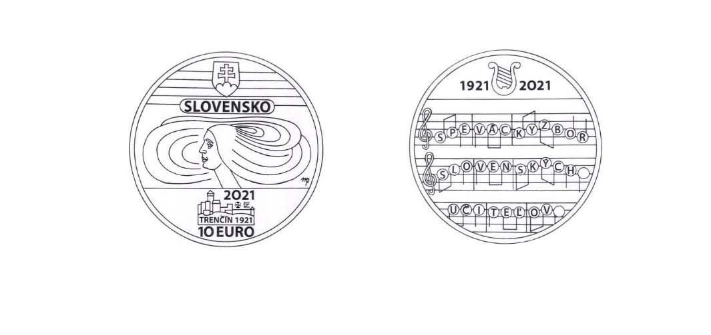

## 399

OZNÁMENIE

Národnej banky Slovenska

z 8. decembra 2020

## o vydaní strieborných zberateľských euromincí v nominálnej hodnote 10 eur pri príležitosti 100. výročia vzniku Speváckeho zboru slovenských učiteľov

1. Úvodné ustanovenia

- a) Národná banka Slovenska podľa § 17h ods. 1 zákona Národnej rady Slovenskej republiky č. 566/1992 Zb. o Národnej banke Slovenska v znení neskorších predpisov a podľa § 12 ods. 1 písm. b) zákona č. 400/2015 Z. z. o tvorbe právnych predpisov a o Zbierke zákonov Slovenskej republiky a o zmene a doplnení niektorých zákonov oznamuje, že vydáva do obehu strieborné zberateľské euromince v nominálnej hodnote 10 eur pri príležitosti 100. výročia vzniku Speváckeho zboru slovenských učiteľov (ďalej len „zberateľská eurominca“).

- b) Zberateľská eurominca má štatút zákonného platidla len v Slovenskej republike.

- c) Zberateľská eurominca sa razí zo zliatiny obsahujúcej 900 dielov striebra a 100 dielov medi; jej hmotnosť je 18 g a priemer 34 mm. Pri razbe zberateľskej euromince je povolená horná a dolná odchýlka v priemere 0,1 mm; povolená horná odchýlka v hmotnosti je 0,4 g a v obsahu striebra 10/1000.

2. Vzhľad zberateľskej euromince

- a) Na líci zberateľskej euromince je časť loga Speváckeho zboru slovenských učiteľov, ktoré tvorí profil ženskej tváre s rozviatymi vlasmi. V pravej časti loga sa nachádzajú štylizované iniciálky autora výtvarného návrhu loga, akad. soch. Mariána Polonského. V hornej časti mincového poľa je na linajkovej štruktúre štátny znak Slovenskej republiky a pod ním nápis „SLOVENSKO“. V dolnej časti mincového poľa je označenie nominálnej hodnoty „10 EURO“. Nad ním je zjednodušená silueta trenčianskeho hradu s nápisom „TRENČÍN 1921“, nad ktorou je letopočet „2021“. Značka Mincovne Kremnica, štátny podnik, ktorú tvorí skratka „MK“ umiestnená medzi dvoma razidlami a štylizované iniciálky autora zberateľskej euromince akad. soch. Zbyňka Fojtů „ZF“ sú pod letopočtom.

- b) Na rube zberateľskej euromince je v troch riadkoch notový zápis nápevu štátnej hymny Slovenskej republiky. V prvých dvoch riadkoch je na začiatku husľový kľúč. Jednotlivé noty sú vyplnené písmenami, ktoré tvoria text „SPEVÁCKY ZBOR SLOVENSKÝCH UČITEĽOV“. V hornej časti mincového poľa je štylizovaná lýra. Vľavo od nej je letopočet „1921“ a vpravo letopočet „2021“.

- c) Na hrane zberateľskej euromince je nápis do hĺbky „• DUCH NÁRODA ŽIJE V PIESNI, V ŇOM SA VZNÁŠA K VÝŠINÁM“.

- 

- Štát vydania: Slovenská republika

- Začiatok vydávania: marec 2021

Peter Kažimír v. r.
