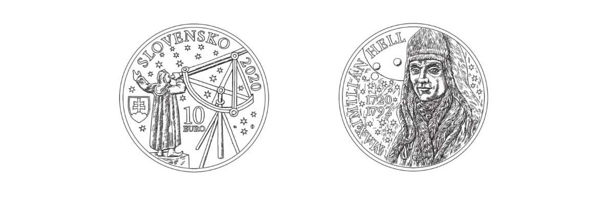

## 83

OZNÁMENIE

Národnej banky Slovenska

z 24. marca 2020

## o vydaní strieborných zberateľských euromincí v nominálnej hodnote 10 eur pri príležitosti 300. výročia narodenia Maximiliána Hella

1. Úvodné ustanovenia

- a) Národná banka Slovenska podľa § 17h ods. 1 zákona Národnej rady Slovenskej republiky č. 566/1992 Zb. o Národnej banke Slovenska v znení neskorších predpisov a podľa § 12 ods. 1 písm. b) zákona č. 400/2015 Z. z. o tvorbe právnych predpisov a o Zbierke zákonov Slovenskej republiky a o zmene a doplnení niektorých zákonov oznamuje, že vydáva do obehu strieborné zberateľské euromince v nominálnej hodnote 10 eur pri príležitosti 300. výročia narodenia Maximiliána Hella (ďalej len „zberateľská eurominca“).

- b) Zberateľská eurominca má štatút zákonného platidla len v Slovenskej republike.

- c) Zberateľská eurominca sa razí zo zliatiny obsahujúcej 900 dielov striebra a 100 dielov medi; jej hmotnosť je 18 g a priemer 34 mm. Pri razbe zberateľskej euromince je povolená horná a dolná odchýlka v priemere 0,1 mm; povolená horná odchýlka v hmotnosti je 0,4 g a v obsahu striebra 10/1000.

2. Vzhľad zberateľskej euromince

- a) Na líci zberateľskej euromince je vyobrazená postava astronóma pri pozorovaní oblohy posiatej hviezdami cez dobový ďalekohľad. Štátny znak Slovenskej republiky je vľavo od astronóma a vpravo od neho je v dvoch riadkoch označenie nominálnej hodnoty „10 EURO“. V hornej časti mincového poľa je v opise názov štátu „SLOVENSKO“ a za ním letopočet „2020“. V pravej spodnej časti mincového poľa sú štylizované iniciálky autora zberateľskej euromince Karola Lička „KL“ a značka Mincovne Kremnica, štátny podnik, ktorú tvorí skratka „MK“ umiestnená medzi dvoma razidlami.

- b) Na rube zberateľskej euromince je vyobrazený portrét Maximiliána Hella. V ľavej hornej časti mincového poľa je zobrazený prechod Venuše cez slnečný disk s hviezdami na pozadí, medzi ktorými sú umiestnené v dvoch riadkoch letopočty narodenia a úmrtia Maximiliána Hella „1720“ a „1792“. V ľavej časti mincového poľa je v opise meno a priezvisko „MAXIMILIÁN HELL“.

- c) Na hrane zberateľskej euromince je nápis do hĺbky „• PRIEKOPNÍK MODERNEJ ASTRONOMICKEJ VEDY“.

Štát vydania: Slovenská republika

Začiatok vydávania: máj 2020

Peter Kažimír v. r.
