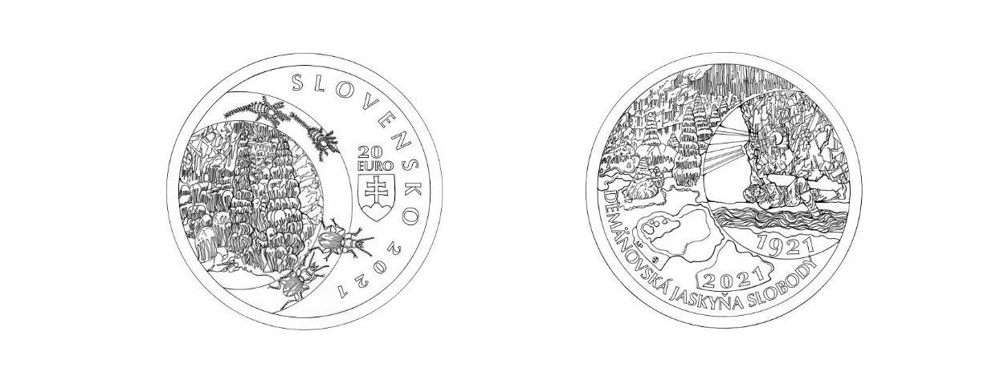

## 118

OZNÁMENIE

Národnej banky Slovenska

z 9. marca 2021

## o vydaní strieborných zberateľských euromincí v nominálnej hodnote 20 eur pri príležitosti 100. výročia objavenia Demänovskej jaskyne slobody

1. Úvodné ustanovenia

- a) Národná banka Slovenska podľa § 17h ods. 1 zákona Národnej rady Slovenskej republiky č. 566/1992 Zb. o Národnej banke Slovenska v znení neskorších predpisov a podľa § 12 ods. 1 písm. b) zákona č. 400/2015 Z. z. o tvorbe právnych predpisov a o Zbierke zákonov Slovenskej republiky a o zmene a doplnení niektorých zákonov oznamuje, že vydáva do obehu strieborné zberateľské euromince v nominálnej hodnote 20 eur pri príležitosti 100. výročia objavenia Demänovskej jaskyne slobody (ďalej len „zberateľská eurominca“).

- b) Zberateľská eurominca má štatút zákonného platidla len v Slovenskej republike.

- c) Zberateľská eurominca sa razí zo zliatiny obsahujúcej 925 dielov striebra a 75 dielov medi; jej hmotnosť je 33,63 g a priemer 40 mm. Pri razbe zberateľskej euromince je povolená horná a dolná odchýlka v priemere 0,1 mm; povolená horná odchýlka v hmotnosti je 0,4 g a v obsahu striebra 10/1 000.

2. Vzhľad zberateľskej euromince

- a) Na líci zberateľskej euromince je v kruhovom výseku vyobrazená bohatá jaskynná výzdoba doplnená vzácnymi živočíšnymi druhmi žijúcimi v Demänovskej jaskyni slobody – šťúrovkami a jaskynnými chrobákmi rodu Duvalius. V pravej časti mincového poľa je štátny znak Slovenskej republiky, nad ktorým je v dvoch riadkoch označenie nominálnej hodnoty zberateľskej euromince „20 EURO“. V kruhopise je názov štátu „SLOVENSKO“ a letopočet „2021“.

- b) Na rube zberateľskej euromince je v kruhovom výseku vyobrazená postava objaviteľa Demänovskej jaskyne slobody Aloisa Krála lezúceho suchým ponorom riečky Demänovka do podzemia. Kompozícia je doplnená svietiacou karbidkou a v spodnej časti letopočtom objavenia jaskyne „1921“. V ľavej časti mincového poľa je vyobrazená bohatá kvapľová výzdoba s jazierkami a jazernými útvarmi. V spodnom jazierku je letopočet „2021“. V spodnej časti mincového poľa je v kruhopise nápis „DEMÄNOVSKÁ JASKYŇA SLOBODY“. V jazierku nad nápisom sú štylizované iniciálky autorky výtvarného návrhu zberateľskej euromince Márie Poldaufovej „MP“ a značka Mincovne Kremnica, štátny podnik, ktorú tvorí skratka „MK“ umiestnená medzi dvoma razidlami.

- c) Na hrane zberateľskej euromince je reliéfny nápis „OCHRANA PRÍRODY A KRAJINY“. Začiatok a koniec textu je oddelený vyobrazením štylizovaného kvetu.

Štát vydania: Slovenská republika

Začiatok vydávania: jún 2021

Peter Kažimír v. r.
