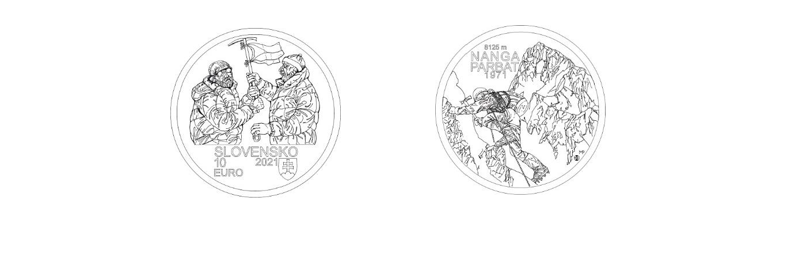

## 184

OZNÁMENIE

Národnej banky Slovenska

z 11. mája 2021

## o vydaní strieborných zberateľských euromincí v nominálnej hodnote 10 eur pri príležitosti 50. výročia zdolania prvej osemtisícovej hory Nanga Parbat slovenskými horolezcami

1. Úvodné ustanovenia

- a) Národná banka Slovenska podľa § 17h ods. 1 zákona Národnej rady Slovenskej republiky č. 566/1992 Zb. o Národnej banke Slovenska v znení neskorších predpisov a podľa § 12 ods. 1 písm. b) zákona č. 400/2015 Z. z. o tvorbe právnych predpisov a o Zbierke zákonov Slovenskej republiky a o zmene a doplnení niektorých zákonov v znení neskorších predpisov oznamuje, že vydáva do obehu strieborné zberateľské euromince v nominálnej hodnote 10 eur pri príležitosti 50. výročia zdolania prvej osemtisícovej hory Nanga Parbat slovenskými horolezcami (ďalej len „zberateľská eurominca“).

- b) Zberateľská eurominca má štatút zákonného platidla len v Slovenskej republike.

- c) Zberateľská eurominca sa razí zo zliatiny obsahujúcej 900 dielov striebra a 100 dielov medi; jej hmotnosť je 18 g a priemer 34 mm. Pri razbe zberateľskej euromince je povolená horná a dolná odchýlka v priemere 0,1 mm; povolená horná odchýlka v hmotnosti je 0,4 g a v obsahu striebra 10/1 000.

2. Vzhľad zberateľskej euromince

- a) Na líci zberateľskej euromince sú horolezci Ivan Fiala a Michal Orolín, ktorí spolu držia horolezecký čakan s československou zástavou na vrchole hory Nanga Parbat v roku 1971. Ivan Fiala drží karabínu, ktorú zanechali na vrchole hory. V spodnej časti mincového poľa je názov štátu „SLOVENSKO“. Pod ním je v dvoch riadkoch označenie nominálnej hodnoty zberateľskej euromince „10 EURO“, letopočet „2021“ a štátny znak Slovenskej republiky.

- b) Na rube zberateľskej euromince je pohľad na vrchol Nanga Parbat, v ktorého popredí je postava lezúceho horolezca. V hornej časti mincového poľa je v dvoch riadkoch názov hory „NANGA PARBAT“, nad ním je označenie jej výšky „8125 m“ a pod ním letopočet jej zdolania slovenskými horolezcami „1971“. V pravej spodnej časti mincového poľa sú štylizované iniciálky autorky výtvarného návrhu zberateľskej euromince Márie Poldaufovej „MP“ a značka Mincovne Kremnica, štátny podnik, ktorú tvorí skratka „MK“ umiestnená medzi dvoma razidlami.

- c) Na hrane zberateľskej euromince je nápis do hĺbky „• PRVÝ ÚSPECH SLOVENSKÝCH HOROLEZCOV V HIMALÁJACH“.

- 

Štát vydania: Slovenská republika

Začiatok vydávania: júl 2021

Peter Kažimír v. r.
