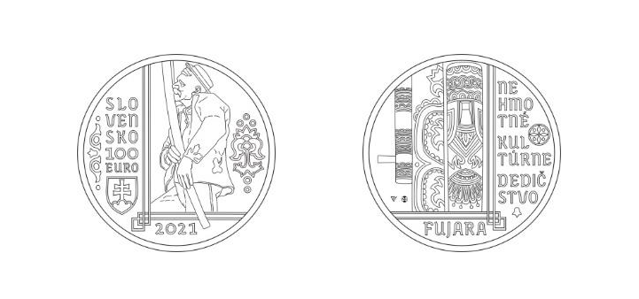

## 253

OZNÁMENIE

Národnej banky Slovenska

z 8. júna 2021

## o vydaní zlatých zberateľských euromincí v nominálnej hodnote 100 eur s tematikou Nehmotné kultúrne dedičstvo Slovenska – Fujara, hudobný nástroj a jeho hudba

1. Úvodné ustanovenia

- a) Národná banka Slovenska podľa § 17h ods. 1 zákona Národnej rady Slovenskej republiky č. 566/1992 Zb. o Národnej banke Slovenska v znení neskorších predpisov a podľa § 12 ods. 1 písm. b) zákona č. 400/2015 Z. z. o tvorbe právnych predpisov a o Zbierke zákonov Slovenskej republiky a o zmene a doplnení niektorých zákonov oznamuje, že vydáva do obehu zlaté zberateľské euromince v nominálnej hodnote 100 eur s tematikou Nehmotné kultúrne dedičstvo Slovenska – Fujara, hudobný nástroj a jeho hudba (ďalej len „zberateľská eurominca“).

- b) Zberateľská eurominca má štatút zákonného platidla len v Slovenskej republike.

- c) Zberateľská eurominca sa razí zo zliatiny obsahujúcej 900 dielov zlata, 75 dielov striebra a 25 dielov medi; jej hmotnosť je 9,5 g a priemer 26 mm. Pri razbe euromince je povolená horná a dolná odchýlka v priemere 0,1 mm; povolená horná odchýlka v hmotnosti je 0,08 g a v obsahu zlata 10/1 000.

2. Vzhľad zberateľskej euromince

- a) Na líci zberateľskej euromince je v dekoratívnom ráme vyobrazený hudobník hrajúci na fujare. Vľavo od dekoratívneho rámu je štátny znak Slovenskej republiky. Nad ním je v troch riadkoch názov štátu „SLOVENSKO“ a v dvoch riadkoch označenie nominálnej hodnoty zberateľskej euromince „100 EURO“. Pri ľavom aj pri pravom okraji zberateľskej euromince sú ľudové ornamentálne prvky. V spodnej časti mincového poľa je letopočet „2021“.

- b) Na rube zberateľskej euromince je v dekoratívnom ráme vyobrazená kompozícia fragmentov fujary s bohatým ornamentálnym zdobením a jej funkčnými detailmi. Štylizované iniciálky autora zberateľskej euromince Mgr. art. Petra Valacha „PV“ a značka Mincovne Kremnica, štátny podnik, ktorú tvorí skratka „MK“ umiestnená medzi dvoma razidlami sú vľavo od kompozície. V pravej časti mincového poľa je v siedmich riadkoch nápis „NEHMOTNÉ KULTÚRNE DEDIČSTVO“ kompozične doplnený ľudovými ornamentálnymi prvkami. V spodnej časti mincového poľa je nápis „FUJARA“.

- c) Hrana zberateľskej euromince je vrúbkovaná.

- 

Štát vydania: Slovenská republika

Začiatok vydávania: október 2021

Peter Kažimír v. r.
