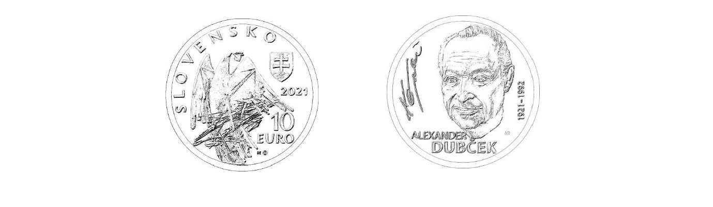

## 314

OZNÁMENIE

Národnej banky Slovenska

z 13. júla 2021

## o vydaní strieborných zberateľských euromincí v nominálnej hodnote 10 eur pri príležitosti 100. výročia narodenia Alexandra Dubčeka

1. Úvodné ustanovenia

- a) Národná banka Slovenska podľa § 17h ods. 1 zákona Národnej rady Slovenskej republiky č. 566/1992 Zb. o Národnej banke Slovenska v znení neskorších predpisov a podľa § 12 ods. 1 písm. b) zákona č. 400/2015 Z. z. o tvorbe právnych predpisov a o Zbierke zákonov Slovenskej republiky a o zmene a doplnení niektorých zákonov v znení neskorších predpisov oznamuje, že vydáva do obehu strieborné zberateľské euromince v nominálnej hodnote 10 eur pri príležitosti 100. výročia narodenia Alexandra Dubčeka (ďalej len „zberateľská eurominca“).

- b) Zberateľská eurominca má štatút zákonného platidla len v Slovenskej republike.

- c) Zberateľská eurominca sa razí zo zliatiny obsahujúcej 900 dielov striebra a 100 dielov medi; jej hmotnosť je 18 g a priemer 34 mm. Pri razbe zberateľskej euromince je povolená horná a dolná odchýlka v priemere 0,1 mm; povolená horná odchýlka v hmotnosti je 0,4 g a v obsahu striebra 10/1 000.

2. Vzhľad zberateľskej euromince

- a) Na líci zberateľskej euromince je ako symbol slobody vyobrazená holubica, do ktorej tela je kompozične vsadený náznak československej vlajky. V ľavej hornej časti mincového poľa je v opise názov štátu „SLOVENSKO“ a v pravej časti je štátny znak Slovenskej republiky. Pod ním je letopočet „2021“. V pravej spodnej časti mincového poľa je v dvoch riadkoch označenie nominálnej hodnoty „10 EURO“. Pod ním je iniciálka priezviska autora lícnej strany zberateľskej euromince Štefana Novotného „N“ a značka Mincovne Kremnica, štátny podnik, ktorú tvorí skratka „MK“ umiestnená medzi dvoma razidlami.

- b) Na rube zberateľskej euromince je portrét Alexandra Dubčeka, ktorý v ľavej časti mincového poľa dopĺňa faksimile jeho podpisu. Pod portrétom sú v dvoch riadkoch meno a priezvisko „ALEXANDER DUBČEK“ a štylizované iniciálky autora rubovej strany zberateľskej euromince Mgr. art. Martina Sabola. Vpravo od portrétu sú letopočty narodenia a úmrtia Alexandra Dubčeka „1921 – 1992“.

- c) Na hrane zberateľskej euromince je nápis do hĺbky „• ĽUDSKOSŤ – VLASTENECTVO – DEMOKRACIA“.

- 

Štát vydania: Slovenská republika

Začiatok vydávania: november 2021

v z. Karol Mrva v. r.
