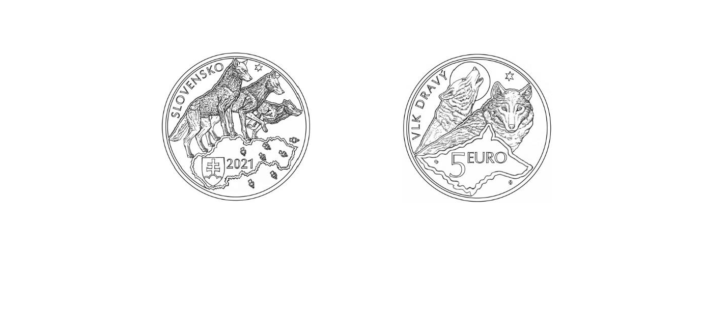

## 323

OZNÁMENIE

Národnej banky Slovenska

z 10. augusta 2021

## o vydaní zberateľských euromincí z obyčajných kovov v nominálnej hodnote 5 eur s tematikou Fauna a flóra na Slovensku – vlk dravý

1. Úvodné ustanovenia

- a) Národná banka Slovenska podľa § 17h ods. 1 zákona Národnej rady Slovenskej republiky č. 566/1992 Zb. o Národnej banke Slovenska v znení neskorších predpisov a podľa § 12 ods. 1 písm. b) zákona č. 400/2015 Z. z. o tvorbe právnych predpisov a o Zbierke zákonov Slovenskej republiky a o zmene a doplnení niektorých zákonov v znení neskorších predpisov oznamuje, že vydáva do obehu zberateľské euromince z obyčajných kovov v nominálnej hodnote 5 eur s tematikou Fauna a flóra na Slovensku – vlk dravý (ďalej len „zberateľská eurominca“).

- b) Zberateľská eurominca má štatút zákonného platidla len v Slovenskej republike.

- c) Zberateľská eurominca sa razí z mosadze MS63 (Cu63Zn37); jej hmotnosť je 19,1 g a priemer 34 mm. Pri razbe zberateľskej euromince je povolená horná a dolná odchýlka v priemere 0,1 mm; povolená horná odchýlka v hmotnosti je 0,76 g.

2. Vzhľad zberateľskej euromince

- a) Na líci zberateľskej euromince je v spodnej časti umiestnená silueta mapy Slovenskej republiky, do ktorej je vsadený štátny znak Slovenskej republiky a letopočet „2021“. Nad mapou je umiestnená trojica vlkov doplnená o ich stopy v siluete mapy aj mimo nej a o hviezdu v hornej časti mincového poľa. Nápis „SLOVENSKO“ je v opise v ľavej časti mincového poľa.

- b) Na rube zberateľskej euromince je kompozícia dvoch vlkov, z ktorých jeden vyje na mesiac. Kompozíciu dopĺňa hviezda na nočnej oblohe v hornej časti mincového poľa a silueta ďalšieho vlka v spodnej časti mincového poľa. Označenie nominálnej hodnoty „5 EURO“ je vo vnútri siluety. V ľavej časti mincového poľa je v opise nápis „VLK DRAVÝ“. Vľavo od nominálnej hodnoty sú štylizované iniciálky autora MgA. Josefa Oplištila. V pravej časti mincového poľa pod siluetou je značka Mincovne Kremnica, štátny podnik, ktorú tvorí skratka „MK“ umiestnená medzi dvoma razidlami.

- c) Hrana zberateľskej euromince je vrúbkovaná.

- 

Štát vydania: Slovenská republika

Začiatok vydávania: september 2021

v z. Ľudovít Ódor v. r.
