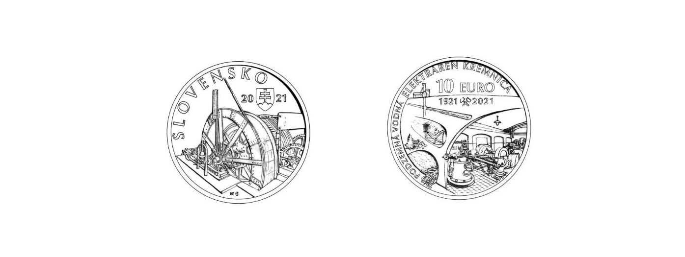

## 48

OZNÁMENIE

Národnej banky Slovenska

z 26. januára 2021

## o vydaní strieborných zberateľských euromincí v nominálnej hodnote 10 eur pri príležitosti 100. výročia uvedenia do prevádzky podzemnej vodnej elektrárne v Kremnici

1. Úvodné ustanovenia

- a) Národná banka Slovenska podľa § 17h ods. 1 zákona Národnej rady Slovenskej republiky č. 566/1992 Zb. o Národnej banke Slovenska v znení neskorších predpisov a podľa § 12 ods. 1 písm. b) zákona č. 400/2015 Z. z. o tvorbe právnych predpisov a o Zbierke zákonov Slovenskej republiky a o zmene a doplnení niektorých zákonov oznamuje, že vydáva do obehu strieborné zberateľské euromince v nominálnej hodnote 10 eur pri príležitosti 100. výročia uvedenia do prevádzky podzemnej vodnej elektrárne v Kremnici (ďalej len „zberateľská eurominca“).

- b) Zberateľská eurominca má štatút zákonného platidla len v Slovenskej republike.

- c) Zberateľská eurominca sa razí zo zliatiny obsahujúcej 900 dielov striebra a 100 dielov medi; jej hmotnosť je 18 g a priemer 34 mm. Pri razbe zberateľskej euromince je povolená horná a dolná odchýlka v priemere 0,1 mm; povolená horná odchýlka v hmotnosti je 0,4 g a v obsahu striebra 10/1 000.

2. Vzhľad zberateľskej euromince

- a) Na líci zberateľskej euromince je unikátne koleso ťažného stroja obsluhujúceho šachtu nad podzemnou vodnou elektrárňou v Kremnici. V pravej časti mincového poľa je štátny znak Slovenskej republiky, ktorý je kompozične vsadený doprostred letopočtu „2021“. Pri hornom okraji zberateľskej euromince je v opise názov štátu „SLOVENSKO“. Iniciálka priezviska autora výtvarného návrhu euromince Štefana Novotného „N“ a značka Mincovne Kremnica, štátny podnik, ktorú tvorí skratka „MK“ umiestnená medzi dvoma razidlami, sú v spodnej časti mincového poľa.

- b) Na rube zberateľskej euromince je kompozícia zemského povrchu s nadzemnou časťou banských objektov spojených s Turčekovským banským vodovodom a banskými dielami pod povrchom. Kompozícii v jej pravej časti dominuje strojové zariadenie podzemnej vodnej elektrárne. V ľavej časti mincového poľa je v hornom priezore križovatka banských chodieb a v spodnom odtok vody z dedičnej štôlne. Pri okraji zberateľskej euromince je v opise nápis „PODZEMNÁ VODNÁ ELEKTRÁREŇ KREMNICA“. V hornej časti mincového poľa je označenie nominálnej hodnoty „10 EURO“. Pod ním sú letopočty „1921“ a „2021“, ktoré sú od seba oddelené baníckym znakom.

- c) Na hrane zberateľskej euromince je nápis do hĺbky „• ELEKTRINA – NOVÉ ZLATO PRE KREMNICKÝCH BANÍKOV“.

- 

Štát vydania: Slovenská republika

Začiatok vydávania: apríl 2021

Peter Kažimír v. r.
