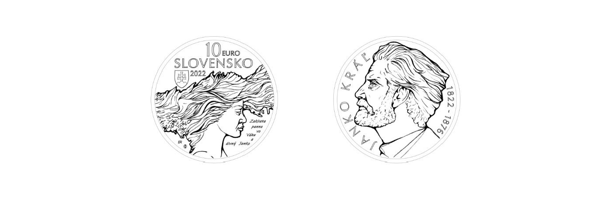

## 549

OZNÁMENIE

Národnej banky Slovenska

zo 7. decembra 2021

## o vydaní strieborných zberateľských euromincí v nominálnej hodnote 10 eur pri príležitosti 200. výročia narodenia Janka Kráľa

1. Úvodné ustanovenia

- a) Národná banka Slovenska podľa § 17h ods. 1 zákona Národnej rady Slovenskej republiky č. 566/1992 Zb. o Národnej banke Slovenska v znení neskorších predpisov a podľa § 12 ods. 1 písm. b) zákona č. 400/2015 Z. z. o tvorbe právnych predpisov a o Zbierke zákonov Slovenskej republiky a o zmene a doplnení niektorých zákonov v znení neskorších predpisov oznamuje, že vydáva do obehu strieborné zberateľské euromince v nominálnej hodnote 10 eur pri príležitosti 200. výročia narodenia Janka Kráľa (ďalej len „zberateľská eurominca“).

- b) Zberateľská eurominca má štatút zákonného platidla len v Slovenskej republike.

- c) Zberateľská eurominca sa razí zo zliatiny obsahujúcej 900 dielov striebra a 100 dielov medi; jej hmotnosť je 18 g a priemer 34 mm. Pri razbe zberateľskej euromince je povolená horná a dolná odchýlka v priemere 0,1 mm; povolená horná odchýlka v hmotnosti je 0,4 g a v obsahu striebra 10/1 000.

2. Vzhľad zberateľskej euromince

- a) Na líci zberateľskej euromince je názov balady Janka Kráľa „Zakliata panna vo Váhu a divný Janko“ s fiktívnym portrétom zakliatej panny s rozpustenými zvlnenými vlasmi symbolizujúcimi vlny rieky Váh. Vľavo od portrétu sú štylizované iniciálky autora výtvarného návrhu zberateľskej euromince Branislava Ronaia „BR“ a značka Mincovne Kremnica, štátny podnik, ktorú tvorí skratka „MK“ umiestnená medzi dvoma razidlami. Nad portrétom je štátny znak Slovenskej republiky a letopočet razby „2022“. V hornej časti mincového poľa je označenie nominálnej hodnoty zberateľskej euromince „10 EURO“ a pod ním názov štátu „SLOVENSKO“.

- b) Na rube zberateľskej euromince je fiktívny portrét Janka Kráľa. Vľavo od neho je v opise meno a priezvisko „JANKO KRÁĽ“. Vpravo sú v opise letopočty jeho narodenia a úmrtia „1822 – 1876“.

- c) Na hrane zberateľskej euromince je nápis do hĺbky „• SLOVENSKÝ ROMANTICKÝ BÁSNIK A BALADIK“.

- 

Štát vydania: Slovenská republika

Začiatok vydávania: marec 2022

Peter Kažimír v. r.
