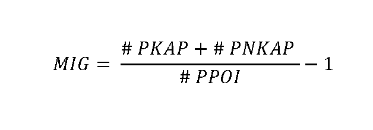

Príloha č. 2 k nariadeniu vlády č. 11/2022 Z. z.

- Spôsob určenia hodnôt vnútroštátnej migrácie

  - 1. Hodnoty vnútroštátnej migrácie sa určia osobitne pre všeobecnú ambulantnú starostlivosť pre dospelých a osobitne pre všeobecnú ambulantnú starostlivosť pre deti a dorast podľa vzorca

    - 

  - # PKAP | počet prepočítaných kapitovaných poistencov vypočítaný podľa bodu 1.1.

  - # PNKAP | počet prepočítaných nekapitovaných poistencov vypočítaný podľa bodu 1.2.

  - # PPOI | počet prepočítaných poistencov v okrese podľa prílohy č. 1 tretieho bodu

    - 1.1. Počet prepočítaných kapitovaných poistencov sa určí podľa vzorca

      - 

      - #

      - P

      - K

      - A

      - P

      - =

      - ∑

      - P

      - K

      - A

      - P

      - v

      - e

      - k

      - 1

      - -

      - 18

      - 

      - #

      - P

      - K

      - A

      - P

      - v

      - e

      - k

      - 1

      - -

      - 18

      - =

      - #

      - K

      - A

      - P

      - v

      - e

      - k

      - 1

      - -

      - 18

      - ×

      - I

      - N

      - D

      - E

      - X

      - v

      - e

      - k

      - 1

      - -

      - 18

    - ∑ PKAPvek1-18 | súčet počtu prepočítaných kapitovaných poistencov podľa bodu 1.3. v príslušných vekových skupinách podľa prílohy č. 3 šiesteho bodu

    - # PKAPvek1-18 | počet prepočítaných kapitovaných poistencov v príslušnej vekovej skupine podľa prílohy č. 3 šiesteho bodu

    - # KAPvek1-18 | počet kapitovaných poistencov v príslušnej vekovej skupine podľa prílohy č. 3 šiesteho bodu

    - INDEXvek1-18 | hodnota indexu náročnosti poistenca príslušnej vekovej skupiny podľa prílohy č. 1 štvrtého bodu

    - 1.2. Počet prepočítaných nekapitovaných poistencov sa určí podľa vzorca

      - 

      - #

      - P

      - N

      - K

      - A

      - P

      - =

      - ∑

      - P

      - N

      - K

      - A

      - P

      - v

      - e

      - k

      - 1

      - -

      - 18

      - 

      - #

      - P

      - N

      - K

      - A

      - P

      - v

      - e

      - k

      - 1

      - -

      - 18

      - =

      - #

      - N

      - K

      - A

      - P

      - v

      - e

      - k

      - 1

      - -

      - 18

      - ×

      - I

      - N

      - D

      - E

      - X

      - v

      - e

      - k

      - 1

      - -

      - 18

    - ∑ PNKAPvek1-18 | súčet počtu prepočítaných nekapitovaných poistencov podľa bodu 1.4. v príslušných vekových skupinách podľa prílohy č. 3 šiesteho bodu

    - # PNKAPvek1-18 | počet nekapitovaných poistencov v príslušnej vekovej skupine podľa prílohy č. 3 šiesteho bodu

    - # NKAPvek1-18 | počet nekapitovaných poistencov v príslušnej vekovej skupine podľa prílohy č. 3 šiesteho bodu

    - INDEXvek1-18 | hodnota indexu náročnosti poistenca príslušnej vekovej skupiny podľa prílohy č. 1 štvrtého bodu

    - 1.3. Skupinu kapitovaných poistencov na výpočet

      - a) hodnôt vnútroštátnej migrácie v minimálnej sieti poskytovateľov všeobecnej ambulantnej starostlivosti pre dospelých tvoria poistenci kapitovaní u poskytovateľov všeobecnej ambulantnej starostlivosti pre dospelých s miestom prevádzkovania ambulancie všeobecného lekárstva v okrese,

      - b) hodnôt vnútroštátnej migrácie v minimálnej sieti poskytovateľov všeobecnej ambulantnej starostlivosti pre deti a dorast tvoria poistenci kapitovaní u poskytovateľov všeobecnej ambulantnej starostlivosti pre deti a dorast s miestom prevádzkovania ambulancie všeobecného lekárstva pre deti a dorast v okrese.

    - 1.4. Skupinu nekapitovaných poistencov na výpočet

      - a) hodnôt vnútroštátnej migrácie v minimálnej sieti poskytovateľov všeobecnej ambulantnej starostlivosti pre dospelých tvorí polovica nekapitovaných poistencov vo veku 19 až 24 rokov s trvalým pobytom v okrese spolu so všetkými nekapitovanými poistencami vo veku 25 a viac rokov s trvalým pobytom v okrese,

      - b) hodnôt vnútroštátnej migrácie v minimálnej sieti poskytovateľov všeobecnej ambulantnej starostlivosti pre deti a dorast tvoria všetci nekapitovaní poistenci do veku 18 rokov s trvalým pobytom v okrese a spolu s polovicou nekapitovaných poistencov vo veku 19 až 24 rokov s trvalým pobytom v okrese.

  - 2. Vnútroštátna migrácia môže nadobúdať kladné aj záporné hodnoty.

  - 3. Hodnoty vnútroštátnej migrácie sa zohľadňujú, ak je priemer súčtu prepočítaných kapitovaných poistencov a prepočítaných nekapitovaných poistencov v okrese na jedno lekárske miesto po zaokrúhlení matematicky na stovky nižší ako normatívny počet kapitovaných poistencov.
