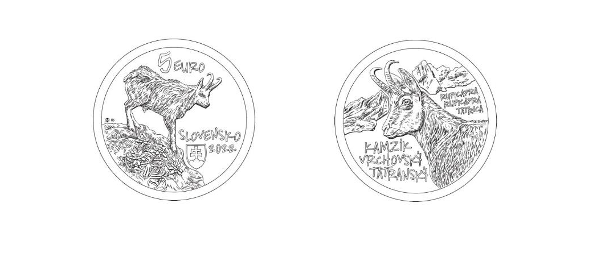

## 140

OZNÁMENIE

Národnej banky Slovenska

z 11. apríla 2022

## o vydaní zberateľských euromincí z obyčajných kovov v nominálnej hodnote 5 eur s tematikou Fauna a flóra na Slovensku – kamzík vrchovský tatranský

1. Úvodné ustanovenia

- a) Národná banka Slovenska podľa § 17h ods. 1 zákona Národnej rady Slovenskej republiky č. 566/1992 Zb. o Národnej banke Slovenska v znení neskorších predpisov a podľa § 12 ods. 1 písm. b) zákona č. 400/2015 Z. z. o tvorbe právnych predpisov a o Zbierke zákonov Slovenskej republiky a o zmene a doplnení niektorých zákonov v znení neskorších predpisov oznamuje, že vydáva do obehu zberateľské euromince z obyčajných kovov v nominálnej hodnote 5 eur s tematikou Fauna a flóra na Slovensku – kamzík vrchovský tatranský (ďalej len „zberateľská eurominca“).

- b) Zberateľská eurominca má štatút zákonného platidla len v Slovenskej republike.

- c) Zberateľská eurominca sa razí z mosadze MS63 (Cu63Zn37); jej hmotnosť je 19,1 g a priemer 34 mm. Pri razbe zberateľskej euromince je povolená horná a dolná odchýlka v priemere 0,1 mm; povolená horná odchýlka v hmotnosti je 0,76 g.

2. Vzhľad zberateľskej euromince

- a) Na líci zberateľskej euromince je zobrazený kamzík vrchovský tatranský stojaci na skale, na ktorej rastie chránený plesnivec alpínsky. Názov štátu „SLOVENSKO“ je napravo od kamzíka. Pod ním je štátny znak Slovenskej republiky a letopočet razby „2022“. Nominálna hodnota „5 EURO“ je v hornej časti mincového poľa. Značka Mincovne Kremnica, štátny podnik, ktorú tvorí skratka „MK“ umiestnená medzi dvoma razidlami a štylizované iniciálky autora zberateľskej euromince Karola Lička „KL“ sú pri ľavom okraji zberateľskej euromince.

- b) Na rube zberateľskej euromince je zobrazený kamzík vrchovský tatranský so skalným pohorím v pozadí. Napravo od kamzíka je v troch riadkoch jeho latinský názov „RUPICAPRA RUPICAPRA TATRICA“ a naľavo od neho v troch riadkoch slovenský názov „KAMZÍK VRCHOVSKÝ TATRANSKÝ“.

- c) Hrana zberateľskej euromince je vrúbkovaná.

- 

Štát vydania: Slovenská republika

Začiatok vydávania: jún 2022

Peter Kažimír v. r.
