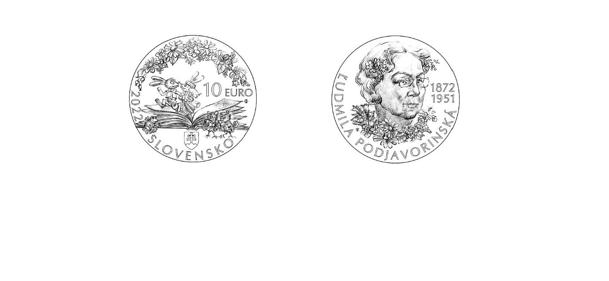

## 15

OZNÁMENIE

Národnej banky Slovenska

z 11. januára 2022

## o vydaní strieborných zberateľských euromincí v nominálnej hodnote 10 eur pri príležitosti 150. výročia narodenia Ľudmily Podjavorinskej

1. Úvodné ustanovenia

- a) Národná banka Slovenska podľa § 17h ods. 1 zákona Národnej rady Slovenskej republiky č. 566/1992 Zb. o Národnej banke Slovenska v znení neskorších predpisov a podľa § 12 ods. 1 písm. b) zákona č. 400/2015 Z. z. o tvorbe právnych predpisov a o Zbierke zákonov Slovenskej republiky a o zmene a doplnení niektorých zákonov v znení neskorších predpisov oznamuje, že vydáva do obehu strieborné zberateľské euromince v nominálnej hodnote 10 eur pri príležitosti 150. výročia narodenia Ľudmily Podjavorinskej (ďalej len „zberateľská eurominca“).

- b) Zberateľská eurominca má štatút zákonného platidla len v Slovenskej republike.

- c) Zberateľská eurominca sa razí zo zliatiny obsahujúcej 900 dielov striebra a 100 dielov medi; jej hmotnosť je 18 g a priemer 34 mm. Pri razbe zberateľskej euromince je povolená horná a dolná odchýlka v priemere 0,1 mm; povolená horná odchýlka v hmotnosti je 0,4 g a v obsahu striebra 10/1 000.

2. Vzhľad zberateľskej euromince

- a) Na líci zberateľskej euromince je otvorená kniha s motívmi diel Ľudmily Podjavorinskej Zajko Bojko, Žabiatko a Čin-čin. Doplnená je girlandou kvetov v hornej časti mincového poľa. Pod knihou je štátny znak Slovenskej republiky a v opise názov štátu „SLOVENSKO“. V ľavej časti mincového poľa je v opise letopočet razby „2022“. V pravej časti mincového poľa je označenie nominálnej hodnoty zberateľskej euromince „10 EURO“ a pod ním je značka Mincovne Kremnica, štátny podnik, ktorú tvorí skratka „MK“ umiestnená medzi dvoma razidlami.

- b) Na rube zberateľskej euromince je portrét Ľudmily Podjavorinskej v kompozícii s girlandou kvetov a dvomi vrabčiakmi z jej diela Čin-čin. Vpravo od kompozície sú v dvoch riadkoch letopočty jej narodenia a úmrtia „1872“ a „1951“ a vľavo od nej je značka autora výtvarného návrhu zberateľskej euromince Asamata Baltaeva, DiS. V opise zľava doprava je meno a priezvisko „ĽUDMILA PODJAVORINSKÁ“.

- c) Na hrane zberateľskej euromince je nápis do hĺbky „• SPISOVATEĽKA A AKTIVISTKA MATICE SLOVENSKEJ“.

- 

Štát vydania: Slovenská republika

Začiatok vydávania: apríl 2022

Peter Kažimír v. r.
