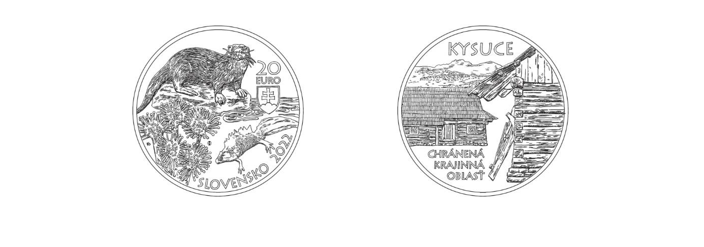

## 173

OZNÁMENIE

Národnej banky Slovenska

z 10. mája 2022

## o vydaní strieborných zberateľských euromincí v nominálnej hodnote 20 eur s tematikou Chránená krajinná oblasť Kysuce

1. Úvodné ustanovenia

- a) Národná banka Slovenska podľa § 17h ods. 1 zákona Národnej rady Slovenskej republiky č. 566/1992 Zb. o Národnej banke Slovenska v znení neskorších predpisov a podľa § 12 ods. 1 písm. b) zákona č. 400/2015 Z. z. o tvorbe právnych predpisov a o Zbierke zákonov Slovenskej republiky a o zmene a doplnení niektorých zákonov oznamuje, že vydáva do obehu strieborné zberateľské euromince v nominálnej hodnote 20 eur s tematikou Chránená krajinná oblasť Kysuce (ďalej len „zberateľská eurominca“).

- b) Zberateľská eurominca má štatút zákonného platidla len v Slovenskej republike.

- c) Zberateľská eurominca sa razí zo zliatiny obsahujúcej 925 dielov striebra a 75 dielov medi; jej hmotnosť je 33,63 g a priemer 40 mm. Pri razbe zberateľskej euromince je povolená horná a dolná odchýlka v priemere 0,1 mm; povolená horná odchýlka v hmotnosti je 0,4 g a v obsahu striebra 10/1000.

2. Vzhľad zberateľskej euromince

- a) Na líci zberateľskej euromince je vyobrazená vydra riečna v kompozícii s mlokom hrebenatým a rosičkou okrúhlolistou. V pravej časti mincového poľa je štátny znak Slovenskej republiky, nad ktorým je v dvoch riadkoch nominálna hodnota zberateľskej euromince „20 EURO“. V spodnej časti mincového poľa je v opise názov štátu „SLOVENSKO“ a za ním letopočet „2022“. Vľavo od rosičky okrúhlolistej sú štylizované iniciálky autora zberateľskej euromince Karola Lička „KL“ a vpravo od nej je značka Mincovne Kremnica, štátny podnik, ktorú tvorí skratka „MK“ umiestnená medzi dvoma razidlami.

- b) Na rube zberateľskej euromince sú dve typické kysucké drevenice so šindľovou strechou z osady „Brízgalky“, jedna v pohľade spredu a druhá, o ktorú sú opreté sane, zboku. Za drevenicami je vyobrazený typický krajinný motív − kysucké kopce a za nimi vrchy Stoh a Rozsutec. V spodnej časti mincového poľa je v troch riadkoch nápis „CHRÁNENÁ KRAJINNÁ OBLASŤ“ a v hornej časti je nápis „KYSUCE“.

- c) Na hrane zberateľskej euromince je reliéfny nápis „OCHRANA PRÍRODY A KRAJINY“. Začiatok a koniec textu je oddelený vyobrazením štylizovaného kvetu.

- 

Štát vydania: Slovenská republika

Začiatok vydávania: jún 2022

Peter Kažimír v. r.
