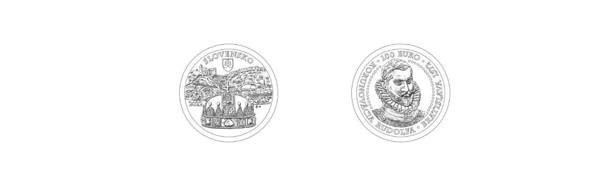

## 174

OZNÁMENIE

Národnej banky Slovenska

z 10. mája 2022

## o vydaní zlatých zberateľských euromincí v nominálnej hodnote 100 eur s tematikou Bratislavské korunovácie – 450. výročie korunovácie Rudolfa

1. Úvodné ustanovenia

- a) Národná banka Slovenska podľa § 17h ods. 1 zákona Národnej rady Slovenskej republiky č. 566/1992 Zb. o Národnej banke Slovenska v znení neskorších predpisov a podľa § 12 ods. 1 písm. b) zákona č. 400/2015 Z. z. o tvorbe právnych predpisov a o Zbierke zákonov Slovenskej republiky a o zmene a doplnení niektorých zákonov oznamuje, že vydáva do obehu zlaté zberateľské euromince v nominálnej hodnote 100 eur s tematikou Bratislavské korunovácie – 450. výročie korunovácie Rudolfa (ďalej len „zberateľská eurominca“).

- b) Zberateľská eurominca má štatút zákonného platidla len v Slovenskej republike.

- c) Zberateľská eurominca sa razí zo zliatiny obsahujúcej 900 dielov zlata, 75 dielov striebra a 25 dielov medi; jej hmotnosť je 9,5 g a priemer 26 mm. Pri razbe euromince je povolená horná a dolná odchýlka v priemere 0,1 mm; povolená horná odchýlka v hmotnosti je 0,08 g a v obsahu zlata 10/1 000.

2. Vzhľad zberateľskej euromince

- a) Na líci zberateľskej euromince je uhorská kráľovská koruna, ktorú na pozadí dopĺňa dobové zobrazenie Bratislavy. Názov štátu „SLOVENSKO“ je v opise pri hornom okraji mincového poľa a pod ním je štátny znak Slovenskej republiky. Naľavo od kráľovskej koruny je letopočet „2022“. Značka Mincovne Kremnica, štátny podnik, ktorú tvorí skratka „MK“ umiestnená medzi dvoma razidlami, a štylizované iniciálky autora zberateľskej euromince Karola Lička „KL“ sú napravo od kráľovskej koruny.

- b) Na rube zberateľskej euromince je portrét kráľa Rudolfa, ktorý je po oboch stranách doplnený ozdobným ornamentom – perlovcom. V hornej časti mincového poľa je v opise označenie nominálnej hodnoty „100 EURO“. Zľava doprava sú v opise nápisy „KORUNOVÁCIA RUDOLFA“ a „BRATISLAVA 1572“, ktoré sú od seba a od označenia nominálnej hodnoty oddelené grafickými značkami.

- c) Hrana zberateľskej euromince je vrúbkovaná.

- 

Štát vydania: Slovenská republika

Začiatok vydávania: júl 2022

Peter Kažimír v. r.
