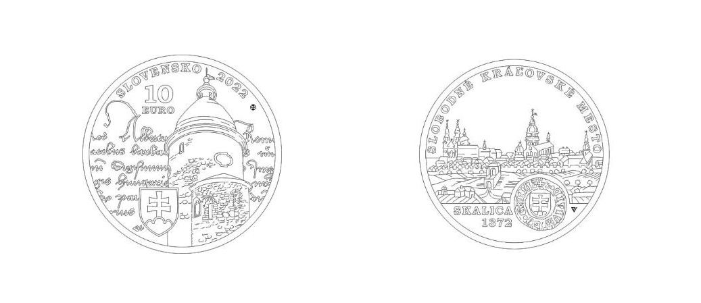

## 215

OZNÁMENIE

Národnej banky Slovenska

zo 6. júna 2022

## o vydaní strieborných zberateľských euromincí v nominálnej hodnote 10 eur pri príležitosti 650. výročia povýšenia Skalice na slobodné kráľovské mesto

1. Úvodné ustanovenia

- a) Národná banka Slovenska podľa § 17h ods. 1 zákona Národnej rady Slovenskej republiky č. 566/1992 Zb. o Národnej banke Slovenska v znení neskorších predpisov a podľa § 12 ods. 1 písm. b) zákona č. 400/2015 Z. z. o tvorbe právnych predpisov a o Zbierke zákonov Slovenskej republiky a o zmene a doplnení niektorých zákonov v znení neskorších predpisov oznamuje, že vydáva do obehu strieborné zberateľské euromince v nominálnej hodnote 10 eur pri príležitosti 650. výročia povýšenia Skalice na slobodné kráľovské mesto (ďalej len „zberateľská eurominca“).

- b) Zberateľská eurominca má štatút zákonného platidla len v Slovenskej republike.

- c) Zberateľská eurominca sa razí zo zliatiny obsahujúcej 900 dielov striebra a 100 dielov medi; jej hmotnosť je 18 g a priemer 34 mm. Pri razbe zberateľskej euromince je povolená horná a dolná odchýlka v priemere 0,1 mm; povolená horná odchýlka v hmotnosti je 0,4 g a v obsahu striebra 10/1 000.

2. Vzhľad zberateľskej euromince

- a) Na líci zberateľskej euromince je vyobrazená Rotunda svätého Juraja v kompozícií s autografom gotickej listiny, ktorou kráľ Albrecht I. potvrdzuje Skalici staršie výsady mesta. V spodnej časti mincového poľa je štátny znak Slovenskej republiky. V hornej časti mincového poľa je v opise názov štátu „SLOVENSKO“, letopočet „2022“ a značka Mincovne Kremnica, štátny podnik, ktorú tvorí skratka „MK“ umiestnená medzi dvoma razidlami. Pod názvom štátu je v dvoch riadkoch nominálna hodnota „10 EURO“.

- b) Na rube zberateľskej euromince je silueta dobovej podoby mesta Skalica doplnená o historickú pečať mesta. V hornej časti je v opise nápis „SLOBODNÉ KRÁĽOVSKÉ MESTO“. V ľavej spodnej časti mincového poľa je názov mesta „SKALICA“ a pod ním letopočet „1372“. Štylizované iniciálky autora zberateľskej euromince Mgr. art. Petra Valacha sú v pravej spodnej časti.

- c) Na hrane zberateľskej euromince je nápis do hĺbky „• SKALICA – SLOBODNÉ KRÁĽOVSKÉ MESTO – 1372“.

- 

- Štát vydania: Slovenská republika

- Začiatok vydávania: august 2022

Peter Kažimír v. r.
