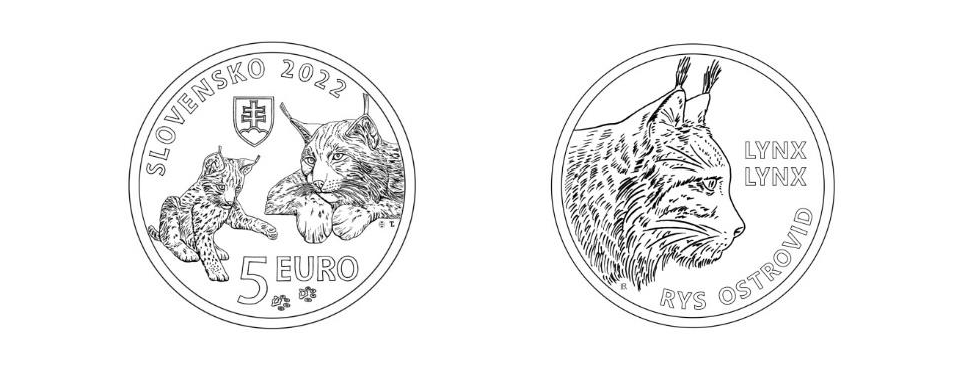

## 216

OZNÁMENIE

Národnej banky Slovenska

zo 6. júna 2022

## o vydaní zberateľských euromincí z obyčajných kovov v nominálnej hodnote 5 eur s tematikou Fauna a flóra na Slovensku – rys ostrovid

1. Úvodné ustanovenia

- a) Národná banka Slovenska podľa § 17h ods. 1 zákona Národnej rady Slovenskej republiky č. 566/1992 Zb. o Národnej banke Slovenska v znení neskorších predpisov a podľa § 12 ods. 1 písm. b) zákona č. 400/2015 Z. z. o tvorbe právnych predpisov a o Zbierke zákonov Slovenskej republiky a o zmene a doplnení niektorých zákonov v znení neskorších predpisov oznamuje, že vydáva do obehu zberateľské euromince z obyčajných kovov v nominálnej hodnote 5 eur s tematikou Fauna a flóra na Slovensku – rys ostrovid (ďalej len „zberateľská eurominca“).

- b) Zberateľská eurominca má štatút zákonného platidla len v Slovenskej republike.

- c) Zberateľská eurominca sa razí z mosadze MS63 (Cu63Zn37); jej hmotnosť je 19,1 g a priemer 34 mm. Pri razbe zberateľskej euromince je povolená horná a dolná odchýlka v priemere 0,1 mm; povolená horná odchýlka v hmotnosti je 0,76 g.

2. Vzhľad zberateľskej euromince

- a) Na líci zberateľskej euromince je vyobrazené mláďa rysa ostrovida v kompozícii s dospelým jedincom, pod ktorým je značka Mincovne Kremnica, štátny podnik, ktorú tvorí skratka „MK“ umiestnená medzi dvoma razidlami a štylizované iniciálky autora lícnej strany zberateľskej euromince Tomáša Lamača, DiS. „TL“. V hornej časti mincového poľa je v opise názov štátu „SLOVENSKO“ a letopočet „2022“. Pod nimi je štátny znak Slovenskej republiky. V spodnej časti mincového poľa sú dva odtlačky stôp rysa ostrovida a nad nimi je nominálna hodnota „5 EURO“.

- b) Na rube zberateľskej euromince je z profilu zobrazená hlava rysa ostrovida, ktorá je v pravej časti mincového poľa doplnená jeho latinským názvom v dvoch riadkoch „LYNX LYNX“. Pod hlavou rysa ostrovida sú štylizované iniciálky autora rubovej strany zberateľskej euromince Mgr. art. Romana Lugára „LR“. V spodnej časti mincového poľa je v opise slovenský názov „RYS OSTROVID“.

- c) Hrana zberateľskej euromince je vrúbkovaná.

- 

- Štát vydania: Slovenská republika

- Začiatok vydávania: august 2022

Peter Kažimír v. r.
