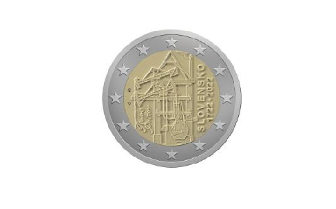

## 217

OZNÁMENIE

Národnej banky Slovenska

zo 6. júna 2022

## o vydaní pamätných euromincí v nominálnej hodnote 2 eurá pri príležitosti 300. výročia zostrojenia prvého parného stroja na odčerpávanie vody z baní v kontinentálnej Európe

1. Úvodné ustanovenia

- a) Národná banka Slovenska podľa § 17h ods. 1 zákona Národnej rady Slovenskej republiky č. 566/1992 Zb. o Národnej banke Slovenska v znení neskorších predpisov a podľa § 12 ods. 1 písm. b) zákona č. 400/2015 Z. z. o tvorbe právnych predpisov a o Zbierke zákonov Slovenskej republiky a o zmene a doplnení niektorých zákonov oznamuje, že pri príležitosti 300. výročia zostrojenia prvého parného stroja na odčerpávanie vody z baní v kontinentálnej Európe vydáva do obehu pamätné euromince v nominálnej hodnote 2 eurá (ďalej len „pamätná eurominca“).

- b) Pamätná eurominca má rovnaké technické parametre ako obehové euromince1) a na jej národnej strane je použitý pamätný motív podľa bodu 2 písm. b).

- c) Pamätná eurominca má štatút zákonného platidla v celej eurozóne.

2. Vzhľad pamätnej euromince

- a) Pamätná eurominca sa vydáva s novou spoločnou európskou stranou.2)

- b) Na národnej strane pamätnej euromince je vyobrazený parný stroj používaný na odčerpávanie vody z baní, ktorý bol zostrojený v roku 1722 v Novej Bani ako prvý svojho druhu na území kontinentálnej Európy. Jeho autorom bol anglický inžinier Isaac Potter, ktorého faksimile podpisu je v dvoch riadkoch zdola nahor v ľavej spodnej časti mincového poľa. Vpravo od stroja je zdola nahor názov štátu „SLOVENSKO“ a letopočty „1722“ a „2022“ oddelené grafickou značkou. Pri ľavom okraji vnútorného kruhu je značka Mincovne Kremnica, štátny podnik, ktorú tvorí skratka „MK“ umiestnená medzi dvoma razidlami a štylizované iniciálky autora výtvarného návrhu národnej strany pamätnej euromince Mgr. art. Petra Valacha. Vo vonkajšom prstenci pamätnej euromince je vyobrazených dvanásť hviezd vlajky Európskej únie.

- c) Na hrane pamätnej euromince je nápis „SLOVENSKÁ REPUBLIKA“. Začiatok a koniec nápisu je oddelený dvoma hviezdami, medzi ktorými je lipový list.

- 

- Štát vydania: Slovenská republika

- Začiatok vydávania: október 2022

Peter Kažimír v. r.
