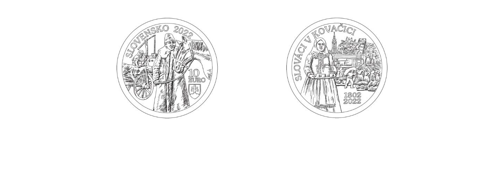

## 285

OZNÁMENIE

Národnej banky Slovenska

z 26. júla 2022

## o vydaní strieborných zberateľských euromincí v nominálnej hodnote 10 eur pri príležitosti 220. výročia začatia osídľovania Kovačice Slovákmi

1. Úvodné ustanovenia

- a) Národná banka Slovenska podľa § 17h ods. 1 zákona Národnej rady Slovenskej republiky č. 566/1992 Zb. o Národnej banke Slovenska v znení neskorších predpisov a podľa § 12 ods. 1 písm. b) zákona č. 400/2015 Z. z. o tvorbe právnych predpisov a o Zbierke zákonov Slovenskej republiky a o zmene a doplnení niektorých zákonov v znení neskorších predpisov oznamuje, že vydáva do obehu strieborné zberateľské euromince v nominálnej hodnote 10 eur pri príležitosti 220. výročia začatia osídľovania Kovačice Slovákmi (ďalej len „zberateľská eurominca“).

- b) Zberateľská eurominca má štatút zákonného platidla len v Slovenskej republike.

- c) Zberateľská eurominca sa razí zo zliatiny obsahujúcej 900 dielov striebra a 100 dielov medi; jej hmotnosť je 18 g a priemer 34 mm. Pri razbe zberateľskej euromince je povolená horná a dolná odchýlka v priemere 0,1 mm; povolená horná odchýlka v hmotnosti je 0,4 g a v obsahu striebra 10/1 000.

2. Vzhľad zberateľskej euromince

- a) Na líci zberateľskej euromince je Kovačičan oblečený v dobovom kožuchu držiaci koňa na vôdzke. Za ním sedia na voze dve ženy a kompozíciu dopĺňa vahadlová studňa. Pod studňou je značka Mincovne Kremnica, štátny podnik, ktorú tvorí skratka „MK“ umiestnená medzi dvoma razidlami, a štylizované iniciálky autora zberateľskej euromince Karola Lička „KL“. V pravej spodnej časti je štátny znak Slovenskej republiky, nad ktorým je v dvoch riadkoch nominálna hodnota „10 EURO“. Názov štátu „SLOVENSKO“ a letopočet „2022“ sú v opise v hornej časti mincového poľa.

- b) Na rube zberateľskej euromince je v kompozícií Kovačičanka oblečená v dobovom ľudovom odeve s výjavom mlátenia obilia a evanjelickým kostolom v Kovačici v pozadí. V ľavej časti mincového poľa je v opise nápis „SLOVÁCI V KOVAČICI“. Letopočty „1802“ a „2022“ sú v dvoch riadkoch v spodnej časti mincového poľa.

- c) Na hrane zberateľskej euromince je nápis do hĺbky „• NEMÔŽEME ZAVÁŽIŤ ČÍSELNE, ALE LEN SVOJOU DOBROU KVALITOU“.

- 

Štát vydania: Slovenská republika

Začiatok vydávania: september 2022

v z. Ľudovít Ódor v. r.
