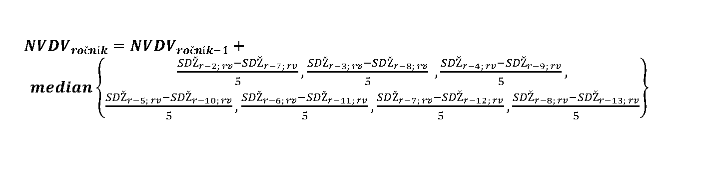

# Čl. I

Zákon č. 461/2003 Z. z. o sociálnom poistení v znení zákona č. 551/2003 Z. z., zákona č. 600/2003 Z. z., zákona č. 5/2004 Z. z., zákona č. 43/2004 Z. z., zákona č. 186/2004 Z. z., zákona č. 365/2004 Z. z., zákona č. 391/2004 Z. z., zákona č. 439/2004 Z. z., zákona č. 523/2004 Z. z., zákona č. 721/2004 Z. z., zákona č. 82/2005 Z. z., zákona č. 244/2005 Z. z., zákona č. 351/2005 Z. z., zákona č. 534/2005 Z. z., zákona č. 584/2005 Z. z., zákona č. 310/2006 Z. z., nálezu Ústavného súdu Slovenskej republiky č. 460/2006 Z. z., zákona č. 529/2006 Z. z., uznesenia Ústavného súdu Slovenskej republiky č. 566/2006 Z. z., zákona č. 592/2006 Z. z., zákona č. 677/2006 Z. z., zákona č. 274/2007 Z. z., zákona č. 519/2007 Z. z., zákona č. 555/2007 Z. z., zákona č. 659/2007 Z. z., nálezu Ústavného súdu Slovenskej republiky č. 204/2008 Z. z., zákona č. 434/2008 Z. z., zákona č. 449/2008 Z. z., zákona č. 599/2008 Z. z., zákona č. 108/2009 Z. z., zákona č. 192/2009 Z. z., zákona č. 200/2009 Z. z., zákona č. 285/2009 Z. z., zákona č. 571/2009 Z. z., zákona č. 572/2009 Z. z., zákona č. 52/2010 Z. z., zákona č. 151/2010 Z. z., zákona č. 403/2010 Z. z., zákona č. 543/2010 Z. z., zákona č. 125/2011 Z. z., zákona č. 223/2011 Z. z., zákona č. 250/2011 Z. z., zákona č. 334/2011 Z. z., zákona č. 348/2011 Z. z., zákona č. 521/2011 Z. z., zákona č. 69/2012 Z. z., zákona č. 252/2012 Z. z., zákona č. 413/2012 Z. z., zákona č. 96/2013 Z. z., zákona č. 338/2013 Z. z., zákona č. 352/2013 Z. z., zákona č. 183/2014 Z. z., zákona č. 195/2014 Z. z., zákona č. 204/2014 Z. z., zákona č. 240/2014 Z. z., zákona č. 298/2014 Z. z., zákona č. 25/2015 Z. z., zákona č. 32/2015 Z. z., zákona č. 61/2015 Z. z., zákona č. 77/2015 Z. z., zákona č. 87/2015 Z. z., zákona č. 112/2015 Z. z., zákona č. 140/2015 Z. z., zákona č. 176/2015 Z. z., zákona č. 336/2015 Z. z., zákona č. 378/2015 Z. z., zákona č. 407/2015 Z. z., zákona č. 440/2015 Z. z., zákona č. 125/2016 Z. z., zákona č. 285/2016 Z. z., zákona č. 310/2016 Z. z., zákona č. 355/2016 Z. z., zákona č. 2/2017 Z. z., zákona č. 85/2017 Z. z., zákona č. 184/2017 Z. z., zákona č. 264/2017 Z. z., zákona č. 266/2017 Z. z., zákona č. 279/2017 Z. z., zákona č. 63/2018 Z. z., zákona č. 87/2018 Z. z., zákona č. 177/2018 Z. z., zákona č. 191/2018 Z. z., zákona č. 282/2018 Z. z., zákona č. 314/2018 Z. z., zákona č. 317/2018 Z. z., zákona č. 366/2018 Z. z., zákona č. 368/2018 Z. z., zákona č. 35/2019 Z. z., zákona č. 83/2019 Z. z., zákona 105/2019 Z. z., zákona č. 221/2019 Z. z., zákona č. 225/2019 Z. z., zákona č. 231/2019 Z. z., zákona č. 321/2019 Z. z., zákona č. 381/2019 Z. z., zákona č. 382/2019 Z. z., zákona č. 385/2019 Z. z., zákona č. 390/2019 Z. z., zákona č. 393/2019 Z. z., zákona č. 466/2019 Z. z., zákona č. 467/2019 Z. z., zákona č. 46/2020 Z. z., zákona č. 63/2020 Z. z., zákona č. 66/2020 Z. z., zákona č. 68/2020 Z. z., zákona č. 95/2020 Z. z., zákona č. 125/2020 Z. z., zákona č. 127/2020 Z. z., zákona č. 157/2020 Z. z., zákona č. 198/2020 Z. z., zákona č. 258/2020 Z. z., zákona č. 275/2020 Z. z., zákona č. 296/2020 Z. z., zákona č. 330/2020 Z. z., zákona č. 365/2020 Z. z., zákona č. 372/2020 Z. z., nálezu Ústavného súdu Slovenskej republiky č. 388/2020 Z. z., zákona č. 426/2020 Z. z., zákona č. 126/2021 Z. z., zákona č. 130/2021 Z. z., zákona č. 215/2021 Z. z., zákona č. 265/2021 Z. z., zákona č. 283/2021 Z. z., zákona č. 355/2021 Z. z., zákona č. 397/2021 Z. z., zákona č. 412/2021 Z. z., zákona č. 431/2021 Z. z., zákona č. 454/2021 Z. z., zákona č. 92/2022 Z. z., zákona č. 125/2022 Z. z., zákona č. 248/2022 Z. z., zákona č. 249/2022 Z. z. a zákona č. 350/2022 Z. z. sa mení a dopĺňa takto:

- 1. V § 13 ods. 2 sa písmeno a) dopĺňa piatym bodom, ktorý znie:

- „5.

- rodičovský dôchodok,“.

- 2. V § 64 odsek 3 znie:

- „(3)

- Dôchodková hodnota platná k 31. decembru kalendárneho roka sa upravuje od 1. januára nasledujúceho kalendárneho roka podľa vzorca uvedeného v prílohe č. 3aa. Takto určená dôchodková hodnota platí vždy od 1. januára do 31. decembra kalendárneho roka.“.

- 3. V § 64 sa vypúšťa odsek 4.

  - Doterajšie odseky 5 a 6 sa označujú ako odseky 4 a 5.

- 4. V § 64 ods. 5 sa slová „odsekov 1 až 5“ nahrádzajú slovami „odsekov 1 až 4“.

- 5. V § 65 odsek 2 znie:

- „(2)

- Dôchodkový vek je všeobecný dôchodkový vek pre príslušný ročník znížený o

- a)

- 6 mesiacov, ak poistenec vychoval jedno dieťa,

- b)

- 12 mesiacov, ak poistenec vychoval dve deti,

- c)

- 18 mesiacov, ak poistenec vychoval tri deti alebo viac detí.“.

- 6. V § 65 sa za odsek 2 vkladajú nové odseky 3 až 5, ktoré znejú:

- „(3)

- Všeobecný dôchodkový vek pre príslušný ročník je neupravený všeobecný dôchodkový vek pre príslušný ročník zaokrúhlený na roky a kalendárne mesiace. Kalendárne mesiace sa zaokrúhľujú na celý mesiac nadol. Neupravený všeobecný dôchodkový vek sa pre príslušný ročník určí podľa vzorca uvedeného v prílohe č. 3c.

- (4)

- Príslušný ročník je rok narodenia osôb narodených v rovnakom kalendárnom roku.

- (5)

- Ak obdobie výchovy dieťaťa nemožno zohľadniť na určenie dôchodkového veku žene, zohľadní sa mužovi, ktorý dieťa vychoval.“.

  - Doterajšie odseky 3 a 4 sa označujú ako odseky 6 a 7.

- 7. § 65 sa dopĺňa odsekmi 8 a 9, ktoré znejú:

- „(8)

- Ministerstvo práce, sociálnych vecí a rodiny Slovenskej republiky (ďalej len „ministerstvo“) vydá všeobecne záväzný právny predpis, ktorým zverejní neupravený všeobecný dôchodkový vek pre príslušný ročník a ustanoví všeobecný dôchodkový vek pre príslušný ročník. Všeobecne záväzným právnym predpisom podľa prvej vety sa v kalendárnom roku zverejňuje neupravený všeobecný dôchodkový vek a ustanovuje všeobecný dôchodkový vek len pre jeden ročník.

- (9)

- Ministerstvo vydá všeobecne záväzný právny predpis podľa odseku 8 v kalendárnom roku, ktorý šesť kalendárnych rokov predchádza kalendárnemu roku, v ktorom osoby narodené v príslušnom ročníku dovŕšia všeobecný dôchodkový vek pre príslušný ročník.“.

- 8. V § 66 ods. 6 písm. h) sa číslovka „2022“ nahrádza číslovkou „2024“.

- 9. V § 66 ods. 6 písm. i) sa slová „2023 do 31. decembra 2023“ nahrádzajú slovami „2025 do 31. decembra 2026“.

- 10. V § 66 ods. 6 písm. j) sa číslovka „2023“ nahrádza číslovkou „2026“.

- 11. V prvej časti tretej hlave sa za druhý diel vkladá nový tretí diel, ktorý vrátane nadpisu znie:

- „TRETÍ DIEL

- RODIČOVSKÝ DÔCHODOK

- § 66b

- Podmienky nároku na rodičovský dôchodok

- (1)

- Nárok na rodičovský dôchodok a nárok na jeho výplatu má poberateľ starobného dôchodku, poberateľ invalidného dôchodku vyplácaného po dovŕšení dôchodkového veku a poberateľ výsluhového dôchodku podľa osobitného predpisu2) vyplácaného po dovŕšení dôchodkového veku (ďalej len „poberateľ dôchodku po dovŕšení dôchodkového veku“), ak je

- a)

- rodičom dieťaťa uvedeného v § 60a ods. 4 písm. a) alebo písm. b) a toto dieťa

- 1.

- bolo dôchodkovo poistené v roku, ktorý dva roky predchádza príslušnému kalendárnemu roku; § 78 ods. 1 prvá veta sa použije primerane, a

- 2.

- do konca augusta kalendárneho roku predchádzajúceho príslušnému kalendárnemu roku nevyhlásilo, že tomuto poberateľovi dôchodku po dovŕšení dôchodkového veku nemá vzniknúť nárok na rodičovský dôchodok,

- b)

- fyzickou osobou, ktorá vychovala dieťa uvedené v § 60a ods. 4 písm. c) a toto dieťa

- 1.

- bolo dôchodkovo poistené v roku, ktorý dva roky predchádza príslušnému kalendárnemu roku; § 78 ods. 1 prvá veta sa použije primerane, a

- 2.

- do konca augusta kalendárneho roku predchádzajúceho príslušnému kalendárnemu roku vyhlásilo, že tomuto poberateľovi dôchodku po dovŕšení dôchodkového veku má vzniknúť nárok na rodičovský dôchodok.

- (2)

- Ak dieťa podľa odseku 1 do konca augusta kalendárneho roku predchádzajúceho sledovanému kalendárnemu roku vyhlási, že nárok na rodičovský dôchodok má zaniknúť, nárok na rodičovský dôchodok zanikne od prvého dňa sledovaného kalendárneho roka. Sledovaný kalendárny rok je najskôr piaty kalendárny rok nasledujúci po kalendárnom roku, v ktorom naposledy vznikol nárok na rodičovský dôchodok.

- (3)

- Ak nárok na rodičovský dôchodok nevznikol podľa odseku 1 písm. a) alebo zanikol podľa odseku 2 a dieťa uvedené v § 60a ods. 4 do konca augusta kalendárneho roku predchádzajúceho príslušnému kalendárnemu roku vyhlási, že nárok na rodičovský dôchodok má vzniknúť, nárok na rodičovský dôchodok a nárok na jeho výplatu poberateľovi dôchodku po dovŕšení dôchodkového veku vzniká od 1. januára príslušného kalendárneho roku, ak dieťa uvedené v § 60a ods. 4 bolo dôchodkovo poistené v roku, ktorý dva roky predchádza príslušnému kalendárnemu roku.

- (4)

- Ak dieťa uvedené v § 60a ods. 4, od ktorého je odvodený nárok na rodičovský dôchodok, nebolo dôchodkovo poistené v kalendárnom roku, ktorý dva roky predchádza príslušnému kalendárnemu roku,

- a)

- nárok na rodičovský dôchodok nezaniká a

- b)

- nárok na výplatu rodičovského dôchodku zaniká od 1. januára príslušného kalendárneho roka.

- (5)

- Nárok na výplatu rodičovského dôchodku, ktorý zanikol podľa odseku 4, opätovne vzniká od 1. januára príslušného kalendárneho roka, ak dieťa uvedené v § 60a ods. 4, od ktorého je odvodený nárok na rodičovský dôchodok, bolo dôchodkové poistené v kalendárnom roku, ktorý dva roky predchádza príslušnému kalendárnemu roku.

- (6)

- Na účely nároku na výplatu rodičovského dôchodku obdobie dôchodkového poistenia je

- a)

- obdobie dôchodkového poistenia podľa § 15, počas ktorého poistenec mal vymeriavací základ a nemal vylúčenú povinnosť platiť poistné počas celého kalendárneho roka,

- b)

- obdobie podľa § 142 ods. 3, za ktoré bolo dodatočne zaplatené poistné na dôchodkové poistenie.

- (7)

- Na účely nároku na výplatu rodičovského dôchodku obdobie dôchodkového poistenia nie je obdobie povinného dôchodkového poistenia, v ktorom dieťa uvedené v § 60a ods. 4 nemalo vymeriavací základ na platenie poistného na starobné poistenie z dôvodu uplatnenia odvodovej odpočítateľnej položky pri sezónnej práci.

- (8)

- Na účely nároku na výplatu rodičovského dôchodku sa za príslušný kalendárny rok považuje kalendárny rok, za ktorý sa posudzuje splnenie podmienok na vznik nároku na výplatu rodičovského dôchodku.

- (9)

- Na účely odseku 1 písm. b) sa § 60a ods. 5 neuplatňuje.

- (10)

- Vyhlásenie podľa odsekov 1 až 3 nevyvoláva právne účinky voči rodičovskému dôchodku, ktorého nárok nie je odvodený od dieťaťa, ktoré vyhlásenie urobilo.

- (11)

- Vyhlásenie podľa odsekov 1 až 3 sa doručuje Sociálnej poisťovni.

- (12)

- Ak poberateľovi dôchodku po dovŕšení dôchodkového veku vznikne nárok na výplatu viacerých rodičovských dôchodkov, vypláca sa len jeden rodičovský dôchodok v sume určenej ako úhrn súm rodičovských dôchodkov.

- § 66c

- Určenie sumy rodičovského dôchodku

- (1)

- Suma rodičovského dôchodku v príslušnom kalendárnom roku sa určí ako 1,5 % jednej dvanástiny úhrnu vymeriavacích základov dieťaťa uvedeného v § 60a ods. 4, od ktorého je odvodený nárok na rodičovský dôchodok, za kalendárny rok, ktorý dva roky predchádza príslušnému kalendárnemu roku, z ktorých bolo zaplatené poistné na starobné poistenie, najviac ako 1,5 % jednej dvanástiny 1,2-násobku všeobecného vymeriavacieho základu platného v kalendárnom roku, ktorý dva roky predchádza príslušnému kalendárnemu roku.

- (2)

- Úhrn súm rodičovských dôchodkov viacerých poberateľov dôchodku po dovŕšení dôchodkového veku v príslušnom kalendárnom roku určených z úhrnu vymeriavacích základov jedného dieťaťa uvedeného v § 60a ods. 4, od ktorého je odvodený nárok na rodičovský dôchodok, je najviac 3 % jednej dvanástiny úhrnu vymeriavacích základov tohto dieťaťa za kalendárny rok, ktorý dva roky predchádza príslušnému kalendárnemu roku, z ktorých bolo zaplatené poistné na starobné poistenie, a najviac 3 % jednej dvanástiny 1,2-násobku všeobecného vymeriavacieho základu platného v kalendárnom roku, ktorý dva roky predchádza príslušnému kalendárnemu roku.

- (3)

- Suma rodičovského dôchodku sa určí podľa odsekov 1 a 2, aj ak sú podmienky nároku na rodičovský dôchodok a nároku na jeho výplatu splnené len za časť kalendárneho mesiaca.

- (4)

- Na účely odsekov 1 a 2 sa

- a)

- na zmeny vymeriavacích základov po 31. auguste kalendárneho roka predchádzajúceho príslušnému kalendárnemu roku neprihliada; § 112 sa nepoužije,

- b)

- § 60 ods. 1 druhá veta, § 78 ods. 1 prvá veta a § 81 ods. 6 časť prvej vety za bodkočiarkou, druhá veta a štvrtá veta použijú primerane.

- § 66d

- Rodičovský dôchodok nepodlieha výkonu rozhodnutia podľa tohto zákona a podľa osobitných predpisov.“.

  - Doterajší tretí diel až siedmy diel sa označujú ako štvrtý diel až ôsmy diel.

- 12. V § 67 ods. 1 písm. b) a § 67 ods. 2 písm. b) sa za slovo „veku“ vkladajú slová „alebo získal najmenej 40 odpracovaných rokov“.

- 13. V § 67 ods. 1 písm. c) sa slová „1,2-násobku“ nahrádzajú slovami „1,6-násobku“.

- 14. V § 67 ods. 2 písm. c) sa slová „1,2-násobok“ nahrádzajú slovami „1,6-násobku“.

- 15. § 67 sa dopĺňa odsekom 8, ktorý znie:

- „(8)

- Na účely nároku na predčasný starobný dôchodok je odpracovaným rokom rok dôchodkového poistenia okrem

- a)

- obdobia podľa § 142 ods. 3 písm. b) a c), za ktoré bolo dodatočne zaplatené poistné na dôchodkové poistenie,

- b)

- doby nezamestnanosti, doby odborného školenia alebo politického školenia a doby štúdia.“.

- 16. V § 68 odsek 1 znie:

- „(1)

- Suma predčasného starobného dôchodku sa určí ako súčin priemerného osobného mzdového bodu, obdobia dôchodkového poistenia získaného ku dňu vzniku nároku na predčasný starobný dôchodok a aktuálnej dôchodkovej hodnoty znížený o

- a)

- 0,5 % za každých začatých 30 dní odo dňa vzniku nároku na predčasný starobný dôchodok do dovŕšenia dôchodkového veku, ak ide o poistenca, ktorý nezískal najmenej 40 odpracovaných rokov; § 63 ods. 1 tretia veta a štvrtá veta platia rovnako,

- b)

- 0,3 % za každých začatých 30 dní odo dňa vzniku nároku na predčasný starobný dôchodok do dovŕšenia dôchodkového veku, ak ide o poistenca, ktorý získal najmenej 40 odpracovaných rokov; § 63 ods. 1 tretia veta a štvrtá veta platia rovnako; ak dôchodkový vek poistenca nie je známy, za dôchodkový vek tohto poistenca sa na účely určenia sumy predčasného starobného dôchodku považuje posledný určený všeobecný dôchodkový vek znížený za výchovu detí a zvýšený o dva mesiace za každý kalendárny rok rozdielu roku narodenia tohto poistenca a príslušného ročníku, pre ktorý bol určený posledný všeobecný dôchodkový vek.“.

- 17. V § 68 sa za odsek 3 vkladá nový odsek 4, ktorý znie:

- „(4)

- Suma predčasného starobného dôchodku sa zvýši o 0,2 % súčinu podľa odseku 1 za každých začatých 30 dní odo dňa, ku ktorému poistenec získal 40 odpracovaných rokov do dňa dovŕšenia dôchodkového veku, ak poistenec uvedený v

- a)

- odseku 2 získal 40 odpracovaných rokov,

- b)

- odseku 3 ku dňu zániku dôchodkového poistenia získal 40 odpracovaných rokov.“.

  - Doterajšie odseky 4 až 7 sa označujú ako odseky 5 až 8.

- 18. V § 68 ods. 5 a 8 sa slová „odsekov 2 a 3“ nahrádzajú slovami „odsekov 2 až 4“.

- 19. V § 69a ods. 2 druhá veta znie: „Suma starobného dôchodku podľa odseku 1 určená podľa § 68 ods. 2 až 4 a zvýšená podľa § 82 sa zvýši o 0,5 % za každých začatých 30 dní pred dňom, ku ktorému získal 40 odpracovaných rokov, a o 0,3 % za každých začatých 30 dní odo dňa, ku ktorému získal 40 odpracovaných rokov, počas ktorých netrval nárok na výplatu predčasného starobného dôchodku; § 82 ods. 4 sa v tomto prípade neuplatní.“.

- 20. V § 75 ods. 3 prvej vete a § 77 ods. 3 prvej vete sa slová „§ 68 ods. 2 a 3 a zvýšeného podľa § 82, ktorý sa zvýši o 0,5 % za každých začatých 30 dní, počas ktorých netrval nárok na výplatu predčasného starobného dôchodku“ nahrádzajú slovami „§ 68 ods. 2 až 4 a zvýšeného podľa § 82, ktorý sa zvýši o 0,5 % za každých začatých 30 dní pred dňom, ku ktorému získal 40 odpracovaných rokov, a o 0,3 % za každých začatých 30 dní odo dňa, ku ktorému získal 40 odpracovaných rokov, počas ktorých netrval nárok na výplatu predčasného starobného dôchodku“.

- 21. V § 81 ods. 6 sa slová „ods. 8“ nahrádzajú slovami „ods. 9“.

- 22. § 82 sa dopĺňa odsekom 9, ktorý znie:

- „(9)

- Na rodičovský dôchodok sa odseky 1 až 8 nevzťahujú.“.

- 23. V § 109 ods. 2 sa na konci bodka nahrádza čiarkou a pripájajú sa tieto slová: „ak § 66b neustanovuje inak.“.

- 24. V § 116 sa za odsek 2 vkladá nový odsek 3, ktorý znie:

- „(3)

- Rodičovský dôchodok sa vypláca v pravidelných mesačných lehotách za príslušné kalendárne mesiace. Ak je suma rodičovského dôchodku nižšia ako päť eur mesačne, Sociálna poisťovňa môže z dôvodu hospodárnosti rodičovský dôchodok vyplatiť jednorazovo v decembri príslušného kalendárneho roka.“.

  - Doterajšie odseky 3 až 8 sa označujú ako odseky 4 až 9.

- 25. V § 116 ods. 8 sa slová „odseku 6“ nahrádzajú slovami „odseku 7“.

- 26. V § 123 ods. 3 písm. c) sa slová „Ministerstva práce, sociálnych vecí a rodiny Slovenskej republiky (ďalej len „ministerstvo“)“ nahrádzajú slovom „ministerstva“.

- 27. V § 131 ods. 2 písm. b) siedmom bode a písm. c) siedmom bode sa slová „roku 2022“ nahrádzajú slovami „rokoch 2022 až 2024“.

- 28. V § 131 ods. 2 písm. b) ôsmom bode a písm. c) ôsmom bode sa slová „roku 2023“ nahrádzajú slovami „rokoch 2025 a 2026“.

- 29. V § 131 ods. 2 písm. b) deviatom bode a písm. c) deviatom bode sa číslovka „2024“ nahrádza číslovkou „2027“.

- 30. V § 139 ods. 1 písm. b) sa na konci pripájajú tieto slová: „a ods. 2“.

- 31. V § 139b sa za odsek 1 vkladá nový odsek 2, ktorý znie:

- „(2)

- Pri určení pomernej časti podľa odseku 1 sa neprihliada na obdobie, za ktoré bolo zaplatené poistné z maximálneho vymeriavacieho základu.“.

  - Doterajší odsek 2 sa označuje ako odsek 3.

- 32. V § 151 ods. 3 sa slová „ods. 7“ nahrádzajú slovami „ods. 8“.

- 33. V § 162 sa odsek 1 dopĺňa písmenom d), ktoré znie:

- „d)

- rodičovského dôchodku.“.

- 34. V § 170 ods. 2 druhej vete sa na konci pripájajú tieto slová: „a účastníkom konania o nároku na rodičovský dôchodok, vdovský dôchodok, vdovecký dôchodok alebo sirotský dôchodok alebo o nároku na ich výplatu, ak ide o osobné údaje uvedené v rozhodnutí, ktoré sú nevyhnutné na posúdenie nároku na rodičovský dôchodok, vdovský dôchodok, vdovecký dôchodok alebo sirotský dôchodok alebo nároku na ich výplatu“.

- 35. V § 233 ods. 11 sa na konci bodka nahrádza bodkočiarkou a pripájajú sa tieto slová: „na účely nároku na rodičovský dôchodok a jeho výplatu, útvary sociálneho zabezpečenia týchto právnických osôb a Vojenský úrad sociálneho zabezpečenia oznamujú Sociálnej poisťovni údaje o poberateľovi výsluhového dôchodku podľa osobitného predpisu2) vyplácaného po dovŕšení dôchodkového veku a o poberateľovi starobného dôchodku a invalidného dôchodku po dovŕšení dôchodkového veku, ktoré vypláca príslušný útvar sociálneho zabezpečenia alebo Vojenský úrad sociálneho zabezpečenia, najmä jeho meno, priezvisko a identifikačné číslo sociálneho zabezpečenia, adresu, na ktorej sa zdržiava, údaje potrebné na určenie dôchodkového veku a spôsob výplaty výsluhového dôchodku vrátane čísla účtu v banke alebo v pobočke zahraničnej banky,67) ak sa výsluhový dôchodok vypláca týmto spôsobom.“.

- 36. Za § 293ft sa vkladajú § 293fta a 293ftb, ktoré vrátane nadpisu nad § 293fta znejú:

- „Prechodné ustanovenia k úpravám účinným od 1. novembra 2022

- § 293fta

- Ak nárok na predčasný starobný dôchodok vznikol pred 1. novembrom 2022, podmienky nároku na predčasný starobný dôchodok sa posudzujú podľa tohto zákona v znení účinnom do 31. októbra 2022.

- § 293ftb

- (1)

- Nárok na rodičovský dôchodok vzniká najskôr od 1. januára 2023.

- (2)

- Na účely vzniku nároku na rodičovský dôchodok v roku 2023

- a)

- možno vyhlásenie podľa § 66b ods. 1 písm. a) druhého bodu a písm. b) druhého bodu urobiť do 28. februára 2023,

- b)

- splnenie podmienky podľa § 66b ods. 1 písm. a) druhého bodu a písm. b) druhého bodu sa posudzuje k 28. februáru 2023.

- (3)

- O nároku na rodičovský dôchodok, ktorý vznikol do 28. februára 2023, a nároku na jeho výplatu rozhodne Sociálna poisťovňa najneskôr do 30. septembra 2023.

- (4)

- Nárok na rodičovský dôchodok za rok 2023 a nárok na jeho výplatu trvá do 31. decembra 2023, aj ak podmienky nároku na rodičovský dôchodok a nároku na jeho výplatu poberateľ dôchodku po dovŕšení dôchodkového veku prestal spĺňať po 28. februári 2023.

- (5)

- Za rok 2023 sa rodičovský dôchodok vyplatí v jednej úhrnnej splátke; § 116 ods. 3 v znení účinnom od 1. novembra 2022 sa nepoužije.“.

- 37. Za § 293fv sa vkladajú § 293fw až 293fz, ktoré vrátane nadpisu § 293fz znejú:

- 㤠293fw

- Dôchodkový vek poistenca narodeného pred rokom 1967 sa určí podľa prílohy č. 3a, ak tento zákon v § 274 neustanovuje inak; ak obdobie výchovy dieťaťa nemožno zohľadniť na určenie dôchodkového veku žene, dôchodkový vek muža narodeného v rokoch 1957 až 1966, ktorý dieťa vychoval, sa určí podľa prílohy č. 3b. Na účely podľa prvej vety platí § 65 ods. 6 a 7 v znení účinnom od 1. januára 2023 rovnako.

- § 293fx

- (1)

- Sociálna poisťovňa novo určí sumu predčasného starobného dôchodku alebo starobného dôchodku podľa § 69a ods. 1 podľa tohto zákona v znení účinnom od 1. januára 2023 poistencovi, ktorý získal 40 odpracovaných rokov do dovŕšenia dôchodkového veku pred 1. januárom 2023, najneskôr do 31. decembra 2026.

- (2)

- Do odpracovaných rokov sa nezapočítava obdobie, za ktoré bola zvýšená suma predčasného starobného dôchodku alebo starobného dôchodku podľa § 293fi.

- § 293fy

- (1)

- Ak je príjem podľa § 3 ods. 1 písm. a) a ods. 2 a 3 plynúci z právneho vzťahu na základe

- a)

- dohody o prácach vykonávaných mimo pracovného pomeru určenej podľa § 227a v znení účinnom do 31. decembra 2022, ktorý zakladá právo na pravidelný mesačný príjem, zúčtovaný po 31. decembri 2022 za obdobie pred 1. januárom 2023, povinné dôchodkové poistenie fyzickej osoby v tomto právnom vzťahu sa za obdobie pred 1. januárom 2023 posudzuje podľa tohto zákona v znení účinnom do 31. decembra 2022,

- b)

- dohody o prácach vykonávaných mimo pracovného pomeru, ktorý zakladá právo na nepravidelný príjem, zúčtovaný za obdobie pred 1. januárom 2023, povinné dôchodkové poistenie fyzickej osoby v tomto právnom vzťahu sa za obdobie pred 1. januárom 2023 posudzuje podľa tohto zákona v znení účinnom do 31. decembra 2022.

- (2)

- Ak fyzickej osobe podľa odseku 1 vznikne povinné dôchodkové poistenie zamestnanca, na určenie vymeriavacieho základu, platenie poistného a na povinnosť zamestnávateľa prihlásiť tohto zamestnanca do registra poistencov a sporiteľov starobného dôchodkového sporenia sa vzťahuje tento zákon v znení účinnom do 31. decembra 2022; na právny vzťah podľa odseku 1 písm. b), ktorý trvá po 31. decembri 2022, sa na účely posúdenia povinného dôchodkového poistenia a určenia vymeriavacieho základu hľadí, akoby zanikol 31. decembra 2022. Ak fyzickej osobe podľa odseku 1 nevznikne povinné dôchodkové poistenie zamestnanca, na určenie vymeriavacieho základu zamestnávateľa a na platenie poistného na úrazové poistenie a poistného na garančné poistenie sa vzťahuje tento zákon v znení účinnom do 31. decembra 2022.“.

- 38. Za prílohu č. 3 sa vkladá príloha č. 3aa, ktorá vrátane nadpisu znie:

- „Príloha č. 3aa

- k zákonu č. 461/2003 Z. z.

- Vzorec na určenie dôchodkovej hodnoty

- 

- A

- D

- H

- r

- =

- A

- D

- H

- r

- -

- 1

- ×

- 1

- +

- P

- M

- r

- -

- 1

- P

- M

- r

- -

- 2

- -

- 1

- ×

- 0,95

- kde:

- ADH je aktuálna dôchodková hodnota,

- PM je priemerná mesačná mzda v hospodárstve Slovenskej republiky zistená štatistickým úradom za tretí štvrťrok kalendárneho roka,

- r je kalendárny rok, od ktorého sa upravuje aktuálna dôchodková hodnota.“.

- 39. V prílohách č. 3a a 3b poslednom riadku sa vypúšťajú slová „a viac“.

- 40. Za prílohu č. 3b sa vkladá príloha č. 3c, ktorá vrátane nadpisu znie:

- „Príloha č. 3c

- k zákonu č. 461/2003 Z. z.

- Vzorec na určenie neupraveného všeobecného dôchodkového veku pre príslušný ročník

- 

- kde

- NVDV je neupravený všeobecný dôchodkový vek určený v rokoch zaokrúhlený na štyri desatinné miesta,

- ročník je príslušný ročník, pre ktorý sa určuje neupravený všeobecný dôchodkový vek,

- SDŽ je stredná dĺžka života v kalendárnom roku a v referenčnom veku vykázaná štatistickým úradom, spoločná pre mužov a ženy,

- r je kalendárny rok, v ktorom sa určuje neupravený všeobecný dôchodkový vek pre príslušný ročník na účel ustanovenia všeobecného dôchodkového veku pre príslušný ročník všeobecne záväzným právnym predpisom podľa § 65 ods. 8,

- rv je referenčný vek, ktorý je neupravený všeobecný dôchodkový vek osôb narodených v kalendárnom roku, ktorý bezprostredne predchádza príslušnému ročníku, zaokrúhlený na celé roky nadol.“.
