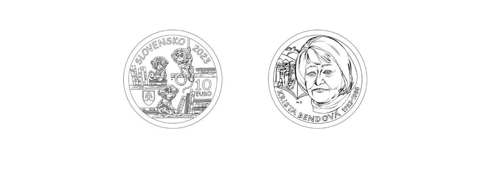

## 369

OZNÁMENIE

Národnej banky Slovenska

z 25. októbra 2022

## o vydaní strieborných zberateľských euromincí v nominálnej hodnote 10 eur pri príležitosti 100. výročia narodenia Kristy Bendovej

1. Úvodné ustanovenia

- a) Národná banka Slovenska podľa § 17h ods. 1 zákona Národnej rady Slovenskej republiky č. 566/1992 Zb. o Národnej banke Slovenska v znení neskorších predpisov a podľa § 12 ods. 1 písm. b) zákona č. 400/2015 Z. z. o tvorbe právnych predpisov a o Zbierke zákonov Slovenskej republiky a o zmene a doplnení niektorých zákonov v znení neskorších predpisov oznamuje, že vydáva do obehu strieborné zberateľské euromince v nominálnej hodnote 10 eur pri príležitosti 100. výročia narodenia Kristy Bendovej (ďalej len „zberateľská eurominca“).

- b) Zberateľská eurominca má štatút zákonného platidla len v Slovenskej republike.

- c) Zberateľská eurominca sa razí zo zliatiny obsahujúcej 900 dielov striebra a 100 dielov medi; jej hmotnosť je 18 g a priemer 34 mm. Pri razbe zberateľskej euromince je povolená horná a dolná odchýlka v priemere 0,1 mm; povolená horná odchýlka v hmotnosti je 0,4 g a v obsahu striebra 10/1 000.

2. Vzhľad zberateľskej euromince

- a) Na líci zberateľskej euromince sú v kompozícií tri opice na policiach s knihami, ktoré odkazujú na dielo Kristy Bendovej „Opice z našej police“. Kompozíciu dopĺňa v ľavej časti štátny znak Slovenskej republiky a v pravej časti v dvoch riadkoch nominálna hodnota zberateľskej euromince „10 EURO“. Názov štátu „SLOVENSKO“ a letopočet „2023“ sú v opise v hornej časti mincového poľa. Štylizované iniciálky autora lícnej strany zberateľskej euromince Karola Lička „KL“ sú v strede mincového poľa.

- b) Na rube zberateľskej euromince je portrét Kristy Bendovej na pozadí doplnený otvorenou knihou, do ktorej je vsadená kresba odkazujúca na jej dielo „Bola raz jedna trieda“. V spodnej časti mincového poľa je v opise meno a priezvisko „KRISTA BENDOVÁ“ a za nimi letopočty jej narodenia a úmrtia „1923 – 1988“. Pod otvorenou knihou je iniciálka priezviska autora rubovej strany zberateľskej euromince Štefana Novotného „N“ a vedľa nej značka Mincovne Kremnica, štátny podnik, ktorú tvorí skratka „MK“ umiestnená medzi dvoma razidlami.

- c) Na hrane zberateľskej euromince je nápis do hĺbky „• AUTORKA OBĽÚBENEJ DETSKEJ LITERATÚRY“.

Štát vydania: Slovenská republika

Začiatok vydávania: január 2023

v z. Ľudovít Ódor v. r.
