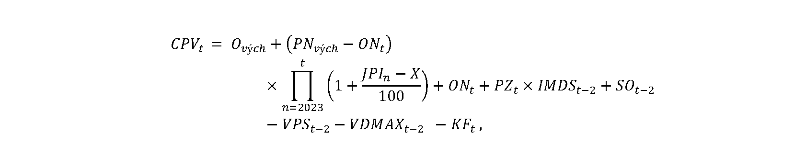

# § 12 Výpočet maximálnej ceny za prístup do distribučnej siete a distribúciu plynu

(1) Maximálna cena za prístup do distribučnej siete a distribúciu plynu PCDt v eurách na jednotku množstva distribuovaného plynu pre jednotlivé roky regulačného obdobia sa vypočíta podľa vzorca

P

C

D

t

=

C

P

V

t

Q

t

,

t

-

n

,

kde

- a) Qt,t-n je celkový objem množstva distribuovaného plynu vypočítaný z priemerného množstva distribuovaného plynu v rokoch t-3, t -2, očakávanej skutočnosti v roku t -1 a plánovaného množstva distribuovaného plynu na rok t,

- b) CPVt sú celkové úradom schválené plánované tržby z taríf za prístup do distribučnej siete a distribúciu plynu v roku t v eurách určené podľa odseku 2.

(2) Celkové úradom schválené plánované tržby z taríf za prístup do distribučnej siete a distribúciu plynu CPVt v roku t v eurách sa vypočítajú podľa vzorca

kde

- a) Ových je určená východisková hodnota odpisov regulovaného subjektu súvisiacich s regulovanou činnosťou vo východiskovom roku regulačného obdobia v eurách,

- b) PNvých sú určené skutočné ročné ekonomicky oprávnené prevádzkové náklady v eurách súvisiace s regulovanou činnosťou určené podľa § 4 ods. 1, okrem osobných nákladov podľa písmena c) a nákladov na krytie strát a vlastnej spotreby v distribučnej sieti, určené ako priemerné ročné prevádzkové náklady nevyhnutne vynaložené na regulovanú činnosť za roky t-2, t-3 a t-4, pričom PNvýchsú určené na celé regulačné obdobie a výpočet PNvých sa predloží regulovaným subjektom ako súčasť návrhu ceny na prvý rok regulačného obdobia spolu s odôvodnením výpočtu jednotlivých nákladových položiek; pre regulovaný subjekt bez histórie PNvých za predchádzajúce regulačné obdobie sa použijú pri návrhu ceny plánované prevádzkové náklady na rok t,

- c) ONt je určená hodnota osobných nákladov podľa § 4 ods. 1 písm. c) v eurách na účely výpočtu maximálnej ceny za prístup do distribučnej siete a distribúciu plynu a vypočíta sa podľa vzorca

- 

- O

- N

- t

- =

- O

- N

- v

- ý

- c

- h

- ×

- 1

- +

- ∏

- n

- =

- 2023

- t

- (

- I

- N

- M

- n

- 100

- ,

- kde

  - 1. INMn je aritmetický priemer zverejnených hodnôt ukazovateľa „Index nominálnej mzdy“ za obdobie od 1. júla roku t-2 do 30. júna roku t-1 zverejnených na webovom sídle Štatistického úradu Slovenskej republiky – http://datacube.statistics.sk v priečinku „Demografia a sociálne štatistiky“ v sekcii „Náklady práce“ a priečinku „Štvrťročné údaje“ a „Priemerná mesačná mzda v hospodárstve SR [pr0204qs]“,

  - 2. ONvých je určená východisková hodnota osobných nákladov v eurách vo východiskovom roku regulačného obdobia stanovená na základe skutočných osobných nákladov za rok 2021 prevádzkovateľa distribučnej siete súvisiacich s regulovanou činnosťou,

- d) JPIn je aritmetický priemer zverejnených hodnôt ukazovateľa „jadrová inflácia“ za obdobie 12 mesiacov predchádzajúcich predloženiu návrhu ceny uvedených na webovom sídle Štatistického úradu Slovenskej republiky – http://datacube.statistics.sk v priečinku „Makroekonomické štatistiky“ v sekcii „Spotrebiteľské ceny a ceny produkčných štatistík“ v časti „Jadrová a čistá inflácia – oproti rovnakému obdobiu minulého roku v percentách“,

- e) X je faktor efektivity ustanovený pre celé regulačné obdobie vo výške 2 %; ak je hodnota rozdielu JPIna X nižšia ako 0, na účely výpočtu maximálnej ceny za prístup do distribučnej siete a distribúciu plynu na rok t sa hodnota rozdielu JPIn a X rovná 0,

- f) SOt-2 je kumulatívna hodnota odpisov v eurách zo skutočne zaradeného nového dlhodobého majetku nevyhnutne potrebného na zabezpečenie prevádzkyschopnosti siete zohľadňujúca technickú dobu životnosti zaradeného majetku od roku t-2 podľa prílohy č. 1; pre rok 2023 sa hodnota SOt-2 rovná 0,

- g) IMDSt-2 je index miery využitia dosiahnutých disponibilných zdrojov regulovaného subjektu na základe využitia dosiahnutých disponibilných zdrojov regulovaného subjektu za rok t-2 na obnovu a rozvoj siete v intervale 0,95 až 1,02, pre rok 2023 sa hodnotaIMDSt-2rovná 1; IMDSt-2 sa vypočíta podľa vzorca

- 

- P

- =

- I

- N

- V

- t

- -

- 2

- I

- N

- V

- t

- -

- 2

- ,

- p

- l

- a

- n

- ,

- pričom, ak je P

- vyšší alebo sa rovná 1,8, tak IMDSt-2 = 1,02,

- menší ako 1,8 a zároveň vyšší alebo sa rovná 1,5, tak IMDSt-2 = 1,01,

- menší ako 1,5 a zároveň vyšší alebo sa rovná 1,0, tak IMDSt-2 = 1,00,

- menší ako 1,0 a zároveň vyšší alebo sa rovná 0,9, tak IMDSt-2 = 0,99,

- menší ako 0,9 a zároveň vyšší alebo sa rovná 0,8, tak IMDSt-2 = 0,98,

- menší ako 0,8 a zároveň vyšší alebo sa rovná 0,7, tak IMDSt-2 = 0,97,

- menší ako 0,7 a zároveň vyšší alebo sa rovná 0,6, tak IMDSt-2= 0,96,

- menší ako 0,6, tak IMDSt-2 = 0,95,

- kde

  - 1. P je podiel využitia investícií do distribučnej siete,

  - 2. INVt-2 je skutočná hodnota investícií do distribučnej siete v eurách vzťahujúca sa k majetku zaradenému do hodnoty regulačnej bázy aktív používanému výhradne na regulovanú činnosť v roku t-2,

  - 3. INVt-2,plan je plánovaná hodnota investícií do distribučnej siete v eurách vzťahujúca sa k majetku zaradeného do hodnoty regulačnej bázy aktív používaného výhradne na regulovanú činnosť ustanovená pre jednotlivé roky regulačného obdobia takto:

  - Rok | 2022 | 2023 | 2024 | 2025 | 2026 | 2027

  - INVt-2,planv miliónoch eur | 35 | 40 | 45 | 50 | 55 | 60

- h) VPSt-2 je hodnota skutočných ročných výnosov za pripojenie do distribučnej siete v eurách za rok t-2,

- i) VDMAXt-2 je hodnota skutočných ročných výnosov za prekročenie zmluvne dohodnutej dennej distribučnej kapacity v eurách za rok t-2,

- j) PZt je hodnota primeraného zisku regulovaného subjektu, ktorá sa vypočíta podľa vzorca

- 

- P

- Z

- t

- =

- (

- (

- R

- A

- B

- v

- ý

- c

- h

- -

- R

- A

- B

- +

- )

- -

- (

- M

- v

- ý

- c

- h

- -

- M

- +

- )

- )

- ×

- W

- A

- C

- C

- +

- (

- R

- A

- B

- +

- -

- M

- +

- )

- ×

- W

- A

- C

- C

- +

- ,

- kde

  - 1. RABvých je východisková hodnota regulačnej bázy aktív v eurách nevyhnutne používaného výhradne na regulovanú činnosť určená k 31. decembru 2021; ak regulovaný subjekt využíva na regulovanú činnosť majetok zaradený do účtovnej evidencie po 31. decembri 2021, použije sa v návrhu ceny hodnota majetku využívaná na regulovanú činnosť od dátumu zaradenia majetku do účtovnej evidencie podľa prílohy č. 1,

  - 2. Mvých je východisková schválená alebo určená hodnota regulačnej bázy aktív v eurách, ktorá sa rovná všeobecnej hodnote majetku28) nevyhnutne používaného výhradne na regulovanú činnosť k 31. decembru 2021 predstavujúca majetok, ktorý je financovaný zo zdrojov Európskej únie alebo iných grantov a štátnych podpôr,

  - 3. WACC je určená miera výnosnosti regulačnej bázy aktív na regulačné obdobie podľa § 6,

  - 4. RAB+ je určená hodnota regulačnej bázy aktív v eurách, ktorá sa rovná všeobecnej hodnote majetku nevyhnutne používaného výhradne na regulovanú činnosť zahŕňajúca zaradený majetok v roku t-2, ktorý vznikol z investícií do regulačnej bázy aktív odsúhlasených úradom v súlade s § 6 ods. 1 písm. c) v rámci cenového konania; pre rok 2023 sa hodnota RAB+ rovná 0,

  - 5. M+ je schválená alebo určená hodnota regulačnej bázy aktív v eurách, ktorá sa rovná všeobecnej hodnote majetku nevyhnutne používaného výhradne na regulovanú činnosť, ktorý vznikol z investícií do regulačnej bázy aktív odsúhlasených úradom v súlade s § 6 ods. 1 písm. c) v rámci cenového konania a je financovaný zo zdrojov Európskej únie alebo iných grantov a štátnych podpôr,

  - 6. WACC+ je miera výnosnosti regulačnej bázy aktív na regulačné obdobie určená podľa § 6 ods. 6.

- k) KFt je korekčný faktor pre rok t vypočítaný ako rozdiel medzi skutočnými celkovými tržbami z taríf podľa § 10 ods. 3 za prístup do distribučnej siete a distribúciu plynu v roku t-2 a celkovými úradom schválenými plánovanými tržbami z taríf za prístup do distribučnej siete a distribúciu plynu v roku t-2 v eurách podľa odseku 1 písm. b); pre roky 2023 a 2024 sa KFtrovná 0.

(3) Odpisy Ových pre prevádzkovateľa distribučnej siete, ktorý distribuuje plyn distribučnou sieťou, do ktorej je pripojených menej ako 100 000 odberateľov plynu, sú regulačné odpisy hmotného majetku a nehmotného majetku nevyhnutne využívaného na regulovanú činnosť vypočítané ako podiel zostatkovej ceny hmotného majetku a nehmotného majetku a doby technickej životnosti jednotlivých druhov hmotného majetku a nehmotného majetku podľa príloh č. 1 a 15, zníženej o dobu od zaradenia do účtovnej evidencie do 31. decembra 2021. Zostatková cena hmotného majetku a nehmotného majetku je rozdiel obstarávacej ceny hmotného majetku a nehmotného majetku a sumy odpisov v jednotlivých rokoch odo dňa zaradenia majetku do účtovnej evidencie.

(4) Regulačná báza aktív RAB pre prevádzkovateľa distribučnej siete, ktorý distribuuje plyn distribučnou sieťou, do ktorej je pripojených menej ako 100 000 odberateľov, je hodnota aktív slúžiaca výhradne na vykonávanie regulovaných činností, ktorá sa určí ako suma zostatkovej ceny hmotného majetku a nehmotného majetku podľa prílohy č. 15 a nájomného podľa § 4 ods. 1 písm. g), alebo na základe znaleckého posudku na stanovenie všeobecnej hodnoty zariadení prevádzkovateľa distribučnej siete slúžiacich výhradne na výkon regulovanej činnosti k 31. decembru 2021 podľa osobitného predpisu.28)

(5) Hodnoty vstupujúce do výpočtov podľa odseku 1 sa odôvodňujú analýzami, ktoré sa predkladajú s návrhom ceny.

(6) K tarifám podľa § 10 ods. 3 sa pripočítajú tarify na krytie strát plynu a vlastnej spotreby plynu v distribučnej sieti. Tarify na krytie strát plynu a vlastnej spotreby plynu v distribučnej sieti na rok t sa navrhujú tak, že celkové plánované tržby z taríf na krytie strát plynu a vlastnej spotreby plynu v distribučnej sieti v roku t regulačného obdobia v eurách na jednotku množstva plynu neprekročia maximálne náklady na krytie strát plynu a vlastnej spotreby plynu v distribučnej sieti. Maximálne náklady na krytie strát plynu a vlastnej spotreby plynu v distribučnej sieti podľa odsekov 6 až 8 vyjadrené v eurách sa pre rok 2023 vypočítajú podľa odseku 7, pre roky 2024 až 2027 sa vypočítajú podľa odseku 8.

(7) Maximálne náklady na krytie strát plynu a vlastnej spotreby plynu v distribučnej sieti pre rok 2023 sa vypočítajú ako súčin ceny plynu na krytie strát plynu a vlastnej spotreby plynu v distribučnej sieti v eurách na jednotku množstva plynu podľa odseku 9, množstva plynu vstupujúceho do distribučnej siete na rok t jednotkách množstva plynu a počiatočnej percentuálnej výšky strát v distribučnej sieti, najviac vo výške 1,9 %. V návrhu ceny regulovaného subjektu, ktorý nevykonával regulovanú činnosť v predchádzajúcom regulačnom období, sa uvádza plánované ročné množstvo plynu vstupujúce do distribučnej siete na rok t.

(8) Maximálne náklady na krytie strát plynu a vlastnej spotreby plynu v distribučnej sieti pre roky 2024 až 2027 sa vypočítajú ako súčin ceny plynu na krytie strát plynu a vlastnej spotreby plynu v distribučnej sieti v eurách na jednotku množstva plynu podľa odseku 9 a povoleného množstva strát v distribučnej sieti PMSDt. Povolené množstvo strát v distribučnej sieti PMSDt v jednotkách množstva plynu pre potreby výpočtu nákladov na krytie strát plynu a vlastnej spotreby plynu v distribučnej sieti pre roky 2024 až 2027 sa vypočíta podľa vzorca

P

M

S

D

t

=

V

S

M

D

t

×

P

P

S

D

×

∏

n

=

2023

t

(

1

-

P

S

n

100

)

,

kde

- a) VSMDt je množstvo plynu vstupujúceho do distribučnej siete na rok t v jednotkách množstva plynu,

- b) PPSD je počiatočná percentuálna výška strát v distribučnej sieti z priemerného množstva plynu vstupujúceho do distribučnej siete určená podľa odseku 6,

- c) PSn je faktor efektivity poklesu strát v distribučnej sieti, ustanovuje sa pre jednotlivé roky regulačného obdobia vo výške 0,25 %, pre rok 2023 je hodnota PSn rovná 0.

(9) Cena plynu na krytie strát a vlastnej spotreby v distribučnej sieti CPSt sa vypočíta podľa vzorca

C

P

S

t

=

C

E

T

H

E

,

t

+

k

s

p

d

,

kde

- a) CETHE,tje aritmetický priemer denných cien zverejnených burzou EEX (European Energy Exchange) na webovom sídle www.powernext.com/futures-market-data v časti All contracts, Settlement prices on Seasons and Calendars, produktu THE Calendar +1 v eurách na megawatthodinu za obdobie od 1. septembra roku t-2 do 31. augusta roku t-1,

- b) kspd je koeficient zohľadňujúci medzinárodnú prepravu plynu na územie Slovenskej republiky, ustanovuje sa vo výške 1,5 eura/MWh.

(10) Na účely prepočtu jednotiek množstva plynu vyjadrených v metroch kubických na jednotky energie sa použije hodnota spaľovacieho tepla objemového vo výške 10,69 kWh/m3.

(11) Ustanovenia o návrhu ceny sa primerane vzťahujú aj na návrh na zmenu cenového rozhodnutia.
