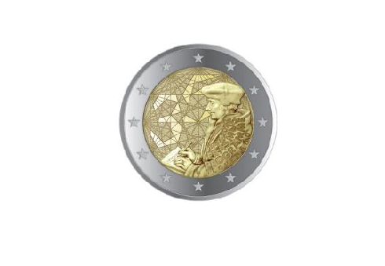

## 97

OZNÁMENIE

Národnej banky Slovenska

z 15. marca 2022

## o vydaní pamätných euromincí v nominálnej hodnote 2 eurá pri príležitosti 35. výročia programu Erasmus

1. Úvodné ustanovenia

- a) Národná banka Slovenska podľa § 17h ods. 1 zákona Národnej rady Slovenskej republiky č. 566/1992 Zb. o Národnej banke Slovenska v znení neskorších predpisov a podľa § 12 ods. 1 písm. b) zákona č. 400/2015 Z. z. o tvorbe právnych predpisov a o Zbierke zákonov Slovenskej republiky a o zmene a doplnení niektorých zákonov oznamuje, že pri príležitosti 35. výročia programu Erasmus vydáva do obehu pamätné euromince v nominálnej hodnote 2 eurá (ďalej len „pamätná eurominca“).

- b) Pamätná eurominca má rovnaké technické parametre ako obehové euromince1) a na jej národnej strane je použitý pamätný motív podľa bodu 2 písm. b).

- c) Pamätná eurominca má štatút zákonného platidla v celej eurozóne.

2. Vzhľad pamätnej euromince

- a) Pamätná eurominca sa vydáva s novou spoločnou európskou stranou.2)

- b) Na národnej strane pamätnej euromince je vyobrazené spojenie dvoch hlavných prvkov programu Erasmus – Erazma Rotterdamského, ktorý je symbolom pôvodnej intelektuálnej inšpirácie, a alegórie jeho vplyvu na Európu, ktorá je vyjadrená prelínajúcimi sa lúčmi vytvárajúcimi v mincovom poli číslovku „35“. V pravej časti sú v opise letopočty „1987 – 2022“, pod nimi v dvoch riadkoch nápis „ERASMUS PROGRAMME“ a pod ním názov štátu „SLOVENSKO“. Iniciálky autora výtvarného návrhu národnej strany pamätnej euromince Joaquina Jimeneza „J. J.“ sú nad rukami Erazma a značka Mincovne Kremnica, štátny podnik, ktorú tvorí skratka „MK“ umiestnená medzi dvoma razidlami, je v spodnej časti pred názvom štátu. Pri okraji pamätnej euromince je vyobrazených dvanásť hviezd vlajky Európskej únie.

- c) Na hrane pamätnej euromince je nápis „SLOVENSKÁ REPUBLIKA“. Začiatok a koniec nápisu je oddelený dvoma hviezdami, medzi ktorými je lipový list.

- 

Štát vydania: Slovenská republika

Začiatok vydávania: júl 2022

Peter Kažimír v. r.
