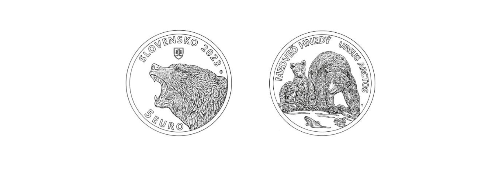

## 166

OZNÁMENIE

Národnej banky Slovenska

z 25. apríla 2023

## o vydaní zberateľských euromincí z obyčajných kovov v nominálnej hodnote 5 eur s tematikou Fauna a flóra na Slovensku – medveď hnedý

1. Úvodné ustanovenia

- a) Národná banka Slovenska podľa § 17h ods. 1 zákona Národnej rady Slovenskej republiky č. 566/1992 Zb. o Národnej banke Slovenska v znení neskorších predpisov a podľa § 12 ods. 1 písm. b) zákona č. 400/2015 Z. z. o tvorbe právnych predpisov a o Zbierke zákonov Slovenskej republiky a o zmene a doplnení niektorých zákonov v znení neskorších predpisov oznamuje, že vydáva do obehu zberateľské euromince

- z obyčajných kovov v nominálnej hodnote 5 eur s tematikou Fauna a flóra na Slovensku – medveď hnedý (ďalej len „zberateľská eurominca“).

- b) Zberateľská eurominca má štatút zákonného platidla len v Slovenskej republike.

- c) Zberateľská eurominca sa razí z mosadze MS63 (Cu63Zn37); jej hmotnosť je 19,1 g a priemer 34 mm. Pri razbe zberateľskej euromince je povolená horná a dolná odchýlka v priemere 0,1 mm; povolená horná odchýlka v hmotnosti je 0,76 g.

2. Vzhľad zberateľskej euromince

- a) Na líci zberateľskej euromince dominuje z profilu zobrazená hlava medveďa hnedého. Nad hlavou je štátny znak Slovenskej republiky. V spodnej časti mincového poľa je v opise nominálna hodnota zberateľskej euromince „5 EURO“. V hornej časti mincového poľa je v opise názov štátu „SLOVENSKO“ a letopočet „2023“. Značka Mincovne Kremnica, štátny podnik, ktorú tvorí skratka „MK“ umiestnená medzi dvoma razidlami, je pri pravom okraji zberateľskej euromince.

- b) Na rube zberateľskej euromince je medvedica s dvomi mláďatami pri love rýb. V hornej časti mincového poľa je v opise slovenský názov „MEDVEĎ HNEDÝ“, na ktorý nadväzuje latinsky názov „URSUS ARCTOS“. Štylizované iniciálky autora zberateľskej euromince Tomáša Lamača, DiS. „TL“ sú pri pravom okraji zberateľskej euromince.

- c) Hrana zberateľskej euromince je vrúbkovaná.

- 

Štát vydania: Slovenská republika

Začiatok vydávania: jún 2023

Peter Kažimír v. r.
