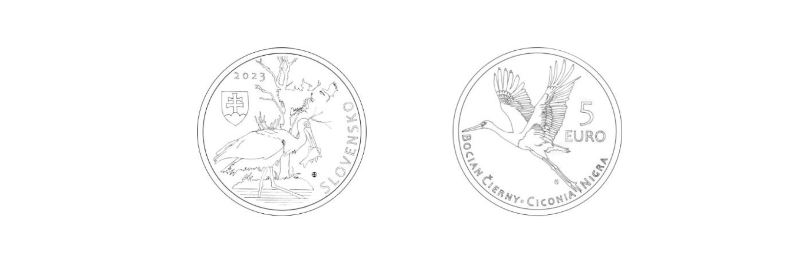

## 199

OZNÁMENIE

Národnej banky Slovenska

z 22. mája 2023

## o vydaní zberateľských euromincí z obyčajných kovov v nominálnej hodnote 5 eur s tematikou Fauna a flóra na Slovensku – bocian čierny

1. Úvodné ustanovenia

- a) Národná banka Slovenska podľa § 17h ods. 1 zákona Národnej rady Slovenskej republiky č. 566/1992 Zb. o Národnej banke Slovenska v znení neskorších predpisov a podľa § 12 ods. 1 písm. b) zákona č. 400/2015 Z. z. o tvorbe právnych predpisov a o Zbierke zákonov Slovenskej republiky a o zmene a doplnení niektorých zákonov v znení neskorších predpisov oznamuje, že vydáva do obehu zberateľské euromince z obyčajných kovov v nominálnej hodnote 5 eur s tematikou Fauna a flóra na Slovensku – bocian čierny (ďalej len „zberateľská eurominca“).

- b) Zberateľská eurominca má štatút zákonného platidla len v Slovenskej republike.

- c) Zberateľská eurominca sa razí z mosadze MS63 (Cu63Zn37); jej hmotnosť je 19,1 g a priemer 34 mm. Pri razbe zberateľskej euromince je povolená horná a dolná odchýlka v priemere 0,1 mm; povolená horná odchýlka v hmotnosti je 0,76 g.

2. Vzhľad zberateľskej euromince

- a) Na líci zberateľskej euromince je zobrazený bocian čierny pri love na vodnej ploche. V pozadí je strom s bocianím hniezdom s mláďaťom, ku ktorému prilieta dospelý jedinec. Vľavo od kompozície je štátny znak Slovenskej republiky, nad ktorým je letopočet „2023“. Vpravo od kompozície je značka Mincovne Kremnica, štátny podnik, ktorú tvorí skratka „MK“ umiestnená medzi dvoma razidlami. V pravej časti mincového poľa je v opise názov štátu „SLOVENSKO“.

- b) Na rube zberateľskej euromince je zobrazený bocian čierny pri vzlete. Napravo od neho je v dvoch riadkoch nominálna hodnota zberateľskej euromince „5 EURO“. Štylizované iniciálky autorky zberateľskej euromince Mgr.– akad. soch. Marie Šeborovej „MŠ“ sú pri nohách bociana. V spodnej časti mincového poľa je v opise slovenský názov „BOCIAN ČIERNY“ oddelený grafickou značkou od latinského názvu „CICONIA NIGRA“.

- c) Hrana zberateľskej euromince je vrúbkovaná.

- 

Štát vydania: Slovenská republika

Začiatok vydávania: september 2023

v z. Karol Mrva v. r.
