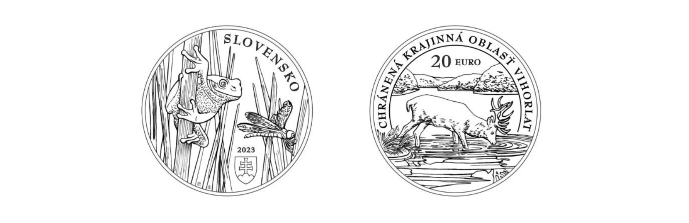

## 200

OZNÁMENIE

Národnej banky Slovenska

z 22. mája 2023

## o vydaní strieborných zberateľských euromincí v nominálnej hodnote 20 eur s tematikou Chránená krajinná oblasť Vihorlat

1. Úvodné ustanovenia

- a) Národná banka Slovenska podľa § 17h ods. 1 zákona Národnej rady Slovenskej republiky č. 566/1992 Zb. o Národnej banke Slovenska v znení neskorších predpisov a podľa § 12 ods. 1 písm. b) zákona č. 400/2015 Z. z. o tvorbe právnych predpisov a o Zbierke zákonov Slovenskej republiky a o zmene a doplnení niektorých zákonov v znení neskorších predpisov oznamuje, že vydáva do obehu strieborné zberateľské euromince v nominálnej hodnote 20 eur s tematikou Chránená krajinná oblasť Vihorlat (ďalej len „zberateľská eurominca“).

- b) Zberateľská eurominca má štatút zákonného platidla len v Slovenskej republike.

- c) Zberateľská eurominca sa razí zo zliatiny obsahujúcej 925 dielov striebra a 75 dielov medi; jej hmotnosť je 33,63 g a priemer 40 mm. Pri razbe zberateľskej euromince je povolená horná a dolná odchýlka v priemere 0,1 mm; povolená horná odchýlka v hmotnosti je 0,4 g a v obsahu striebra 10/1 000.

2. Vzhľad zberateľskej euromince

- a) Na líci zberateľskej euromince je zobrazená rosnička zelená a vážka v prostredí vodnej trstiny. V spodnej časti kompozície je štátny znak Slovenskej republiky, nad ktorým je letopočet „2023“. Názov štátu „SLOVENSKO“ je v opise v hornej časti mincového poľa. Značka Mincovne Kremnica, štátny podnik, ktorú tvorí skratka „MK“ umiestnená medzi dvoma razidlami, je pri spodnom okraji mincového poľa a naľavo od nej sú štylizované iniciálky autora zberateľskej euromince Mgr. art. Romana Lugára „LR“.

- b) Na rube zberateľskej euromince je zobrazený jeleň čeriaci vodnú hladinu Morského oka, ktorá je lemovaná panorámou pohoria v pozadí. Nominálna hodnota zberateľskej euromince „20 EURO“ je nad kompozíciou. V hornej časti mincového poľa je v opise nápis „CHRÁNENÁ KRAJINNÁ OBLASŤ VIHORLAT“ oddelený od kompozície líniou kopírujúcou nápis v opise.

- c) Na hrane zberateľskej euromince je reliéfny nápis „OCHRANA PRÍRODY A KRAJINY“. Začiatok a koniec textu je oddelený vyobrazením štylizovaného kvetu.

- 

Štát vydania: Slovenská republika

Začiatok vydávania: september 2023

v z. Karol Mrva v. r.
