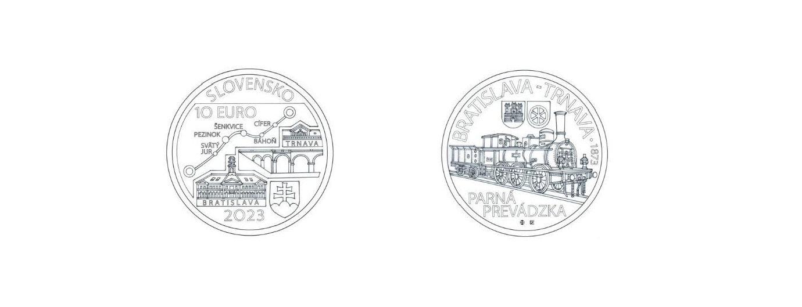

## 22

OZNÁMENIE

Národnej banky Slovenska

z 10. januára 2023

## o vydaní strieborných zberateľských euromincí v nominálnej hodnote 10 eur pri príležitosti 150. výročia spustenia parnej prevádzky na železničnej trati Bratislava – Trnava

1. Úvodné ustanovenia

- a) Národná banka Slovenska podľa § 17h ods. 1 zákona Národnej rady Slovenskej republiky č. 566/1992 Zb. o Národnej banke Slovenska v znení neskorších predpisov a podľa § 12 ods. 1 písm. b) zákona č. 400/2015 Z. z. o tvorbe právnych predpisov a o Zbierke zákonov Slovenskej republiky a o zmene a doplnení niektorých zákonov v znení neskorších predpisov oznamuje, že vydáva do obehu strieborné zberateľské euromince v nominálnej hodnote 10 eur pri príležitosti 150. výročia spustenia parnej prevádzky na železničnej trati Bratislava – Trnava (ďalej len „zberateľská eurominca“).

- b) Zberateľská eurominca má štatút zákonného platidla len v Slovenskej republike.

- c) Zberateľská eurominca sa razí zo zliatiny obsahujúcej 900 dielov striebra a 100 dielov medi; jej hmotnosť je 18 g a priemer 34 mm. Pri razbe zberateľskej euromince je povolená horná a dolná odchýlka v priemere 0,1 mm; povolená horná odchýlka v hmotnosti je 0,4 g a v obsahu striebra 10/1 000.

2. Vzhľad zberateľskej euromince

- a) Na líci zberateľskej euromince sú v kompozícií historické budovy železničných staníc s označením miest „BRATISLAVA“ a „TRNAVA“ doplnené fragmentom oblúkového viaduktu. V pravej spodnej časti mincového poľa je štátny znak Slovenskej republiky a vľavo od neho je letopočet „2023“. Nad kompozíciou je schematicky vyznačená železničná línia medzi Bratislavou a Trnavou spolu s označením zastávok „SVÄTÝ JUR“, „PEZINOK“, „ŠENKVICE“, „BÁHOŇ“ a „CÍFER“. V hornej časti mincového poľa je v opise názov štátu „SLOVENSKO“ a pod ním nominálna hodnota zberateľskej euromince „10 EURO“.

- b) Na rube zberateľskej euromince je parná lokomotíva so zásobníkom na palivo, nad ktorou sa nachádzajú erby mesta Bratislava a mesta Trnava. V hornej časti mincového poľa je v opise nápis označujúci počiatočnú a cieľovú stanicu „BRATISLAVA – TRNAVA“ a letopočet „1873“, ktorý je od nápisu oddelený grafickou značkou. Pod lokomotívou je v dvoch riadkoch nápis „PARNÁ PREVÁDZKA“. Značka Mincovne Kremnica, štátny podnik, ktorú tvorí skratka „MK“ umiestnená medzi dvoma razidlami a štylizované iniciálky autora zberateľskej euromince akad. soch. Zbyňka Fojtů „ZF“ sú umiestnené v spodnej časti mincového poľa.

- c) Na hrane zberateľskej euromince je nápis do hĺbky „– ZAČIATOK PARNEJ PREVÁDZKY Z BRATISLAVY DO TRNAVY – 1873“.

- 

Štát vydania: Slovenská republika

Začiatok vydávania: apríl 2023

v z. Ľudovít Ódor v. r.
